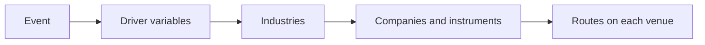
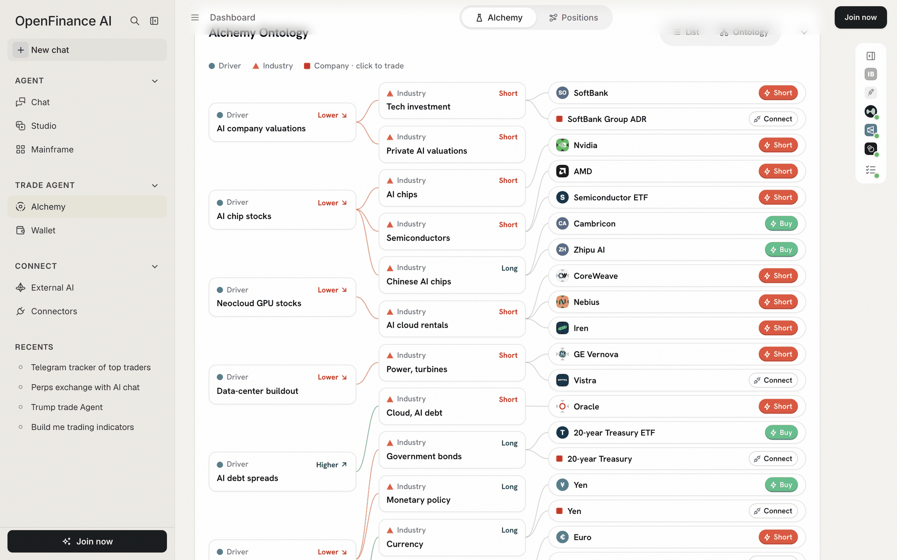
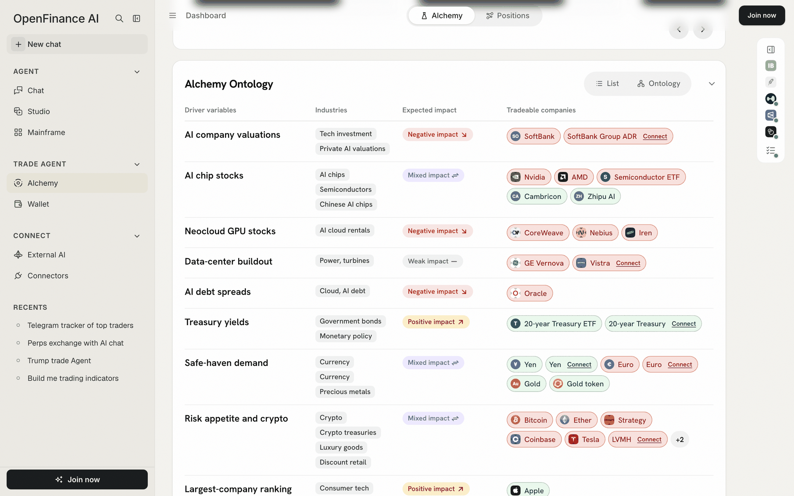
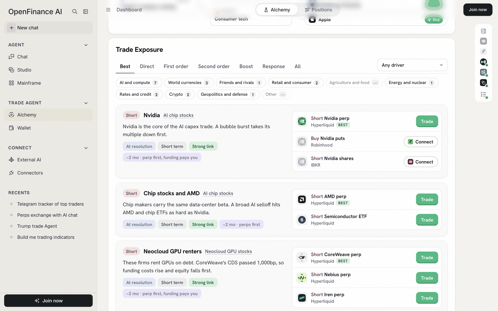
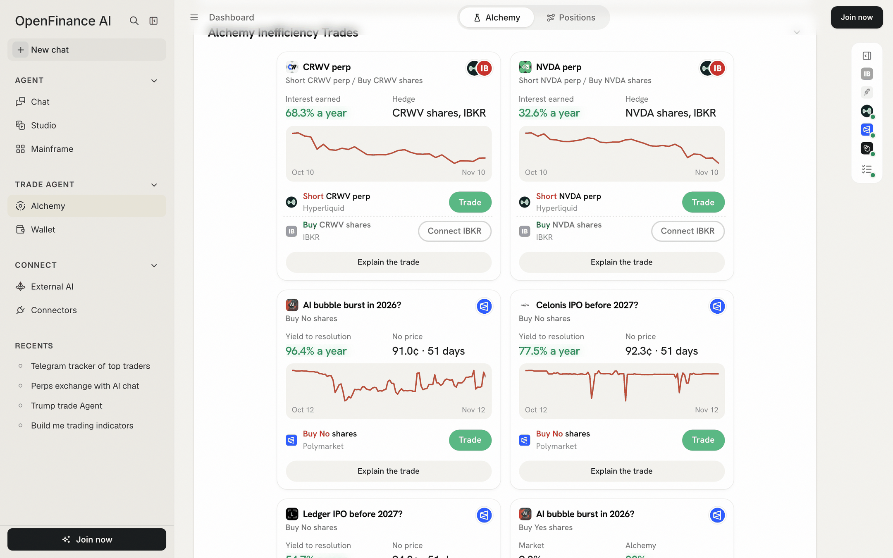
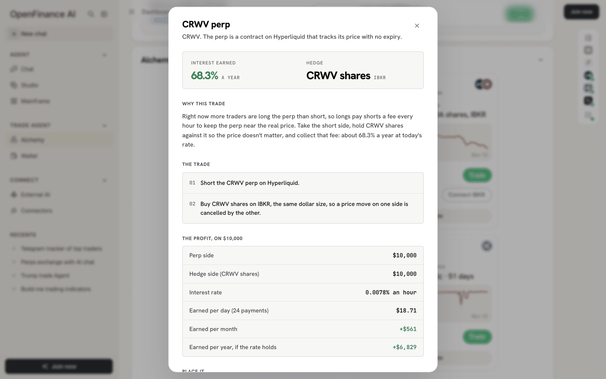
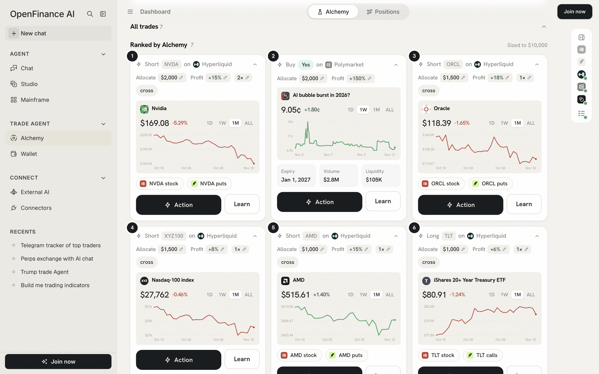
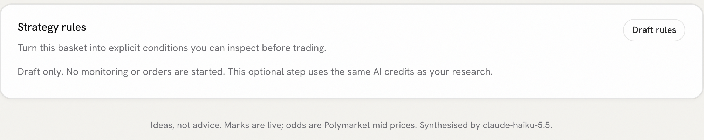

The top half of a result tells you what Alchemy would trade. You can place a trade without scrolling any further, so treat these sections as the place to test the reasoning before you trust it. They all draw on one map of cause and effect, so start there.

## How the pieces fit

A **driver variable** is a force the event pushes, such as "AI company valuations" or "rate expectations". Each driver reaches **industries**, each industry has **companies**, and each company can be traded through one or more **routes**: a perp on Hyperliquid, a tokenized stock, shares or options at a broker. Every section below is a different cut of that same map. When you switch to **Trade NO**, every effect flips to match.

## Alchemy Ontology

The Ontology shows what the event moves, three levels deep: driver, industry, company. It has two views, switched at the top of the card.

- **List** is a table with four columns: **Driver variables**, **Industries**, **Expected impact** and **Tradeable companies**.
- **Ontology** draws the same thing as a tree, with a legend: Driver, Industry, and "Company · click to trade".

<Frame caption="The Ontology tree: drivers on the left, industries in the middle, tradeable companies on the right">
  
</Frame>

<Frame caption="The Ontology as a table: drivers, industries, impact and tradeable companies">
  
</Frame>

How to use it:

- **Expected impact** reads **Positive impact**, **Negative impact**, **Mixed impact** or **Weak impact** for the industries in that row.
- Click an **Expected impact** label, such as "Negative impact", to open **Why this impact**: the outcome you are trading, which way it pushes the driver, and the mechanism for each industry.
- Click a company to open its order ticket. A company marked **Connect** has no route Alchemy can trade with your current switches. Its window offers **Turn on Onchain Tokens**, **Connect Robinhood** or **Connect IBKR**, or says "Preview only for now."
- "Weak impact" marks a link Alchemy is less sure of.

## Trade Exposure

Trade Exposure lists every effect as a card, with the ways to trade it beside it.

<Frame caption="Trade Exposure: filter by order and world view, then trade a route">
  
</Frame>

### Filters

- **Tabs** sort effects by how directly the event causes them: **Best** (strong links only), **Direct**, **First order**, **Second order**, **Boost**, **Response** and **All**.
- **Any driver** narrows the list to one driver variable.
- **World view** chips group effects by theme, each with a count: AI and compute, World currencies, Friends and rivals, Retail and consumer, Agriculture and food, Energy and nuclear, Rates and credit, Crypto, Geopolitics and defense, and Other. A chip with a dash has no effect for this event.

### Each exposure card

- **Lean and title**, for example "Short Nvidia", with the driver it comes from.
- **Mechanism**: one or two sentences on why it moves.
- **Pills** for timing (**Before it resolves**, **At resolution** or **After**), horizon (**Short term** or **Long term**), confidence (**Strong link**, **Moderate link** or **Link to check**), **Weak impact** when it applies, and the holding period, such as "~2 mo · perp first, funding pays you".
- **Routes** on the right, up to three at first, with "more ways to trade this" for the rest. The route marked **Best** is Alchemy's preferred one.

### Route buttons

Each route carries one of four buttons, which tell you whether Alchemy can place it.

| Button | Meaning |
| --- | --- |
| **Trade** | Alchemy can open an order ticket for this route |
| **Connect** | The venue is switched off or not connected. Brokers open the Connectors page |
| **Preview** | Shown for coverage only; Alchemy does not place this order |
| **No quote** | Alchemy could not get a live price for this route |

## Alchemy Inefficiency Trades

This section looks for places where the prices themselves look off, using arithmetic on the run's own data. It can find four kinds of opportunity:

| Kind | What it is | Main risk |
| --- | --- | --- |
| Arbitrage | Related markets that contradict each other, so buying both legs costs less than the payout | Both legs must fill at these prices |
| Carry | A perp whose funding rate pays far more than cash, hedged with shares, an ETF or spot | Funding changes every hour |
| Yield | A near-certain Polymarket outcome that pays a high yearly rate to resolution | You are selling the tail: the unlikely outcome still loses the whole stake |
| Edge | Alchemy's odds differ from the market's | It is an opinion, not a price |

<Frame caption="Inefficiency cards: each shows its legs, two figures, a chart and a button per leg">
  
</Frame>

Click **Explain the trade** for a full walk-through: why it pays, the legs, the profit worked out on a \$10,000 example, and the risks.

<Frame caption="Explain the trade: the reasoning and the profit worked out line by line">
  
</Frame>

Not every leg can be placed from Alchemy: a leg on a venue Alchemy cannot trade shows **Connect** or **Preview** instead of **Trade**. Every number is as of the result's capture time.

## All trades

**All trades** is folded by default. Open it to see every trade for the current view as full cards.

- Under **Alchemy's pick** it shows one group, **Ranked by Alchemy**, sized to your budget.
- Under **Trade YES** or **Trade NO** it groups trades by venue: **Prediction markets** (Polymarket), **Stocks** and **Commodities, FX and indices** (Hyperliquid HIP-3), and **Crypto perps** (Hyperliquid). An empty group says "Nothing worth trading here for this view."

<Frame caption="All trades under Alchemy's pick: every trade as a full card">
  
</Frame>

## Strategy rules

Under **Alchemy's pick** only, **Strategy rules** can turn the basket into explicit conditions, such as "Nvidia price crosses below a level".

<Frame caption="Strategy rules sit at the bottom of the result, above the closing note">
  
</Frame>

<Steps>
  <Step title="Draft rules">
    Click **Draft rules**. Alchemy writes up to eight rules from the basket. This makes another AI request and uses the same AI credits as a run.
  </Step>
  <Step title="Read the rules">
    Each rule lists its conditions, marked as AI proposals with a short reason, plus hold time, cooldown and how many times it may fire. Requirements Alchemy cannot check are listed under "Needs additional data".
  </Step>
  <Step title="Check research snapshot">
    This tests the rules against the run's saved values, not live prices or your account.
  </Step>
</Steps>

<Note>
Strategy rules are a draft only. In the app's words: "No monitoring or orders are started." Nothing watches the market for you and nothing trades.
</Note>

## Next

<CardGroup cols={2}>
  <Card title="The order ticket" icon="receipt" href="/alchemy/order-ticket">
    Turn a route or basket row into an order.
  </Card>
  <Card title="Alchemy FAQ" icon="circle-question" href="/alchemy/faq">
    Why routes are greyed out, and other questions.
  </Card>
</CardGroup>
