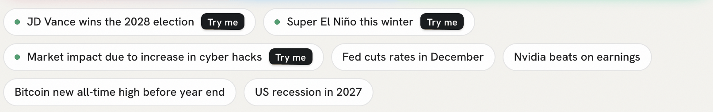
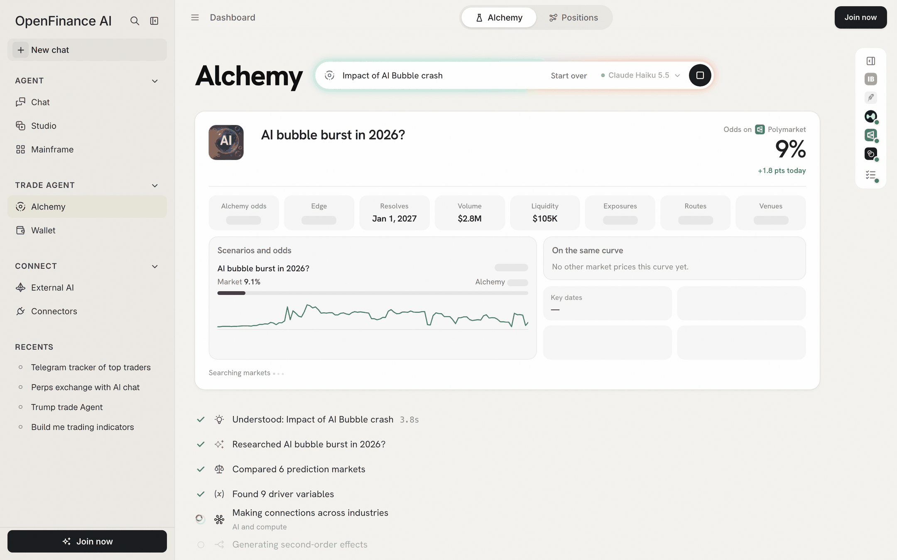
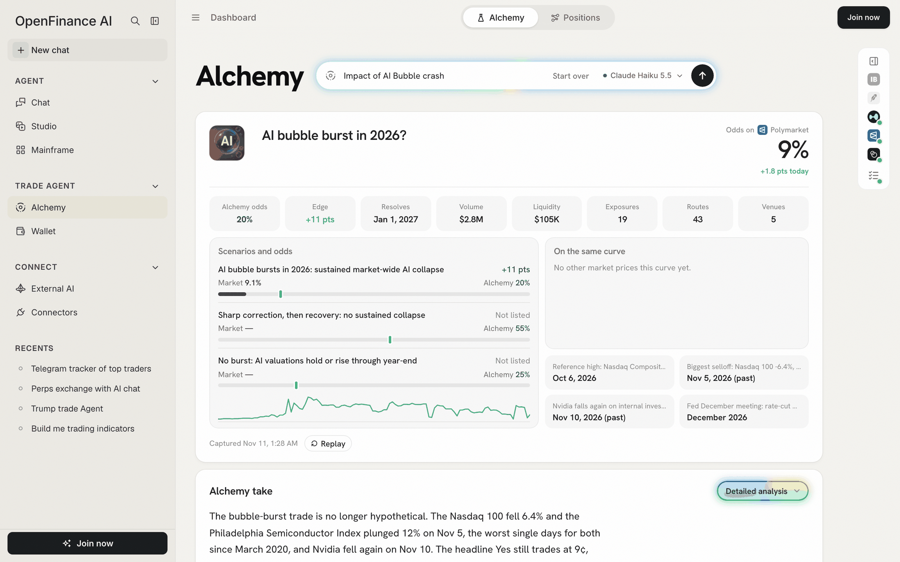

Reading about Alchemy only goes so far; the quickest way to get a feel for it is to watch a run. Samples are real runs saved earlier, so they open in seconds, need no sign-in and spend no AI credits. Start by finding one.

## Where the samples are

The Alchemy page shows two lists under the event box.

- **Example chips.** A row of example events. The ones tagged **Try me** are samples. Hover one and it says "Sample run: opens instantly, no credits used".
- **Hot queries.** A short list under the **Hot queries** switch, labelled "What people are running". The first row, **Impact of AI Bubble crash**, is also a sample.

<Frame caption="Example chips: the ones tagged Try me open a saved sample">
  
</Frame>

<Warning>
Chips and Hot queries rows without a sample behind them start a real run. Signed out, that asks you to sign in. Signed in, it spends AI credits. Stick to the **Try me** chips and **Impact of AI Bubble crash** while you explore.
</Warning>

## Walk through a sample

With a sample picked out, here is the whole run, from the first click to the basket at the bottom.

<Steps>
  <Step title="Open Alchemy">
    Click **Alchemy** under **Trade Agent** in the sidebar, or go to openfinance.tech/alchemy.
  </Step>
  <Step title="Pick a sample">
    Click **Impact of AI Bubble crash** under Hot queries, or any chip tagged **Try me**. The event box folds into a slim bar at the top with your question in it.
  </Step>
  <Step title="Watch the steps">
    A checklist appears and ticks through the same eight steps a live run takes. A sample replays them in a few seconds. A live run shows a clock and the note "Can take 3–4 minutes".
  </Step>
  <Step title="Read the summary">
    The first card names the headline Polymarket question and its odds, then eight number tiles and the scenarios. See [Reading a result](/alchemy/reading-results) for each one.
  </Step>
  <Step title="Read the Alchemy take">
    The second card is Alchemy's call in its own words, with **Detailed analysis** on the right and three view tabs at the bottom.
  </Step>
  <Step title="Switch views">
    Click **Trade YES**, **Trade NO** or **Alchemy's pick**. Everything below the take follows the view you choose.
  </Step>
  <Step title="Look at the basket">
    **Basket trades** lists the trades for that view, sized to a \$10,000 budget by default. Switch between **Cards** and **List**.
  </Step>
</Steps>

<Frame caption="A run in progress: the summary fills in while the steps tick down">
  
</Frame>

## The eight steps

The checklist you watched in step 3 names each stage of the work. This is what Alchemy does in each one.

| Step | What Alchemy is doing |
| --- | --- |
| Understanding the question | Reads your event and decides what it is really asking |
| Researching | Gathers context on the event |
| Comparing prediction markets | Searches Polymarket and picks the market that prices it |
| Finding the driver variables | Lists the forces that move the outcome, such as rates or AI valuations |
| Making connections across industries | Links each driver to the industries it reaches |
| Generating second-order effects | Traces the knock-on effects one step further |
| Estimating exposure across stocks, macro and crypto | Finds the instruments that carry each effect |
| Building the trades and the AI pick | Sizes the trades and writes Alchemy's own pick |

The summary card fills in early, as soon as Alchemy has found the market. You can read the market's odds while the rest is still working.

## What you just saw

<Frame caption="The top of a result: the market's answer, Alchemy's numbers and the scenarios">
  
</Frame>

In the AI bubble sample, the market prices the headline question low and Alchemy's own odds sit higher, so the **Edge** tile is positive and **Alchemy's pick** leans Yes. That gap between the two numbers is the whole thesis. The basket then shows how Alchemy would express it: a Yes share on Polymarket, short perps on the companies the event hits hardest, and a few hedges.

<Note>
Numbers in a sample are frozen at the time it was captured, shown at the bottom of the summary card. Charts inside the trade cards still load live prices. A sample also shows a **Replay** button, which plays the steps again.
</Note>

## After the sample

- Click **Start over** in the top bar to clear the result and return to the empty box.
- Signed in, the sample is saved under **My history**, so you can reopen it later.
- When you are ready, type your own event. [Writing good events](/alchemy/writing-good-events) shows how to phrase it.

## Your first live run

When you want an answer to a question of your own, a live run takes four steps.

<Steps>
  <Step title="Sign in">
    A live run spends your AI credits, so Alchemy asks you to sign in first.
  </Step>
  <Step title="Type one event">
    One clear outcome with a date works best, for example "Fed cuts rates in December".
  </Step>
  <Step title="Pick a model, or keep the default">
    The model picker sits next to the send button. See [History, models and credits](/alchemy/history-and-models).
  </Step>
  <Step title="Send and wait">
    Press Enter or the arrow. The square button stops the run. You can move to another page of the app and come back; the run keeps going in that browser tab and shows in the sidebar's **Recents**.
  </Step>
</Steps>

<Tip>
Closing or refreshing the tab during a live run stops it, so the browser asks you first. Asking a second question while one is running opens the new one in a new tab.
</Tip>

## Next

<CardGroup cols={2}>
  <Card title="Reading a result" icon="magnifying-glass-chart" href="/alchemy/reading-results">
    What each number and section means.
  </Card>
  <Card title="Writing good events" icon="pen" href="/alchemy/writing-good-events">
    Example events you can paste.
  </Card>
</CardGroup>
