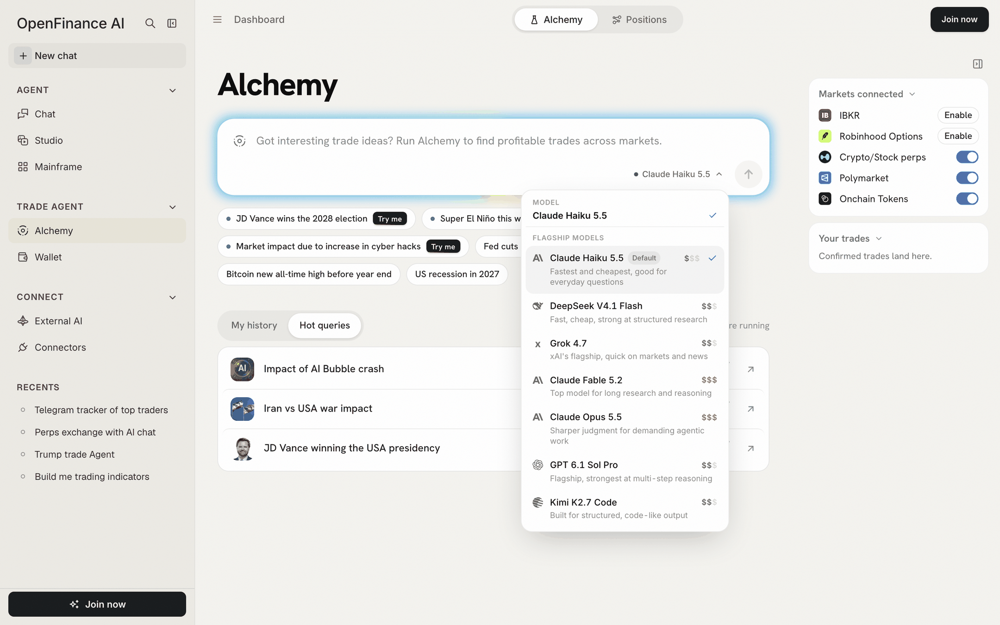

Every trade on Positions traces back to a run, and those runs stay in the browser you made them in. You also choose the model behind each run, and live runs draw on the same AI credits as Chat. The sections below take those three in turn.

## My history and Hot queries

Under the event box, a switch flips between two lists.

| List | Label on the right | What it holds |
| --- | --- | --- |
| **My history** | Saved in this browser | Every question you have asked, newest first |
| **Hot queries** | What people are running | A short list of popular questions |

Once you have history, the page opens on **My history**. Until then it opens on **Hot queries**. Signed out, My history says "Sign in to see the questions you've asked."

### Using My history

- **Open a run** by clicking its row. The saved result opens instantly and costs nothing.
- **Search** appears once you have more than eight runs: type in "Search N questions".
- **Show all** lists every run when there are more than eight.
- **Delete** a run with the bin icon, then click **Delete?** to confirm.
- **One row per question.** Asking the same question again replaces the older run.

### Hot queries

Clicking a Hot queries row runs it as if you typed it. **Impact of AI Bubble crash** opens a saved sample for free; the others start a live run, which asks you to sign in and spends credits.

### Recents in the sidebar

Your Alchemy runs also appear in the sidebar's **Recents**, mixed with your chats. Use the filter there and pick **Alchemy** to see only runs. A run that is still working shows there straight away, and clicking it takes you back to it.

## Where history lives

Alchemy runs are not stored on your account. They live in the browser you ran them in, per signed-in user.

- The newest runs are kept for quick access; older ones move to a larger archive in the same browser.
- Another browser or device does not see them.
- Clearing site data deletes them.
- If the browser dropped a saved result, opening its row asks the question again, which is a new paid run.

<Tip>
Want to keep a result? Note the key numbers, or keep the tab. A saved run is a snapshot: reopening it shows the numbers from when it was captured, not today's.
</Tip>

## Choosing a model

The model picker sits next to the send button and shows the current model, **Claude Haiku 5.5** by default. Click it to open a short list under **Flagship models**.

<Frame caption="The Alchemy model picker: one flat list with a price tier and a note per model">
  
</Frame>

Each row shows the model's maker, a one-line note and a price tier:

| Tier | Meaning |
| --- | --- |
| \$ | Under \$1 per million output tokens |
| \$\$ | \$1 to \$10 per million output tokens |
| \$\$\$ | Above \$10 per million output tokens, shown in gold |

Hover the tier to see the exact output price. The list changes as models are updated, so check the picker for what is offered today.

How the choice behaves:

- Your pick is remembered in this browser for future runs.
- You cannot change model while a run is working.
- The result names the model that wrote it in its last line.
- If a model you picked is retired, Alchemy moves you to its successor or the default.

### Which model to pick

- **Start with the default.** It is the fastest and cheapest, and fine for most events.
- **Try a higher tier** for tangled questions with many moving parts, such as a geopolitical event that touches energy, currencies and defense.
- **Compare.** Running the same event on two models is a quick way to see how much the call depends on the model. Remember that each run replaces the last one in My history.

## AI credits

A live Alchemy run uses your AI credits, the same balance that pays for Chat, Build and Studio. A stronger model costs more per run. See [Models and AI credits](/product/models-and-credits) for where to see and top up your balance.

What costs credits and what does not:

| Action | Credits |
| --- | --- |
| A live run | Yes |
| **Draft rules** under Strategy rules | Yes |
| Opening a sample (**Try me**, or Impact of AI Bubble crash) | No |
| Reopening a run from My history or Recents | No |
| Switching views, opening Learn, opening a ticket | No |

If a run fails because your balance is empty, the error shows **Add credits**, which opens the top-up window. Any other failure shows **Run again**.

## Next

<CardGroup cols={2}>
  <Card title="Writing good events" icon="pen" href="/alchemy/writing-good-events">
    Get more from each paid run.
  </Card>
  <Card title="Models and AI credits" icon="microchip" href="/product/models-and-credits">
    The credit balance across the app.
  </Card>
</CardGroup>
