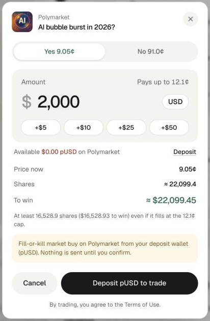
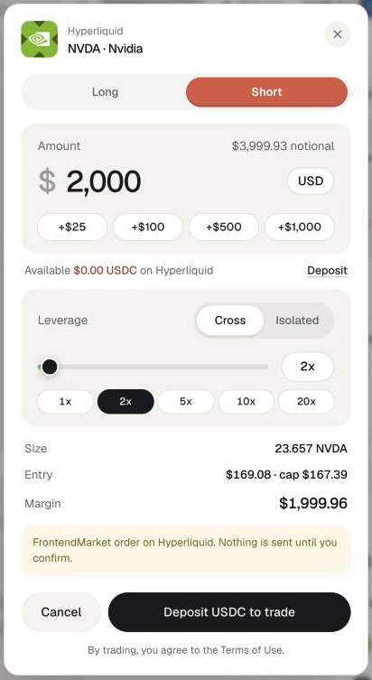

However you sized the basket, nothing has been placed yet. Each trade goes out through its own ticket: you choose the side and the amount, the ticket shows what will happen, and nothing is sent until you press its confirm button.

<Warning>
Every trade needs your confirmation in its ticket. Alchemy's trades are ideas from an AI model and can be wrong. Nothing here is financial advice.
</Warning>

## Open a ticket

Click **Action** on a trade card, **Trade** on a basket row or a route, the lightning button next to a related market, or **Open ticket** in **Review your basket**. Opening a ticket is free and places nothing. You can open one signed out to look; confirming asks you to sign in.

## What to fund first

Each venue spends from its own balance. The ticket checks the right one for you.

| Venue | Spends | Deposit tab |
| --- | --- | --- |
| Polymarket | pUSD in your Polymarket deposit wallet | Polymarket |
| Hyperliquid perps | USDC on Hyperliquid | EVM |
| xStocks on Solana | USDC in your Solana wallet | Solana |

pUSD on your main wallet address cannot buy Polymarket shares; it has to be in the deposit wallet. See [Polymarket](/markets/polymarket) and [Hyperliquid](/markets/hyperliquid) for how each is funded.

## The ticket, by venue

The ticket changes with the venue. Pick the tab for the trade you are placing.

<Tabs>
  <Tab title="Prediction market">
    - Pick **Yes** or **No**; each shows its price in cents.
    - Enter an amount in dollars, or add \$5, \$10, \$25 or \$50 with the chips.
    - The ticket shows **Price now**, **Shares** and **To win**, and "Pays up to" a cap 3¢ above the price so the order can fill.
    - The order is a fill-or-kill market buy from your Polymarket deposit wallet in pUSD: it fills in full or not at all.
    - Orders from Alchemy start at \$5. Some markets also need a minimum number of shares.
  </Tab>
  <Tab title="Perp on Hyperliquid">
    - Pick **Long** or **Short**.
    - Enter the amount. This is your margin; the ticket shows the notional, which is the amount times the leverage.
    - Choose **Cross** or **Isolated** margin and drag the leverage slider, or tap a quick stop such as 2x or 5x. The cap is 20x or the market's own maximum, whichever is lower.
    - The ticket shows **Size**, **Entry** with a price cap about 1% from the mark, and **Margin**.
    - The order is immediate: what can fill within the cap fills, and the rest is cancelled.
  </Tab>
  <Tab title="xStocks on Solana">
    - The side reads, for example, "Buy TSLAx with USDC". xStocks are buy only here.
    - The ticket fetches a live quote and shows **Price**, **Price impact**, **You pay** and **You get**.
    - The order is a USDC swap on Solana through Jupiter from your OpenFinance Solana wallet, with up to 1% slippage.
  </Tab>
</Tabs>

<Frame caption="A Polymarket ticket: side, amount, available pUSD and what you win">
  
</Frame>

## Prices on a saved result

<Warning>
On a result you reopened from history, a sample, or one you ran a while ago, the prices in basket cards and their tickets are the ones from when the result was captured. The Polymarket cap and the perp price cap are worked out from those prices. If the market has moved past them, a fill-or-kill order fails and an immediate perp order does not fill. Before trading an older result, ask the question again for fresh numbers.
</Warning>

Not everything is frozen, though. Charts on the cards, xStocks quotes, and the Hyperliquid routes in Trade Exposure and the Ontology load live prices when you open the result.

## Funds and confirming

Signed in, the ticket shows **Available** for that venue, with a **Deposit** link that opens the deposit window on the right tab. The ticket keeps your amount and side while you deposit.

- Not enough? A red line says how much the order needs and how much you have.
- Nothing on the venue? The main button becomes **Deposit USDC to trade**, or **Deposit pUSD to trade** for Polymarket.
- Signed out, the button reads **Sign in to trade**.

With the venue funded, confirming comes down to three checks.

<Steps>
  <Step title="Check side and amount">
    Make sure the side matches the trade you meant. The ticket lets you flip it.
  </Step>
  <Step title="Read the yellow note">
    It says exactly what kind of order will go out and ends "Nothing is sent until you confirm."
  </Step>
  <Step title="Confirm">
    Press the black button, for example **Buy Yes · \$25** or **Long · \$100**. By trading you agree to the Terms of Use.
  </Step>
</Steps>

<Frame caption="A perp ticket with margin mode and leverage">
  
</Frame>

## What happens after

- The ticket shows **Order sent** with what filled, or **Not placed** with the reason, such as a venue rejection. Click **Done**.
- A sent trade appears in **Your trades** on the right panel, with the total deployed and **View positions**.
- On the [Positions](/alchemy/positions) tab it is grouped under the question that led to it.
- Balances refresh after every order.
- No take-profit or stop order is placed. Exit yourself, for example with **Close** on Positions.

## Common mistakes

- **Funding the wrong place.** Money in the wrong wallet or on the wrong chain does not count for that venue.
- **Trading an old result.** Ask again first; see above.
- **Expecting a stop.** Nothing closes the trade for you. Watch your positions.
- **Too much leverage on a long hold.** Funding is paid or earned every hour. Read the hold note in **Learn** first.

## Next

<CardGroup cols={2}>
  <Card title="Positions" icon="chart-line" href="/alchemy/positions">
    Track and close what you placed.
  </Card>
  <Card title="Wallet" icon="wallet" href="/product/wallet">
    Fund each venue.
  </Card>
</CardGroup>
