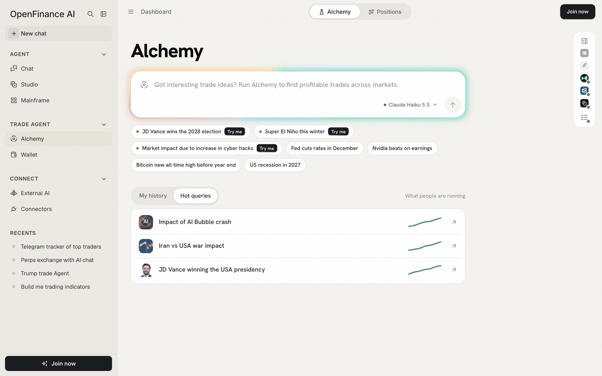
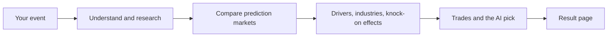

Most trading tools start from a ticker. Alchemy starts from something that might happen, such as "Fed cuts rates in December". It researches the event, finds the prediction market that prices it, and lays out the trades the event implies across Polymarket, Hyperliquid and tokenized stocks.

<Frame caption="The Alchemy page: type an event, or open a sample from the chips or Hot queries">
  
</Frame>

## What it is

Alchemy is a page in the OpenFinance app, under **Trade Agent** in the sidebar, at openfinance.tech/alchemy. It has two tabs at the top: **Alchemy**, where you ask, and **Positions**, where you see your money and the trades you placed from here.

One question gives you one result page. That page answers three things, in this order:

1. **What the market thinks.** The headline Polymarket question and its current odds.
2. **What Alchemy thinks.** Alchemy's own odds, the gap between the two, and its call in plain words.
3. **What you could trade.** A basket of trades for the view you pick, sized to a budget, each with its own order ticket.

## When to use it instead of Chat

Alchemy and Chat can both research and trade, but they start from different places.

| Use Alchemy when | Use Chat when |
| --- | --- |
| You start from a view on the world: an election, a rate decision, a war, an earnings beat | You already know what you want to trade: "long ETH 3x", "buy Yes on this market" |
| You want every market the event touches, laid out side by side | You want one answer or one action |
| You want to compare the market's odds with a second opinion | You want to ask follow-up questions in a conversation |
| You want ready-sized trades across venues | You want to build a tool or a dashboard |

The two are linked: Chat's home screen has an **Alchemy** tab of starter questions. Picking one opens it here, because Alchemy is its own page and the chat agent does not run it.

## How a run works

You type one event and press send. Alchemy then works through eight steps you can watch live, which fall into the stages below.

In plain words: Alchemy reads your question, searches Polymarket for the markets that price it, works out which forces drive the outcome and which industries and companies they reach, then builds trades and its own pick. Prices and odds come from the venues at that moment. A live run can take 3 to 4 minutes, and it runs on an AI model that spends your [AI credits](/alchemy/history-and-models).

## What it can do

- Find the Polymarket market that best matches your event, with its odds, volume, liquidity and resolution date.
- Give its own probability for the event and each scenario, next to the market's.
- Build three views of the same event: **Trade YES**, **Trade NO** and **Alchemy's pick**.
- Size a basket of trades to one budget and open an order ticket for each.
- Place orders on three venues after you confirm: Polymarket, Hyperliquid (crypto perps and stock, commodity, FX and index perps) and xStocks tokenized stocks on Solana.
- Show the chain of effects, other ways to trade each effect, and pricing gaps it found.
- Track what you placed from here on the **Positions** tab, with a **Close** button.

## What it cannot do

- It does not trade for you. Every order needs your confirmation in its ticket, one trade at a time.
- It does not place take-profit or stop orders. The profit target and stop on each trade are planning numbers.
- It does not send orders to IBKR or Robinhood. Those routes appear for reference only.
- It does not refresh a finished result. Each result records when it was captured, and its basket prices stay from that moment; ask again for fresh numbers.
- It does not sync history across devices. Your past runs live in the browser you used.

<Warning>
Alchemy's output is research written by an AI model. It can be wrong, and nothing in it or in these docs is financial advice. Every trade needs your confirmation before anything is sent.
</Warning>

## Before you start

- **Browsing is free and open.** You can open Alchemy signed out and replay the sample runs marked **Try me**.
- **Asking your own question needs an account.** Sending one signed out asks you to sign in, because a run spends your AI credits. Sign up at [openfinance.tech](https://openfinance.tech) and [buy a few credits](/funding/buy-ai-credits) first.
- **Trading needs funds on the venue.** See [The order ticket](/alchemy/order-ticket) for what to fund where.

## In this tab

<CardGroup cols={2}>
  <Card title="Your first run" icon="play" href="/alchemy/first-run">
    Open a free sample and walk through a result screen by screen.
  </Card>
  <Card title="Reading a result" icon="magnifying-glass-chart" href="/alchemy/reading-results">
    Every number on the result page, defined.
  </Card>
  <Card title="Deeper analysis" icon="sitemap" href="/alchemy/deeper-analysis">
    Ontology, Trade Exposure, Inefficiency Trades and strategy rules.
  </Card>
  <Card title="Basket and budget" icon="bolt" href="/alchemy/trading">
    Where Alchemy trades, the basket and how the budget is split.
  </Card>
  <Card title="The order ticket" icon="receipt" href="/alchemy/order-ticket">
    Place one trade, fund the venue and confirm.
  </Card>
  <Card title="Positions" icon="chart-line" href="/alchemy/positions">
    Balances, open positions, strategies and closing.
  </Card>
  <Card title="History, models and credits" icon="clock-rotate-left" href="/alchemy/history-and-models">
    Past runs, the model picker and what a run costs.
  </Card>
  <Card title="Writing good events" icon="pen" href="/alchemy/writing-good-events">
    Phrase an event so Alchemy finds the right market.
  </Card>
  <Card title="Alchemy FAQ" icon="circle-question" href="/alchemy/faq">
    Limits, risks and common questions.
  </Card>
</CardGroup>
