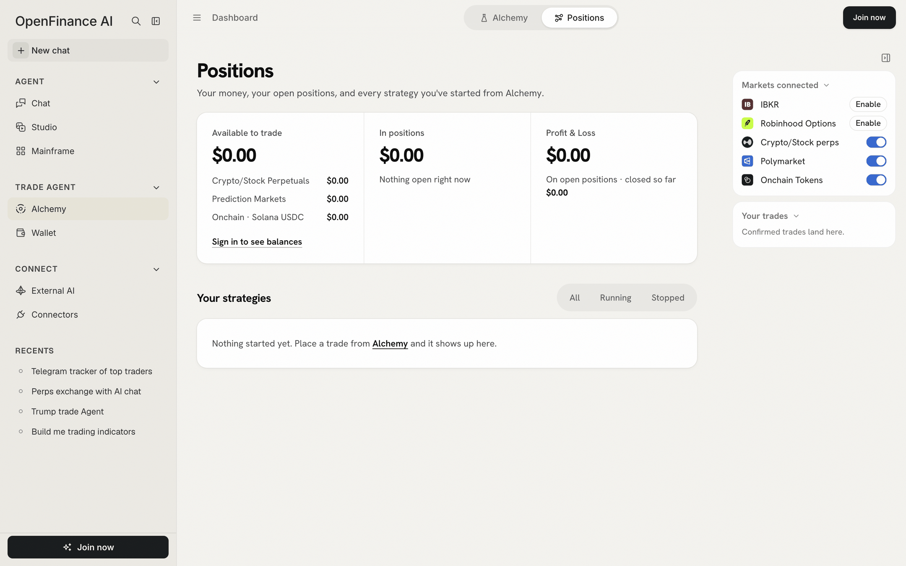
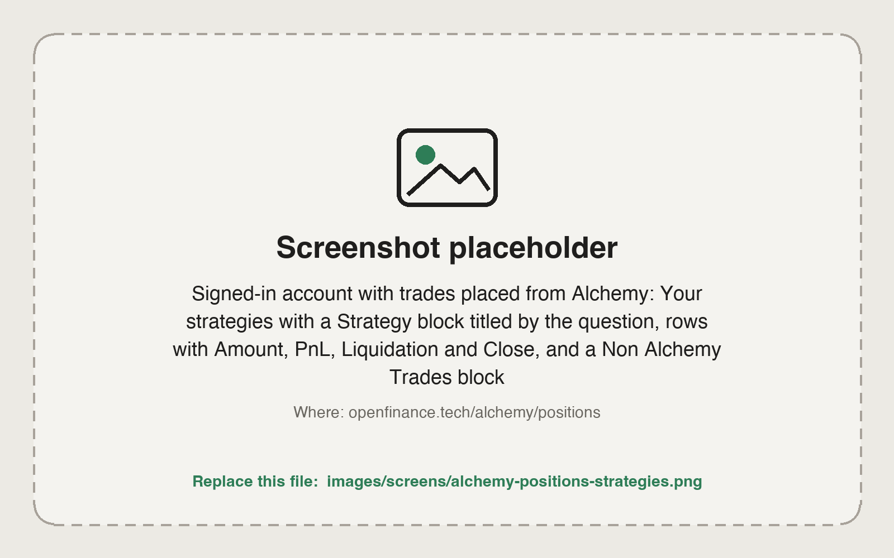

Once a ticket says **Order sent**, the trade lives on the **Positions** tab, next to **Alchemy** at the top of the page, at openfinance.tech/alchemy/positions. It brings your money and your open positions together, and groups every trade you started from Alchemy under the question that led to it.

<Frame caption="Positions signed out: the three money panels, the strategies list and the Markets connected panel">
  
</Frame>

## How it works

Two sources feed this page:

- **The venues.** Balances and open positions are read live from your Hyperliquid account, your Polymarket deposit wallet and your Solana wallet.
- **Your browser.** Each trade you confirm in an Alchemy ticket is recorded in this browser, with the question it came from. That record is what turns positions into "strategies".

So the money and the positions are the truth from the venues; the grouping by question is a layer Alchemy adds on top.

## The three panels

Across the top, three panels sum up your money.

| Panel | What it shows |
| --- | --- |
| **Available to trade** | What you can spend now, in total and per venue: **Crypto/Stock Perpetuals** (USDC on Hyperliquid), **Prediction Markets** (pUSD in your Polymarket deposit wallet) and **Onchain · Solana USDC** |
| **In positions** | The current value of your open Hyperliquid and Polymarket positions, with the first five listed |
| **Profit & Loss** | Profit or loss on open positions, with the amount "closed so far" underneath |

Under **Available to trade** you get **Add money** and **Withdraw**, which open the [Wallet](/product/wallet), and **Refresh**. Signed out, the panels show zero and a **Sign in to see balances** link.

<Note>
Tokenized stocks bought through xStocks count in your Solana wallet, not in **In positions** or **Profit & Loss** here.
</Note>

## Your strategies

Below the panels, **Your strategies** lists one block per Alchemy question. Each block is labelled **Strategy** with the question as its title and the number of trades.

<Frame caption="Strategies grouped by question, with a Close button per position">
  
</Frame>

Each block is a table:

| Column | What it shows |
| --- | --- |
| **Position** | Side and name, such as "Long BTC" or "Buy Yes" with a short form of the market question, plus the venue and leverage |
| **Amount** | The position's current value. For a leveraged perp, a second line shows the stake and leverage, such as "\$100 at 3x"; for a Polymarket bet, what you staked |
| **PnL** | Profit or loss in dollars and percent |
| **Liquidation** | The liquidation price for a perp, or "None, fully backed" for a prediction market |

Useful details:

- **Click a block's title** to reopen the Alchemy result it came from. If that result is no longer saved in this browser, the question is asked again, which starts a new run and spends AI credits.
- Click anywhere else on a block's header to fold or unfold it.
- A row reading "no open position" was recorded here but the venue holds nothing now, for example because you closed it elsewhere.
- **Non Alchemy Trades**, labelled "Open on your account", lists open positions with no Alchemy record in this browser: trades placed in Chat, on another device, or straight on the venue. They can be closed here too.

## Filters: All, Running, Stopped

The switch at the top right filters the strategies, with a count on each.

- **Running**: trades you sent that have not been closed from this page.
- **Stopped**: trades you closed from this page.
- **All**: both.

A trade becomes **Stopped** when you close it with **Close** here. There is no separate Stop button, and nothing runs in the background: a strategy is a group of positions you placed, not an automated bot.

## Close a position

Nothing closes a trade for you, so this is how you exit. Closing takes two clicks, which means one stray click sends nothing.

<Steps>
  <Step title="Find the row">
    Open **All** or **Running** and find the position.
  </Step>
  <Step title="Click Close">
    The button turns into **Confirm close** for a few seconds.
  </Step>
  <Step title="Click Confirm close">
    The row shows **Closing**, then a note with the result, for example what filled and at what price.
  </Step>
</Steps>

What Close sends:

- **Hyperliquid perp**: one reduce-only order for the whole position on the other side, capped about 1% from the mark price.
- **Polymarket**: a fill-or-kill sell of every share, at no less than about 3¢ under the current price. A position worth under \$1 is below Polymarket's minimum and cannot be sold this way.

Other cases:

- **Settled** means the market has resolved. Redeem it from Polymarket or the [Wallet](/product/wallet) page; it cannot be sold.
- **Remove** appears when there is nothing to close. It removes the record from this list only.
- **xStocks** tokens have no Close here. Sell them elsewhere in OpenFinance, for example by asking Chat to swap them back to USDC.

<Warning>
Closing sends a real order and needs your confirmation. Nothing here is financial advice.
</Warning>

## Your trades panel

The right panel's **Your trades** box lists your latest confirmed trades with venue, amount and status ("sent" or "stopped"), the total **Deployed**, and **View positions**. The small x on a row removes it from the list; it does not close the position.

## Limits

- The strategy records live in this browser. On another device or browser your positions still show, under **Non Alchemy Trades**, but not grouped by question.
- Clearing your browser data removes the records, not the positions.
- Balances load when you open the tab and reload after a close. Use **Refresh** for a fresh read.

## Next

<CardGroup cols={2}>
  <Card title="The order ticket" icon="receipt" href="/alchemy/order-ticket">
    How orders are placed.
  </Card>
  <Card title="History, models and credits" icon="clock-rotate-left" href="/alchemy/history-and-models">
    Reopen past runs.
  </Card>
</CardGroup>
