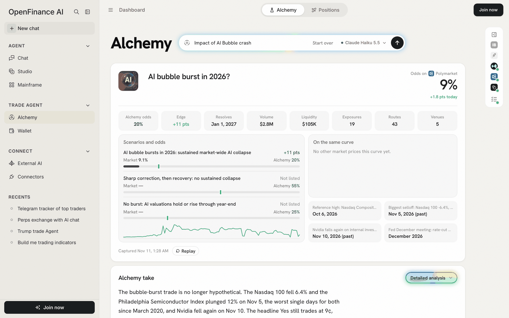
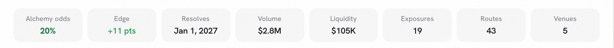
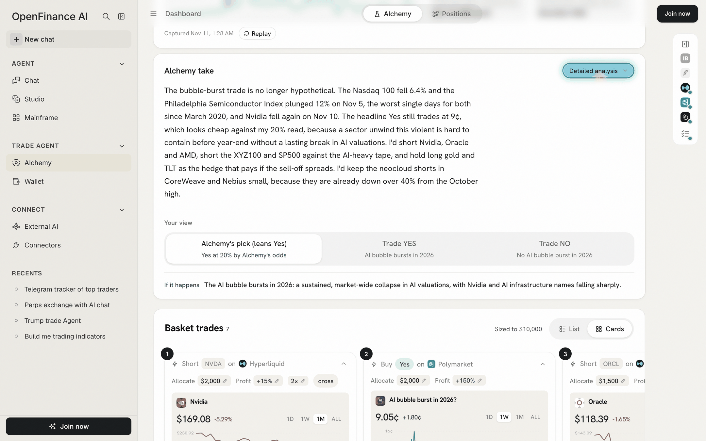
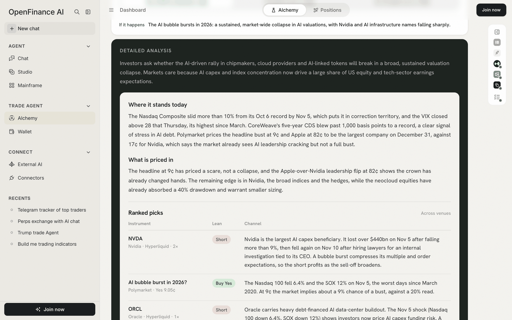
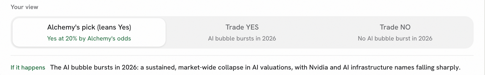

Whatever event you sent, the result comes back in the same shape, so once you know it you can read any run in under a minute. The sections below the basket have a page of their own, [Deeper analysis](/alchemy/deeper-analysis).

## The order of the page

A result reads in the order you would decide:

1. **Summary card.** What the market prices, and what Alchemy thinks.
2. **Alchemy take.** The call in plain words, and the three views.
3. **Basket trades.** The trades for the view you picked. See [Basket and budget](/alchemy/trading).
4. **Alchemy Ontology**, **Trade Exposure** and **Alchemy Inefficiency Trades.** The reasoning and other ways to trade it.
5. **All trades.** Everything for the view, folded.
6. **Strategy rules.** Only under Alchemy's pick.

The last line of every result reads: "Ideas, not advice. Marks are live; odds are Polymarket mid prices." It also names the model that wrote the run.

## The summary card

The first card answers the first two questions: what the market thinks, and whether Alchemy agrees.

<Frame caption="The summary card: headline question and odds, eight tiles, scenarios, related markets and key dates">
  
</Frame>

### The headline question and its odds

At the top sits the Polymarket question Alchemy chose as the best match for your event, with its picture. On the right, **Odds on Polymarket** shows the market's chance of Yes, and a line such as "+1.8 pts today" when the odds moved today.

If no market prices your event, the title is Alchemy's own wording, the odds read "Current odds" with a dash and "no market prices this yet". The trades then rely on related markets and instruments.

### Market odds vs Alchemy odds

Two numbers matter most, and they mean different things:

- **The market's odds** are the price of a Yes share on Polymarket. A Yes share at 9¢ means traders, as a group, price a 9% chance.
- **Alchemy odds** are the AI model's own estimate that the event happens. It is an opinion, not a price, and nobody trades at it.

The gap between them is the **Edge**. If the market says 9% and Alchemy says 20%, the edge is +11 pts, and Alchemy's pick will lean Yes. A large gap is a reason to look closer, not a guarantee: the market may know something the model missed.

### The eight tiles

The same eight tiles appear on every result, in the same order. A tile shows a dash when its number is not known. Hover a tile to see its definition in the app.

| Tile | What it means |
| --- | --- |
| **Alchemy odds** | Alchemy's own probability that the event happens. Green when it is above the market, blue when below |
| **Edge** | Alchemy odds minus the market's odds, in percentage points |
| **Resolves** | When the outcome is known: the headline market's end date |
| **Volume** | Dollars traded on the headline market |
| **Liquidity** | Dollars resting on the headline market's order book, a rough guide to how much you can trade without moving the price |
| **Exposures** | Industries and companies the event reaches |
| **Routes** | Ways to trade those exposures, across all venues |
| **Venues** | How many venues those routes trade on |

<Frame caption="The eight tiles, always in this order">
  
</Frame>

### Scenarios and odds

The ladder on the left breaks the event into outcomes. Each row shows:

- **Market**: the Polymarket odds for that outcome, or a dash and "Not listed" when no market prices it.
- **Alchemy**: Alchemy's odds for the same outcome.
- **The edge** in points, in green when Alchemy is higher and red when lower.
- A bar: the filled part is the market's odds; the marker is Alchemy's.

A row marked "Implied by the two markets above" is worked out from other markets rather than priced directly. Under the ladder, a small chart shows the headline market's odds over the last month.

### On the same curve and key dates

- **On the same curve** lists up to four other markets on the same question, such as the same event by a different date, with their odds. When there is no headline market the panel is called **Related markets**. The lightning button on a row opens an order ticket to buy Yes on that market.
- **Key dates** shows up to four dates that matter for the event, such as a scheduled meeting or a past sell-off.

### Captured and Replay

The bottom of the card says when the result was captured, for example "Captured Nov 11, 1:28 AM", and how long a live run took. Odds, tiles and the prices on the basket cards are frozen at that moment; only the card charts load live. A saved sample also shows **Replay**, which plays the steps again.

## The Alchemy take

<Frame caption="The Alchemy take, the three view tabs, and the start of the basket">
  
</Frame>

The take is Alchemy's call in a few sentences: where the event stands, why the market's price looks right or wrong, and what Alchemy would trade.

Click **Detailed analysis** to open the evidence:

- A short summary of the event.
- **Where it stands today** and **What is priced in**.
- A table per venue with three columns: **Instrument**, **Lean** (for example Buy Yes or Short) and **Channel**, the way the event moves that instrument.

<Frame caption="Detailed analysis: the summary, what is priced in, and the reasoning per trade">
  
</Frame>

## The three views

Under **Your view** you pick how to read the event. The view drives everything below it: the basket, All trades, and the direction of the effects in the Ontology.

| View | What it shows | Use it when |
| --- | --- | --- |
| **Alchemy's pick** | Alchemy's own ranked basket across venues, with each trade's share of the budget. The tab says which way it leans, for example "Yes at 20% by Alchemy's odds" | You want Alchemy's best single plan |
| **Trade YES** | Trades that pay if the event happens. The tab carries a short label of the outcome | You believe it will happen |
| **Trade NO** | Trades that pay if it does not happen | You believe it will not |

<Frame caption="The view tabs: the pick says which way it leans and at what odds">
  
</Frame>

Under the tabs, a line spells out the world you are trading: **If it happens** or **If it doesn't**, followed by what that outcome means.

<Tip>
Read Trade YES and Trade NO even when you agree with Alchemy's pick. Seeing what pays in the other world shows you what you are betting against.
</Tip>

## How to read a result well

- **Start with the edge.** If Alchemy and the market agree, there is little to trade on the event itself.
- **Check Resolves.** A trade tied to an event a year away ties up money for a year, and perps pay or earn funding all that time.
- **Check Liquidity before sizing.** A thin market can move when you buy.
- **Check Captured.** A result from last week may no longer match the market, and its tickets start from the old prices. Ask again for fresh numbers.
- **Open Learn on a trade** before you place it. See [Basket and budget](/alchemy/trading).

## Next

<CardGroup cols={2}>
  <Card title="Deeper analysis" icon="sitemap" href="/alchemy/deeper-analysis">
    Ontology, Trade Exposure and Inefficiency Trades.
  </Card>
  <Card title="Basket and budget" icon="bolt" href="/alchemy/trading">
    Size the trades for your view.
  </Card>
</CardGroup>
