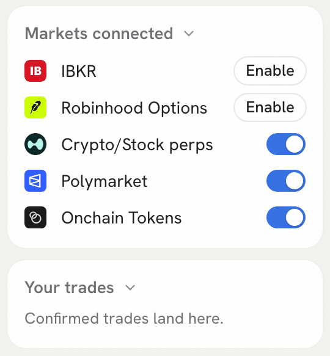
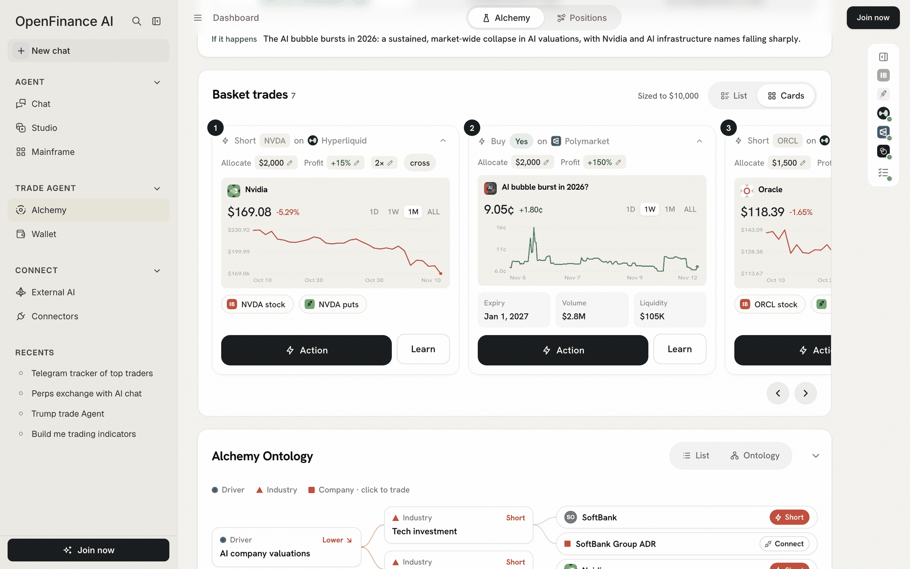
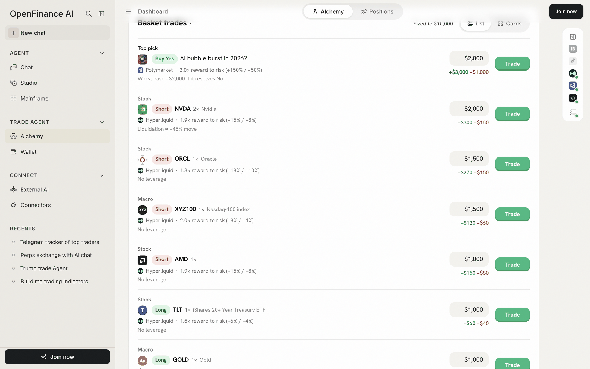
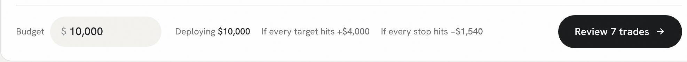
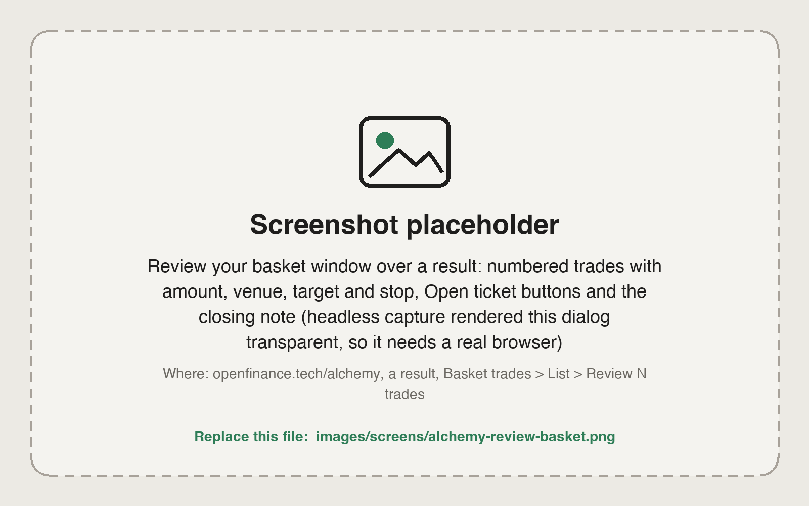
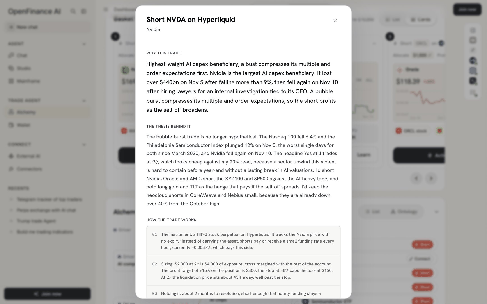

Once the reasoning holds up, the basket is where a result becomes a plan. Alchemy sizes every trade in it for you, but you place each one yourself, through its own [order ticket](/alchemy/order-ticket).

<Warning>
Every trade needs your confirmation in its ticket. Alchemy's trades are ideas from an AI model and can be wrong. Nothing here is financial advice.
</Warning>

## Where Alchemy can trade

The basket draws only on venues Alchemy can send orders to. There are three.

| Venue | What you trade | Paid from |
| --- | --- | --- |
| **Polymarket** | Yes or No shares on prediction markets | pUSD in your Polymarket deposit wallet |
| **Hyperliquid** | Crypto perps, plus HIP-3 perps on stocks, commodities, FX and indices, long or short with leverage | USDC on Hyperliquid |
| **xStocks on Solana** | Tokenized stocks, bought with USDC (buy only) | USDC in your OpenFinance Solana wallet |

IBKR and Robinhood routes appear on cards and in Trade Exposure so you can see the coverage, but Alchemy does not send orders to them.

## The Markets connected panel

You decide which of those venues to use from a panel on the right edge of Alchemy and Positions. It starts as a thin strip of venue marks; click it to open **Markets connected** and **Your trades**.

<Frame caption="Markets connected: switch venues on or off; brokers show Enable">
  
</Frame>

- **Crypto/Stock perps**, **Polymarket** and **Onchain Tokens** are on by default. Switch one off and its trades grey out, with a **Connect** button on each that switches the venue back on.
- **IBKR** and **Robinhood Options** show **Enable**, which opens the [Connectors](/product/connectors) page.
- The switches are remembered in your browser and shared by both tabs.

## The basket

**Basket trades** holds every trade for the view you picked, with the best reward to risk first. The header says how many trades there are and "Sized to \$10,000", the default budget.

### Cards view

The default view is a row of cards you can slide sideways with the arrows. Each card shows:

- The trade line, such as "Short NVDA on Hyperliquid" or "Buy Yes on Polymarket".
- Editable chips: **Allocate** (dollars), **Profit** (target in percent), and for perps the leverage and **cross** or **isolated** margin.
- The price, today's change and a chart with **1D**, **1W**, **1M** and **ALL** ranges.
- For prediction markets, **Expiry**, **Volume** and **Liquidity**.
- Chips for the same exposure elsewhere, such as "NVDA stock" at IBKR or "NVDA puts" at Robinhood. These are for reference.
- **Action** opens the order ticket. **Learn** explains the trade.

<Frame caption="Basket trades in Cards view">
  
</Frame>

### List view

Click **List** for a plan you can size at a glance. The first row is labelled **Top pick**; the others are labelled **Direct bet**, **Stock**, **Macro** or **Crypto**. Each row shows:

- The reward to risk, for example "3.0× reward to risk (+150% / −50%)".
- A risk note: "Worst case −\$2,000 if it resolves No" for a prediction market, "Liquidation ≈ +45% move" for a leveraged perp, "No leverage" otherwise, or the funding cost when the hold is long.
- The amount, which you can edit, with what it makes at the target and loses at the stop.
- A **Trade** button.

<Frame caption="Basket trades in List view: Top pick first, each row with its reward to risk and worst case">
  
</Frame>

### Budget and how sizes are split

At the bottom of List view, set **Budget** to what you would really put to work. Alchemy then:

1. Takes the trades on venues you have switched on.
2. Splits the budget by the weights the model gave each trade, in \$10 steps.
3. Gives the last trade whatever is left, so the total always equals the budget.

The footer shows **Deploying**, **If every target hits** and **If every stop hits**. Edit any single amount and only that trade changes.

<Frame caption="The List view footer: budget, totals and Review">
  
</Frame>

<Note>
The profit target and stop on each trade are planning numbers. Alchemy does not place take-profit or stop orders; you exit yourself, for example with **Close** on the [Positions](/alchemy/positions) tab.
</Note>

### Review the basket

Click **Review N trades** to open **Review your basket**: a numbered list with each trade's amount, venue, target and stop, and an **Open ticket** button per row. In the app's words, "Each one opens its own order ticket, and nothing is placed until you confirm there."

<Frame caption="Review your basket: one Open ticket button per trade">
  
</Frame>

## Learn before you trade

Before you open a ticket, **Learn** on a card gives you a plain-language explainer for that one trade:

- **Why this trade** and **The thesis behind it**.
- **How the trade works**, step by step: the instrument, the sizing in dollars, the holding period, liquidity and the exit.
- Key figures: price, volume and liquidity for a prediction market; price, funding per hour, open interest and 24h volume for a perp.
- Notes on what can go wrong, ending with "Nothing here places an order; the Action button does."

<Frame caption="Learn: the reasoning and the mechanics of one trade">
  
</Frame>

## Next

<CardGroup cols={2}>
  <Card title="The order ticket" icon="receipt" href="/alchemy/order-ticket">
    Place one trade: sides, amounts, funds and confirming.
  </Card>
  <Card title="Positions" icon="chart-line" href="/alchemy/positions">
    Track and close what you placed.
  </Card>
</CardGroup>
