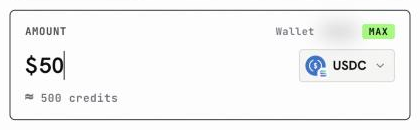
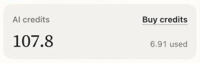

Every reply from a model costs a little, and AI credits are how you pay for it. They are a separate balance from your trading funds, so buying credits never moves money out of a venue, and running low on credits never touches your positions.

## What credits pay for

Credits are spent whenever a model does work for you:

- replies in [Chat](/product/chat) and builds in [Build mode](/product/build-mode),
- images in [Studio](/product/studio),
- runs in [Alchemy](/alchemy/overview),
- calls to the [inference API](/inference/overview) from your own code.

The model you pick sets the price. The model picker shows each model's price tier, so you can choose a lighter model for quick questions. See [Models and AI credits](/product/models-and-credits) for the details.

## What they cost

You buy credits with stablecoins from your own wallet. One dollar comes to about 10 credits, and the Fund AI credits sheet shows the estimate (for example "≈ 500 credits") before you pay, so there are no surprises.

<Frame caption="The estimate appears as you type an amount">
  
</Frame>

## See your balance

Click **Deposit** in the top bar. The account panel shows your **AI credits**, how many are available and how many you have used, with a **Buy credits** button next to them.

<Frame caption="Your AI credits in the account panel">
  
</Frame>

## Top up

Buying credits takes about a minute if you already hold USDC, USDT or USDG in your OpenFinance wallet.

<CardGroup cols={2}>
  <Card title="Buy with crypto" icon="coins" href="/funding/buy-credits-with-crypto">
    Step by step, from the Buy credits button to a credited balance.
  </Card>
  <Card title="Deposit funds first" icon="arrow-down-to-bracket" href="/funding/deposit-funds">
    No stablecoins in your wallet yet? Start here.
  </Card>
</CardGroup>
