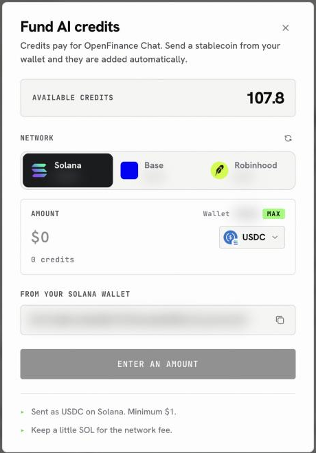
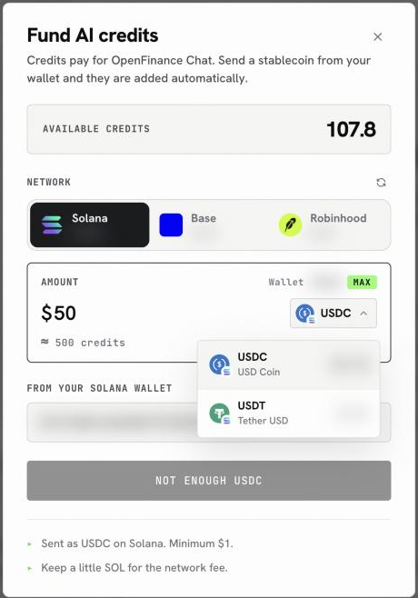
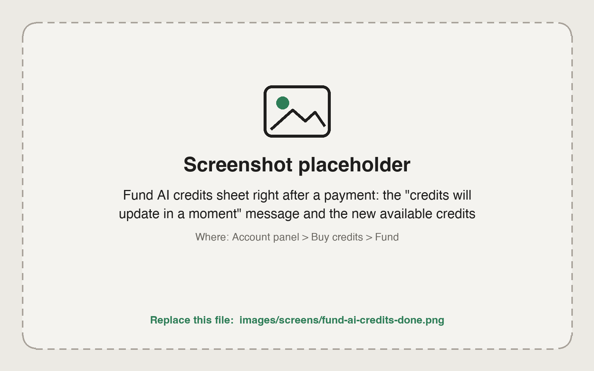

Credits are paid for with stablecoins straight from your OpenFinance wallet: USDC or USDT on Solana, USDC on Base, or USDG on Robinhood Chain. There is no card form and no separate checkout. You pick a network and a coin, enter an amount, and the app sends it and adds the credits to your balance.

## What you need

Have one of these in your OpenFinance wallet, plus a little gas on the same network:

| Network | Pay with | Gas |
| - | - | - |
| Solana | USDC or USDT | SOL |
| Base | USDC | ETH on Base |
| Robinhood Chain | USDG | ETH on Robinhood Chain |

Not funded yet? [Deposit](/funding/deposit-funds) to your EVM address for Base or Robinhood Chain, or to your Solana address for Solana. A network that is not accepting payments yet shows **Soon** in the sheet.

## Buy credits

<Steps>
  <Step title="Open Fund AI credits">
    Click **Deposit** in the top bar, then **Buy credits** next to your AI credits. The **Fund AI credits** sheet opens with your **Available credits** at the top.
  </Step>
  <Step title="Choose a network">
    Pick **Solana**, **Base** or **Robinhood**. The sheet reads your balances on that network.
  </Step>
  <Step title="Choose a stablecoin">
    Open the token menu and pick the coin you want to pay with. Each one shows your balance next to it.
  </Step>
  <Step title="Enter an amount">
    Type the dollar amount. Below it you see roughly how many credits it buys, and the **From your wallet** line shows the address it is paid from.
  </Step>
  <Step title="Fund">
    Click **Fund** and approve in your wallet. The sheet shows **Adding your credits** while the network confirms; your balance updates in a moment.
  </Step>
</Steps>

<Frame caption="The Fund AI credits sheet">
  
</Frame>

<Frame caption="Pick the coin to pay with; each shows your balance">
  
</Frame>

<Frame caption="Done: the sheet confirms and your balance updates">
  
</Frame>

## If the button will not go

The Fund button tells you what is missing instead of failing silently:

| The button says | What to do |
| - | - |
| **Enter an amount** | Type how much you want to spend. |
| **Minimum is ...** | Raise the amount to at least the minimum shown. |
| **Not enough USDC** (or USDT, USDG) | Deposit more of that coin, or pick another coin or network. |
| **Add SOL (or ETH) for the network fee** | Send a small amount of the gas token to that network. |
| **Set up your ... wallet first** | Finish setting up your account so the wallet for that network exists. |

If a payment is sent but the credits have not shown up after a minute or two, keep the transaction hash the sheet shows and email [dev@openfinance.tech](mailto:dev@openfinance.tech).

## Next

<CardGroup cols={2}>
  <Card title="Models and AI credits" icon="sparkles" href="/product/models-and-credits">
    Pick the right model for each job.
  </Card>
  <Card title="Inference API" icon="microchip" href="/inference/overview">
    Spend the same credits from your own code.
  </Card>
</CardGroup>
