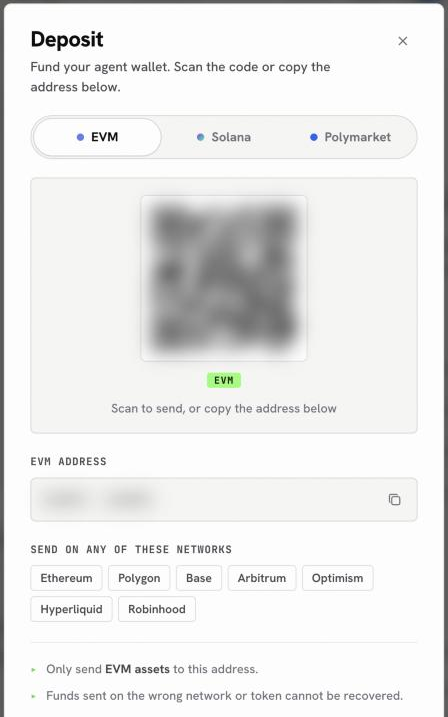
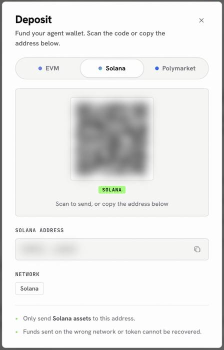

When you sign up, OpenFinance creates a self-custodial wallet for you: one EVM address that works on every EVM chain, and one Solana address. Depositing means sending crypto to one of those addresses, or to your Polymarket deposit address, from an exchange or another wallet. Once it arrives, you can trade it, swap it or move it on to a venue.

## Open the Deposit sheet

<Steps>
  <Step title="Open the account panel">
    Click **Deposit** in the top bar. You can also open the [Wallet](/product/wallet) page and click **Deposit** there.
  </Step>
  <Step title="Click Deposit">
    Under your wallet total, click **Deposit**. A sheet opens with a QR code and your address.
  </Step>
  <Step title="Pick the right tab">
    Choose **EVM**, **Solana** or **Polymarket** at the top. The address, the networks and the notes change with the tab.
  </Step>
  <Step title="Send from your exchange or wallet">
    Scan the code, or copy the address and paste it into the app you are sending from. Check the network there matches one listed on the sheet.
  </Step>
</Steps>

<Frame caption="The Deposit sheet on the EVM tab">
  
</Frame>

## The three tabs

Each tab is a different address for a different job, so the tab you pick decides where your money lands.

| Tab | Address | Accepts | Use it for |
| - | - | - | - |
| **EVM** | Your EVM address | Assets on Ethereum, Polygon, Base, Arbitrum, Optimism, Hyperliquid and Robinhood Chain | USDC for Hyperliquid, tokens and tokenized stocks on EVM chains |
| **Solana** | Your Solana address | Solana assets | SOL, USDC on Solana, memecoins |
| **Polymarket** | Your Polymarket deposit address | pUSD on Polygon only | Your Polymarket trading balance |

The EVM address is the same on every EVM chain, which is why one tab covers seven networks. What changes is the network you choose when you send.

<Frame caption="The Solana tab: a separate address for Solana assets">
  
</Frame>

<Warning>
Funds sent on the wrong network or as the wrong token cannot be recovered. Send a small test amount first if you have never used an address before.
</Warning>

## From your wallet to a venue

Money sent to the EVM or Solana tab sits in your own wallet. To trade on Hyperliquid you move it onto the venue in one more step, which the agent does for you after you confirm. Polymarket is the exception: its tab is the venue's own deposit address, so funds sent there are ready to trade.

<CardGroup cols={3}>
  <Card title="Deposit for Polymarket" icon="square-poll-vertical" href="/funding/deposit-polymarket">
    pUSD on Polygon, straight to your trading balance.
  </Card>
  <Card title="Deposit for Hyperliquid" icon="chart-line" href="/funding/deposit-hyperliquid">
    USDC on Arbitrum, then onto Hyperliquid.
  </Card>
  <Card title="Deposit onchain" icon="coins" href="/funding/deposit-onchain">
    Tokens and gas on EVM chains and Solana.
  </Card>
</CardGroup>
