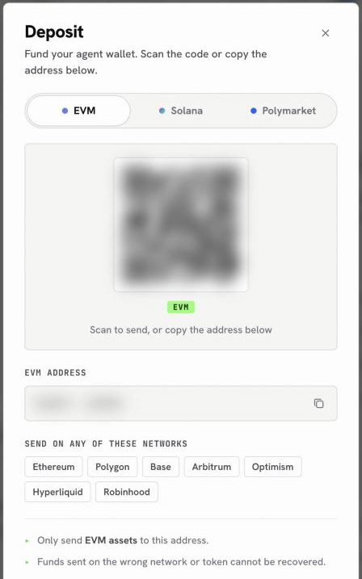
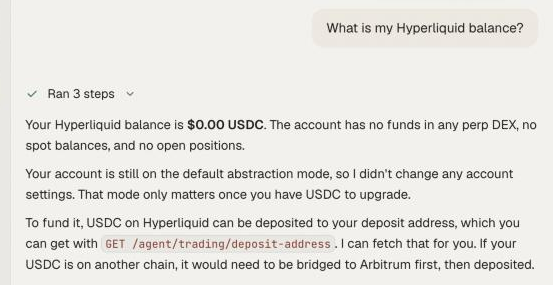

Hyperliquid is its own chain and takes **USDC only**. Not USDT, not USDC.e. USDC in your OpenFinance wallet, on Arbitrum or another supported chain, is not on Hyperliquid yet: the agent moves it in with one confirmed step, and the same balance then covers perps, spot, stock perps and outcome markets.

<Frame caption="Step one of the easy route: the EVM tab, sending on Arbitrum">
  
</Frame>

## Pick your route

<Tabs>
  <Tab title="Through your OpenFinance wallet (easiest)">
    <Steps>
      <Step title="Send USDC on Arbitrum to your wallet">
        Open the Deposit sheet, stay on the **EVM** tab, and send USDC on **Arbitrum** to your address.
      </Step>
      <Step title="Move it onto Hyperliquid">
        Ask the agent:

        ```text
        Deposit 50 USDC from my Arbitrum wallet to my Hyperliquid account. Show me the summary first.
        ```

        Check the summary and confirm. It usually lands within a few minutes, and the agent tells you when it does.
      </Step>
    </Steps>
  </Tab>
  <Tab title="Straight from an exchange">
    <Steps>
      <Step title="Withdraw USDC to your OpenFinance address">
        From your exchange, withdraw USDC on the **Arbitrum** network to your OpenFinance address (the EVM tab of the Deposit sheet). Send a small test amount first if you have never used it. Withdraw on Arbitrum, not on HyperEVM: an exchange's "Hyperliquid" network is usually HyperEVM, which is not your trading balance.
      </Step>
      <Step title="Move it onto Hyperliquid">
        USDC that arrives on Arbitrum is in your wallet, not on Hyperliquid yet. Ask the agent to move it in, as in the first tab. If you have no gas token on an EVM chain, the agent uses a gas-free route and Relay takes a small fee from the amount; the summary shows it.
      </Step>
    </Steps>
  </Tab>
</Tabs>

<Warning>
Send only USDC, and never on HyperEVM. USDC sent to your address on Arbitrum or another EVM chain lands in your wallet first, and the agent moves it in. Funds sent as another token or on the wrong network cannot be recovered.
</Warning>

## If your USDC is somewhere else

Most people do not start with USDC on Arbitrum, and that is fine. The agent can move USDC into Hyperliquid straight from Arbitrum, Base, Polygon, Ethereum, BNB Chain or Solana.

```text
Move all my USDC on Base into Hyperliquid. Show the quote first.
```

Starting from rupees? Buy USDC on Polygon with UPI, then ask the agent to move it into Hyperliquid. The [funding guide](/guides/fund-each-venue) walks through that route step by step, and [Fund with card or bank](/markets/fund-with-card-or-bank) covers buying crypto in the first place.

## Check your balance

Ask "What is my Hyperliquid balance?". You get one USDC figure, because OpenFinance uses Hyperliquid's unified account, where spot and perp USDC share one pool.

<Frame caption="One USDC balance for spot and perps">
  
</Frame>

## Getting money back out

Withdrawals go to Arbitrum, to the same address, and take about five minutes. Ask "Withdraw 50 USDC from Hyperliquid to Arbitrum" and confirm.

## Next

<CardGroup cols={2}>
  <Card title="Hyperliquid" icon="chart-line" href="/markets/hyperliquid">
    Perps, spot and stock perps explained.
  </Card>
  <Card title="Perp with take-profit and stop-loss" icon="route" href="/guides/hyperliquid-perp-with-tp-sl">
    Your first trade, with exits attached.
  </Card>
</CardGroup>
