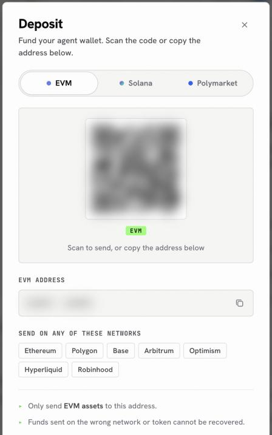
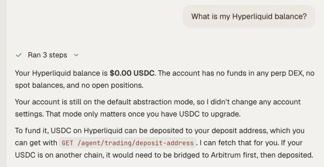

Hyperliquid is its own chain, and the only door in is **USDC on Arbitrum**. Not USDT, not USDC.e, not USDC on another network. Once your USDC is on Arbitrum, getting it onto Hyperliquid is one confirmed step, and the same balance then covers perps, spot, stock perps and outcome markets.

<Frame caption="Step one of the easy route: the EVM tab, sending on Arbitrum">
  
</Frame>

## Pick your route

<Tabs>
  <Tab title="Through your OpenFinance wallet (easiest)">
    <Steps>
      <Step title="Send USDC on Arbitrum to your wallet">
        Open the Deposit sheet, stay on the **EVM** tab, and send USDC on **Arbitrum** to your address.
      </Step>
      <Step title="Move it onto Hyperliquid">
        Ask the agent:

        ```text
        Deposit 50 USDC from my Arbitrum wallet to my Hyperliquid account. Show me the summary first.
        ```

        Check the summary and confirm. Your Hyperliquid balance is credited within minutes.
      </Step>
    </Steps>
  </Tab>
  <Tab title="Straight from an exchange">
    <Steps>
      <Step title="Get your Hyperliquid deposit address">
        Ask "What is my Hyperliquid deposit address, and which token and network does it accept?". The address lives on Arbitrum.
      </Step>
      <Step title="Send USDC on Arbitrum">
        From your exchange or wallet, send USDC on the **Arbitrum** network to that address. Send a small test amount first if you have never used it.
      </Step>
    </Steps>
  </Tab>
</Tabs>

<Warning>
Send only USDC, and only on Arbitrum. Hyperliquid does not accept other tokens or other networks, and funds sent the wrong way cannot be recovered.
</Warning>

## If your USDC is somewhere else

Most people do not start with USDC on Arbitrum, and that is fine. The agent can bridge it there first, then deposit.

```text
Bridge all my USDC on Base to Arbitrum, then deposit it to Hyperliquid. Show each quote first.
```

Starting from rupees? Buy USDC on Polygon with UPI, bridge it to Arbitrum, then deposit. The [funding guide](/guides/fund-each-venue) walks through that route step by step, and [Fund with card or bank](/markets/fund-with-card-or-bank) covers buying crypto in the first place.

## Check your balance

Ask "What is my Hyperliquid balance?". You get one USDC figure, because OpenFinance uses Hyperliquid's unified account, where spot and perp USDC share one pool.

<Frame caption="One USDC balance for spot and perps">
  
</Frame>

## Getting money back out

Withdrawals go to Arbitrum, to the same address, and take about five minutes. Ask "Withdraw 50 USDC from Hyperliquid to Arbitrum" and confirm.

## Next

<CardGroup cols={2}>
  <Card title="Hyperliquid" icon="chart-line" href="/markets/hyperliquid">
    Perps, spot and stock perps explained.
  </Card>
  <Card title="Perp with take-profit and stop-loss" icon="route" href="/guides/hyperliquid-perp-with-tp-sl">
    Your first trade, with exits attached.
  </Card>
</CardGroup>
