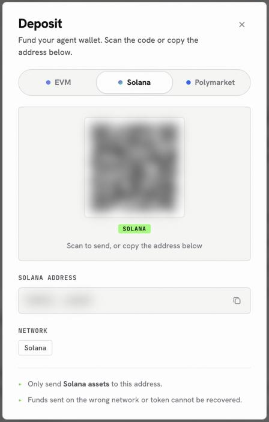
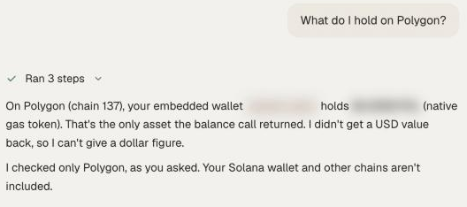

Onchain trades happen in your own wallet, not on a venue. You need the token you will pay with on the chain where the asset trades, plus a small amount of that chain's gas token. Your EVM address is the same on every EVM chain, and your Solana address is separate.

## Which address for which chain

Pick the chain the asset trades on, then send to the matching tab of the Deposit sheet.

| You want to buy | Chain | Deposit tab | Also keep |
| - | - | - | - |
| Memecoins and tokens on Solana | Solana | **Solana** | A little SOL for gas |
| Tokens and tokenized stocks on Base, Ethereum, Arbitrum and other EVM chains | That chain | **EVM** | A little ETH on that chain |
| Tokens on Polygon | Polygon | **EVM** | A little POL |
| Tokens on Robinhood Chain | Robinhood Chain | **EVM** | A little ETH on Robinhood Chain |

The EVM tab lists every network your EVM address accepts: Ethereum, Polygon, Base, Arbitrum, Optimism, Hyperliquid and Robinhood Chain.

## Deposit

<Steps>
  <Step title="Open the Deposit sheet">
    Click **Deposit** in the top bar, then **Deposit** under your wallet total.
  </Step>
  <Step title="Choose EVM or Solana">
    Pick the tab for the chain you are sending on.
  </Step>
  <Step title="Send the token and some gas">
    From your exchange or wallet, send the token you will pay with on that network, and a small amount of the gas token if you do not hold any there yet.
  </Step>
  <Step title="Check it arrived">
    Ask "What do I hold on Base?" or "What is in my Solana wallet?". Ask about one chain at a time; the agent reads chains one by one.
  </Step>
</Steps>

<Frame caption="The Solana tab of the Deposit sheet">
  
</Frame>

<Frame caption="Checking what arrived on one chain">
  
</Frame>

<Warning>
Only send assets for the tab you picked: EVM assets to the EVM address, Solana assets to the Solana address. Funds sent on the wrong network cannot be recovered.
</Warning>

## Already funded on another chain?

You do not need a new deposit to move between chains. Ask the agent to bridge or swap across, and it shows a quote first:

```text
Bridge 100 USDC from Arbitrum to Solana. Show the quote first.
```

See [Bridge and swap](/markets/bridge-and-swap) for how routes and quotes work.

## Next

<CardGroup cols={3}>
  <Card title="Onchain tokens" icon="coins" href="/markets/onchain-tokens">
    Search, check and swap tokens.
  </Card>
  <Card title="Find, check and swap a memecoin" icon="route" href="/guides/solana-memecoin-swap">
    A careful first memecoin trade.
  </Card>
  <Card title="Tokenized stocks and FX" icon="building-columns" href="/guides/tokenized-stocks-and-fx">
    Stocks and currencies as tokens.
  </Card>
</CardGroup>
