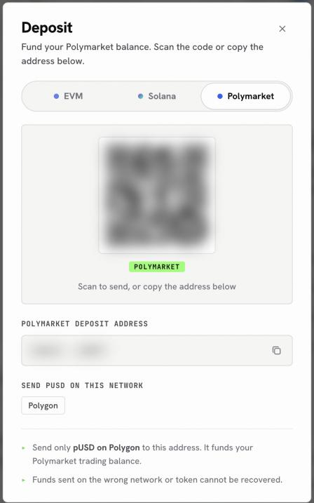
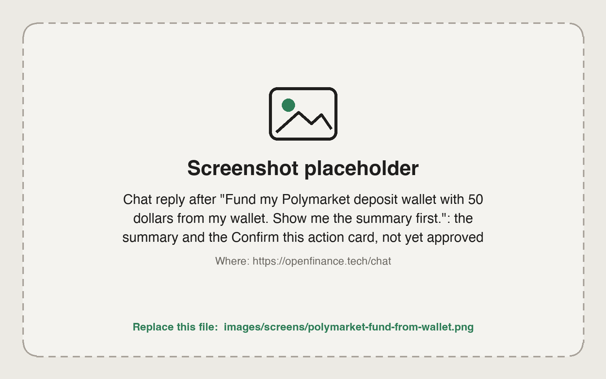
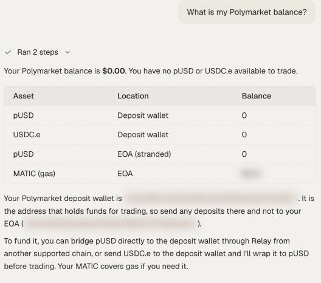

Polymarket orders do not use your main wallet. They draw on a separate **Polymarket deposit wallet** that belongs to your account, and it accepts one thing only: **pUSD on Polygon**. Get that right and funding takes a couple of minutes.

## Find your Polymarket deposit address

<Steps>
  <Step title="Open the Deposit sheet">
    Click **Deposit** in the top bar, then **Deposit** under your wallet total.
  </Step>
  <Step title="Choose the Polymarket tab">
    The sheet shows your Polymarket deposit address, a QR code and the line "Send pUSD on this network: Polygon".
  </Step>
  <Step title="Copy the address">
    Use the copy button rather than retyping it. You can also ask the chat "What is my Polymarket deposit address?".
  </Step>
</Steps>

<Frame caption="The Polymarket tab of the Deposit sheet">
  
</Frame>

If the tab says "Set up your agent first to get a Polymarket deposit address", your account key is still being created, which happens on its own right after sign-up. Close the sheet and open it again in a moment; [External AI](/product/external-ai) shows the key once it is ready.

## Fund it

There are two ways in, depending on where your money is now.

<Tabs>
  <Tab title="From an exchange or another wallet">
    Send **pUSD on Polygon** to the Polymarket deposit address. Nothing else: not USDC on another chain, not USDT. Funds on the wrong network or token cannot be recovered.
  </Tab>
  <Tab title="From your OpenFinance wallet">
    Ask the agent to move funds you already hold, for example:

    ```text
    Fund my Polymarket deposit wallet with 50 dollars from my wallet. Show me the summary first.
    ```

    The agent routes and converts as needed and shows a summary. Nothing is sent until you confirm. If some funds arrive as USDC.e, ask it to convert them to pUSD; the conversion is 1 to 1.
  </Tab>
</Tabs>

<Frame caption="Funding Polymarket from your wallet: the summary waits for your yes">
  
</Frame>

## Check it arrived

Ask "What is my Polymarket balance?". The agent reports what is ready to trade in your deposit wallet. Then head to [Polymarket](/markets/polymarket) to place your first order.

<Frame caption="The agent confirms what is ready to trade">
  
</Frame>

<Note>
The first time you open External AI, a one-time notice reminds you to send only pUSD to Polymarket. It is the same rule as above, shown once so it sticks.
</Note>

## Next

<CardGroup cols={2}>
  <Card title="Polymarket" icon="square-poll-vertical" href="/markets/polymarket">
    How prediction markets work and what to ask.
  </Card>
  <Card title="Polymarket from research to redeem" icon="route" href="/guides/polymarket-research-to-redeem">
    A full trade, end to end.
  </Card>
</CardGroup>
