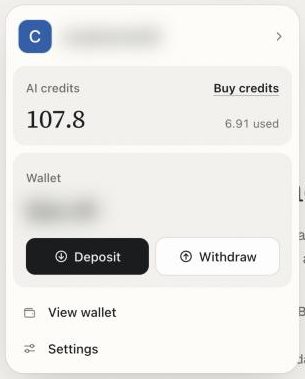

Your account holds two separate balances. Your **funds** are the crypto you trade with, and they live in your own wallet or on a venue such as Hyperliquid. Your **AI credits** pay for the models that read markets and answer you. Topping up one never touches the other.

<CardGroup cols={2}>
  <Card title="Deposit funds" icon="arrow-down-to-bracket" href="/funding/deposit-funds">
    Send crypto to your wallet, then on to the venue you want to trade.
  </Card>
  <Card title="Buy AI credits" icon="sparkles" href="/funding/buy-ai-credits">
    Top up the balance that pays for chat, Alchemy and the inference API.
  </Card>
</CardGroup>

## Where your money goes

Each venue takes one token on one network. Pick the row that matches what you want to do, and the page next to it walks you through it.

| You want to | Send | To | Guide |
| - | - | - | - |
| Trade on Polymarket | pUSD on Polygon | Your Polymarket deposit address | [Deposit for Polymarket](/funding/deposit-polymarket) |
| Trade on Hyperliquid | USDC on Arbitrum | Your wallet, then your Hyperliquid account | [Deposit for Hyperliquid](/funding/deposit-hyperliquid) |
| Buy tokens, tokenized stocks or memecoins | The token you pay with, plus a little gas | Your EVM or Solana address | [Deposit onchain](/funding/deposit-onchain) |
| Use the AI models | USDC, USDT or USDG from your own wallet | The Fund AI credits sheet | [Buy with crypto](/funding/buy-credits-with-crypto) |

<Tip>
No crypto yet? You can buy some with a card, Apple Pay, Google Pay, a bank transfer or UPI, and it lands straight in your wallet. See [Fund with card or bank](/markets/fund-with-card-or-bank).
</Tip>

## Both start in the same place

Click **Deposit** in the top bar of the app. The panel that opens shows your AI credits with a **Buy credits** button, and your wallet total with **Deposit** and **Withdraw**. Everything on this section of the docs starts from one of those buttons.

<Frame caption="The account panel: AI credits at the top, your wallet below">
  
</Frame>

## Next

<CardGroup cols={3}>
  <Card title="Deposit funds" icon="wallet" href="/funding/deposit-funds">
    How the Deposit sheet works.
  </Card>
  <Card title="Buy with crypto" icon="coins" href="/funding/buy-credits-with-crypto">
    Add AI credits in under a minute.
  </Card>
  <Card title="Safety and custody" icon="shield-halved" href="/reference/safety-and-custody">
    Who holds your money once it arrives.
  </Card>
</CardGroup>
