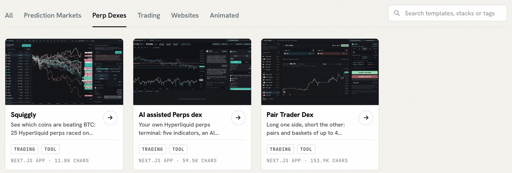
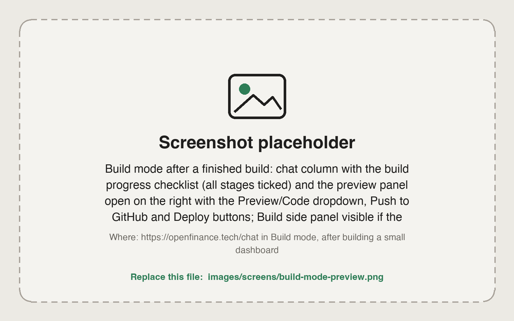

By the end of this guide you will have a working trading tool, such as a funding-rate dashboard or a wallet watchlist, running from your own Vercel account with its code in your own GitHub repository.

[Build mode](/product/build-mode) is the second mode of the OpenFinance chat. You describe an app, the agent writes the code in a private sandbox, shows a live preview, and ships it when you ask. [Mainframe](/mainframe/overview) is a gallery of ready-made templates that start a build with one click. Start from a template when one is close to what you want; start from a prompt when it is not.

<Frame caption="Trading templates on Mainframe, under the Perp Dexes tab">
  
</Frame>

## What you need

- An OpenFinance account with AI credits. Building uses more credits than chatting. See [Models and AI credits](/product/models-and-credits).
- GitHub and Vercel connected, if you want to ship. Connect them from the Build panel or [Connectors](/product/connectors). You can build and preview without them.

## Steps

<Steps>
  <Step title="Pick a starting point">
    **From a template:** open Mainframe, browse a section such as **Perp Dexes** or **Prediction Markets**, open the demo, then click **Deploy**. The chat opens in Build mode with the template as the first message.

    **From a prompt:** open [Chat](https://openfinance.tech/chat), choose **Build** in the toggle, and write your brief.
  </Step>
  <Step title="Write a brief that leaves little to guess">
    Say what the app shows, where the data comes from, how often it refreshes, and how it looks. Name the data source so the agent does not invent one:

    ```text
    Build a one-page dashboard that shows Hyperliquid funding rates for the top 20 perps by open interest, sorted from highest to lowest, with a 24 hour change column, refreshing every minute. Dark theme, one table, no login.
    ```

    ```text
    Build a watchlist page for three Hyperliquid wallets I will paste in. For each wallet show account value, open positions and the largest position, refreshing every 5 minutes. Read-only, no trading.
    ```
  </Step>
  <Step title="Watch the build and open the preview">
    A checklist tracks the build: start the sandbox, write the files, install packages, build the preview and write a summary. The preview opens beside the chat when the build is done.

    <Frame caption="Build mode: the chat with its progress checklist, and the live preview">
      
    </Frame>
  </Step>
  <Step title="Check the numbers, then iterate">
    Compare a few values in the preview with what the chat tells you for the same market. Then ask for one change at a time:

    ```text
    Add a column for open interest in dollars and highlight the five highest rates.
    ```

    ```text
    The preview shows an error on load. Find the cause and fix it.
    ```
  </Step>
  <Step title="Keep your key out of the code">
    Do not paste your `open_` key into the chat or the code; it can trade and move funds. The trading templates are written so that the finished app runs read-only and turns on trading only when a visitor pastes their own key in the browser tab, without storing it in the code or the repository. Switch the preview to **Code** and check that your build does the same.
  </Step>
  <Step title="Ship it">
    ```text
    Push this app to a new GitHub repo, then deploy it to Vercel.
    ```

    The preview is temporary; a deploy gives the app a permanent address on your own Vercel account. If a deploy fails, the chat shows a card with **Reconnect Vercel**, then **Deploy again**.
  </Step>
  <Step title="Test any trading feature small (moves money)">
    If your app can place orders, it trades from the wallet of the key pasted into it. Check that it shows a confirmation before each order, the same rule as OpenFinance itself, and place one small order before you rely on it.
  </Step>
</Steps>

Every trade needs your confirmation, and nothing a built app does is financial advice.

## Check it worked

- The deployed address loads without the chat open.
- Values match what the chat reports for the same market.
- Searching the repository for `open_` finds no key.

## Common mistakes

- **One giant brief.** Start with one clear page, then add features one message at a time.
- **No named data source.** "Show funding rates" invites a guess; "Hyperliquid funding rates" does not.
- **Trusting AI-written code with funds untested.** Review what a bot does and start with small amounts.
- **Running out of credits midway.** Check your balance before a long template. If a run pauses, click **Continue run**.

## Next guides

<CardGroup cols={2}>
  <Card title="Use the inference API in your code" icon="microchip" href="/guides/inference-api-in-your-code">
    Add a model to the app you built.
  </Card>
  <Card title="Mainframe" icon="table-cells-large" href="/mainframe/overview">
    Browse every template.
  </Card>
</CardGroup>
