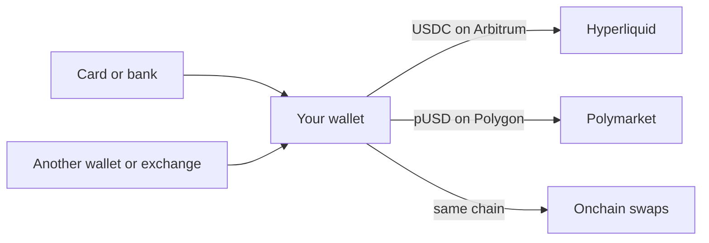
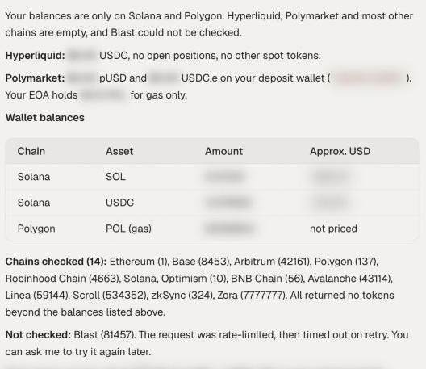

By the end of this guide you will know which balance each venue trades from, you will have funds sitting where your first trade needs them, and you will have checked that they arrived.

The most common reason a first trade fails is money in the wrong place. Your OpenFinance wallet has one EVM address (the same on every EVM chain) and one Solana address, but each venue keeps its own balance. Funds in your wallet are not automatically on Hyperliquid or Polymarket.

## What each venue needs

Here is the balance each kind of trade draws from, and what to send there:

| You want to trade | It trades from | Send this | Where |
| --- | --- | --- | --- |
| Hyperliquid perps, spot, stock perps, outcome markets | Your Hyperliquid account | USDC on Arbitrum only | Your Hyperliquid deposit address |
| Polymarket | Your Polymarket deposit wallet | pUSD on Polygon only | Your Polymarket deposit address |
| Solana tokens | Your Solana address | SOL or the token you pay with | Your Solana address |
| EVM tokens on Ethereum, Base and others | Your EVM address on that chain | The token you pay with, plus gas | Your EVM address |

You also need a little of each chain's native coin (ETH, SOL and so on) for gas on that chain. AI credits for the app chat are a separate balance again and are not covered here; see [Models and AI credits](/product/models-and-credits). The diagram shows how money reaches each venue:



## What you need

- A connected agent or the [app chat](/product/chat).
- Funds somewhere: crypto in another wallet or exchange, or a card, bank account or UPI for an onramp.

## Steps

<Steps>
  <Step title="See where your money is now">
    ```text
    Show my balance on every venue: Hyperliquid, Polymarket, and my wallet on every chain including Solana and Robinhood Chain. Say which chains you checked.
    ```

    The agent reads one chain at a time, so asking it to list the chains it checked tells a real zero apart from a chain it skipped.

    <Frame caption="Balances per venue in chat, with the chains that were checked">
      
    </Frame>
  </Step>
  <Step title="Get the right address">
    Ask for the address of the venue you want, never reuse one from memory:

    ```text
    What is my Hyperliquid deposit address, and which token and network does it accept?
    ```

    ```text
    What is my Polymarket deposit address?
    ```

    You can also open **Deposit** in the app and pick the **EVM**, **Solana** or **Polymarket** tab. See [Wallet](/product/wallet).
  </Step>
  <Step title="Send funds from outside (moves money)">
    From your exchange or other wallet, send exactly the token and network in the table above. Send a small test amount first if you have never used that address.
  </Step>
  <Step title="Or buy with a card, bank or UPI (moves money)">
    ```text
    Give me a link to buy 100 dollars of USDC on Arbitrum with my card.
    ```

    The agent returns a checkout link from Moonpay. You pay on the provider's page and the crypto lands in your wallet. See [Fund with card or bank](/markets/fund-with-card-or-bank).
  </Step>
  <Step title="Move wallet funds onto the venue (moves money)">
    ```text
    Deposit 50 USDC from my Arbitrum wallet to my Hyperliquid account. Show me the summary first.
    ```

    For Polymarket, ask the agent to fund your deposit wallet from what you hold. If funds arrive there as USDC.e, ask it to convert them to pUSD; the conversion is 1 to 1.
  </Step>
</Steps>

Every deposit, bridge and trade needs your confirmation, and nothing here is financial advice.

## Paying in INR

Onramp.money handles INR through UPI, IMPS and bank transfer, and supports a fixed set of token and network pairs. USDC is available on Polygon and BNB Chain only. To reach Hyperliquid from INR:

<Steps>
  <Step title="Buy USDC on Polygon (moves money)">
    ```text
    Give me a link to buy 5000 rupees of USDC on Polygon with UPI.
    ```
  </Step>
  <Step title="Bridge to Arbitrum (moves money)">
    ```text
    Bridge all my USDC on Polygon to Arbitrum. Show the quote first.
    ```
  </Step>
  <Step title="Deposit to Hyperliquid (moves money)">
    ```text
    Deposit that USDC to my Hyperliquid account.
    ```
  </Step>
</Steps>

If you ask for a pair outside the supported list, the agent proposes one that works. The full list is on [Fund with card or bank](/markets/fund-with-card-or-bank).

## Check it worked

Once the funds have landed, ask for both venue balances:

```text
What is my Hyperliquid balance? And my Polymarket balance?
```

Hyperliquid should show one USDC figure. Polymarket should show pUSD that is ready to trade.

## Common mistakes

- **USDT or USDC.e to Hyperliquid.** Hyperliquid accepts USDC only, deposited from Arbitrum.
- **pUSD to your main wallet address.** It is not tradeable on Polymarket until it is moved to the deposit wallet.
- **No gas on the chain you swap or bridge from.** Keep a little native coin there.
- **Expecting the onramp to fund a venue directly.** It delivers to your wallet. Depositing is a second step.
- **Checking one chain and concluding the wallet is empty.** Ask for every chain.

## Next guides

<CardGroup cols={2}>
  <Card title="Move funds between chains" icon="bridge" href="/guides/move-funds-between-chains">
    Bridges in detail, with status checks.
  </Card>
  <Card title="Polymarket from research to redeem" icon="square-poll-vertical" href="/guides/polymarket-research-to-redeem">
    Your first prediction market trade.
  </Card>
</CardGroup>
