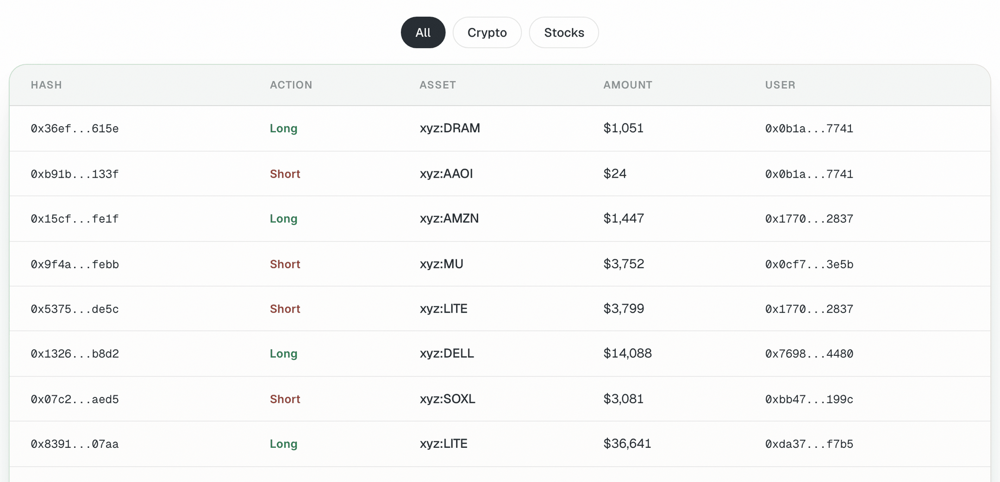
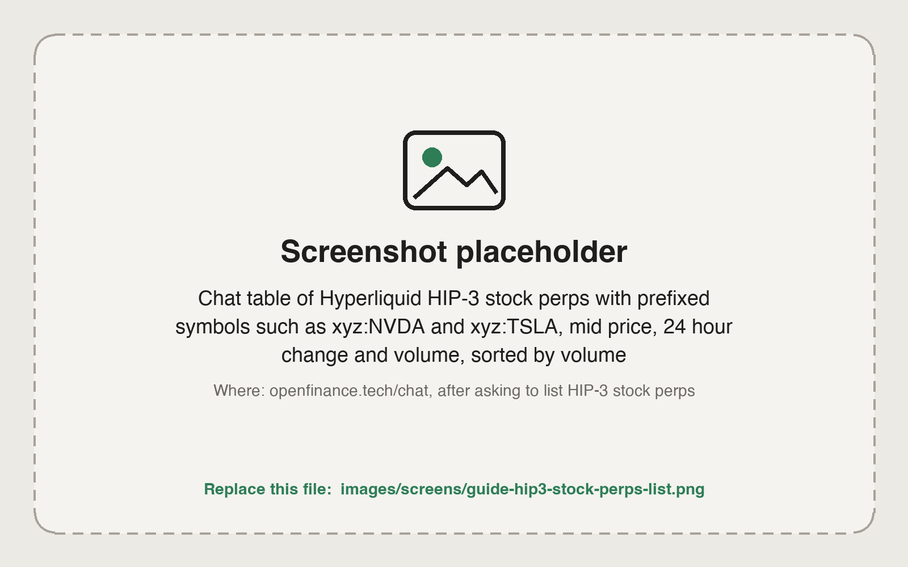

By the end of this guide you will have found a stock, index, commodity or FX perp on Hyperliquid, checked who runs it and what collateral it uses, and opened a small position with a stop-loss.

These markets are **HIP-3 perps**: perps listed on Hyperliquid by independent deployers. Their symbols carry the deployer's prefix, for example `xyz:NVDA`. A stock perp gives price exposure only, with leverage, funding and liquidation risk; you never hold a share or a token. If you want to hold a token instead, see [Tokenized stocks and FX tokens](/guides/tokenized-stocks-and-fx).

<Frame caption="Live Transactions shows HIP-3 orders landing on Hyperliquid, with the deployer prefix on each asset">
  
</Frame>

## What you need

- USDC in your Hyperliquid account. See [Fund each venue](/guides/fund-each-venue).
- The ticker you are interested in, and a plan for size, leverage and the stop.

## Steps

<Steps>
  <Step title="List the markets in a category">
    ```text
    List the HIP-3 stock perps on Hyperliquid. Show symbol, mid price, 24 hour change and volume, sorted by volume.
    ```

    Categories are crypto, stocks, commodities, indices, fx and preipo. Swap "stock" for "FX" or "commodity" to browse the others.

    <Frame caption="HIP-3 stock perps listed in chat with their deployer prefixes">
      
    </Frame>
  </Step>
  <Step title="Check the one you want">
    The same ticker can be listed by more than one deployer. Ask about the exact symbol:

    ```text
    Tell me about xyz:NVDA: the deployer prefix, maximum leverage, funding rate, open interest, 24 hour volume and which collateral token this market uses.
    ```

    Low open interest and volume mean a thin book and more slippage. Most HIP-3 markets use USDC as collateral; a few use USDH, and the agent tells you if yours does.
  </Step>
  <Step title="Get USDH only if the market needs it (moves money)">
    ```text
    Swap 50 USDC to USDH on Hyperliquid spot.
    ```

    Skip this step for markets that use USDC.
  </Step>
  <Step title="Preview the order with a stop">
    ```text
    Long 200 dollars of xyz:NVDA at 2x isolated, with a stop-loss 4% below entry. Show me the size, the price, the liquidation price and the stop before placing anything.
    ```
  </Step>
  <Step title="Place it (moves money)">
    Reply yes if the summary matches. Then verify:

    ```text
    Show my positions on every Hyperliquid dex and my open trigger orders.
    ```

    One account summary covers the main dex and every HIP-3 dex, so the position shows with the rest.
  </Step>
  <Step title="Close when you are done (moves money)">
    ```text
    Close my xyz:NVDA position at market, reduce-only, and cancel its stop-loss.
    ```
  </Step>
</Steps>

Every order needs your confirmation, and nothing here is financial advice. Leverage can lose your whole margin.

## Example prompts for FX and commodities

The same steps work beyond stocks. Start with prompts like these:

```text
What FX perps are listed on Hyperliquid right now? Show funding and open interest.
```

```text
Short 100 dollars of EUR/USD on Hyperliquid at 2x with a 1% stop. Show the order first.
```

```text
Which commodity perps have the highest volume today?
```

## Check it worked

- The position appears under the right dex prefix with the size you approved.
- The stop-loss is resting as a reduce-only trigger order.

## Common mistakes

- **Mixing up deployers.** `xyz:NVDA` and another prefix's NVDA are different markets with different books and terms. Always name the full symbol.
- **Expecting a share.** A perp has no shareholder rights, dividends or delivery.
- **"Insufficient collateral" on a USDH market.** The error names the asset the market needs. Swap USDC to USDH on Hyperliquid spot, then retry.
- **Using the readable symbol in your own code.** Orders need the numeric asset index from the market metadata. See the [Hyperliquid tool](/mcp/tools-hyperliquid).
- **Sizing from the headline price.** Check the mid price on Hyperliquid, which can differ from the stock's last close.

## Next guides

<CardGroup cols={2}>
  <Card title="Perp with take-profit and stop-loss" icon="chart-line" href="/guides/hyperliquid-perp-with-tp-sl">
    Exits in depth.
  </Card>
  <Card title="Live Transactions" icon="bolt" href="/product/live-transactions">
    Watch large orders as they land.
  </Card>
</CardGroup>
