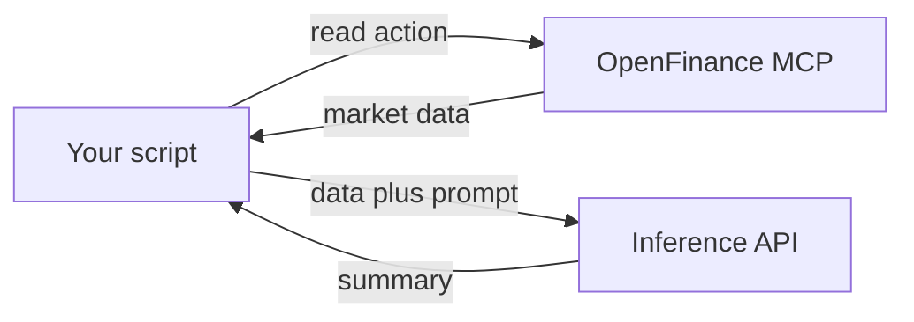

By the end of this guide you will have a script that pulls live Hyperliquid market data, sends it to a model through the OpenFinance inference API, and prints a short brief, all with your one OpenFinance key.

The [inference API](/inference/overview) is an OpenAI-compatible endpoint at `https://api.openfinance.tech/agent/v1`. It returns text and is billed in AI credits. It cannot trade by itself. The [MCP server](/mcp/overview) gives code the market data and trading tools. This guide uses the inference API for the model and only **read** actions from the MCP server, so the script never places an order.



## What you need

- Your `open_` key from [External AI](/product/external-ai). Please make an account at [openfinance.tech](https://openfinance.tech) to get your keys.
- AI credits on your account. See [Models and AI credits](/product/models-and-credits).
- Node.js and a terminal. The same idea works in Python with the OpenAI SDK; see [Examples](/inference/examples).

## Steps

<Steps>
  <Step title="Store the key in your environment">
    ```bash
    export OPENFINANCE_API_KEY="open_..."
    ```

    The same key trades and moves funds, so keep it on your machine or server only. Never put it in a browser app, a mobile app or a repository.
  </Step>
  <Step title="Check credits and pick a model">
    ```bash
    curl https://api.openfinance.tech/agent/chat/credits \
      -H "x-api-key: $OPENFINANCE_API_KEY"

    curl https://api.openfinance.tech/agent/v1/models \
      -H "Authorization: Bearer $OPENFINANCE_API_KEY"
    ```

    Look at `availableCredits`, then choose a model id from the list. Ids use a `provider/model` form. A smaller model is enough while you test.
  </Step>
  <Step title="Install the two client libraries">
    ```bash
    npm install openai @modelcontextprotocol/sdk
    ```
  </Step>
  <Step title="Write the script">
    Save this as `brief.mts` (the `.mts` ending lets it use top-level `await`):

    ```ts
    import OpenAI from "openai";
    import { Client } from "@modelcontextprotocol/sdk/client/index.js";
    import { StreamableHTTPClientTransport } from "@modelcontextprotocol/sdk/client/streamableHttp.js";

    const key = process.env.OPENFINANCE_API_KEY!;

    // 1. Read-only market data from the MCP server
    const mcp = new Client({ name: "funding-brief", version: "1.0.0" });
    await mcp.connect(
      new StreamableHTTPClientTransport(new URL("https://api.openfinance.tech/agent/mcp"), {
        requestInit: { headers: { "x-api-key": key } },
      }),
    );
    const result = await mcp.callTool({
      name: "hyperliquid",
      arguments: { action: "get_market_metas", kind: "all" },
    });
    await mcp.close();

    // The response is large. Trim it to save credits, or keep only the fields you need.
    const data = (result.content as { type: string; text?: string }[])
      .map((part) => part.text ?? "")
      .join("")
      .slice(0, 40000);

    // 2. Ask a model to summarize it
    const ai = new OpenAI({ apiKey: key, baseURL: "https://api.openfinance.tech/agent/v1" });
    const reply = await ai.chat.completions.create({
      model: "anthropic/claude-fable-5.1",
      messages: [
        { role: "system", content: "You summarize market data in plain words. You never give trading advice." },
        {
          role: "user",
          content: `From this Hyperliquid market data, list the five perps with the highest and the five with the lowest funding rate, with open interest:\n\n${data}`,
        },
      ],
    });

    console.log(reply.choices[0].message.content);
    ```
  </Step>
  <Step title="Run it">
    ```bash
    npx tsx brief.mts
    ```

    You should see a short list of perps with funding rates and open interest. This uses AI credits and places no trades.
  </Step>
  <Step title="Check what it cost">
    Run the credits call from step 2 again and compare `usageCredits`. Larger models and longer inputs cost more.
  </Step>
</Steps>

## Make it yours

- **Change the data.** Swap the action: `get_perp_categories` for HIP-3 markets, or the `polymarket` tool with `search` for prediction markets. Every action is listed in the [tool reference](/mcp/overview).
- **Run it on a schedule** with cron or your host's scheduler, and send the output to wherever you read it.
- **Stream the reply** by setting `stream: true`. See [Examples](/inference/examples).

## Keep it read-only

A script that only summarizes should only call read actions. If you later add trading, show a summary to a person and wait for a yes before each write, the same rule the OpenFinance tools follow. Every trade needs the user's confirmation, and nothing a model writes is financial advice.

## Check it worked

- The script prints a summary that matches what the chat says for the same markets.
- Your credit usage went up by a small amount.

## Common mistakes

- **Rejected for an invalid key.** Check that the value starts with `open_`. Either `Authorization: Bearer` or `x-api-key` works on the inference API.
- **Rejected for insufficient credits.** Top up in the app and retry.
- **Sending a huge payload.** Trim market data before you send it. Credits scale with input length.
- **A `429`.** You are calling too fast. Slow the loop down.
- **Hard-coding a model list.** Read ids from `GET /models`; the list changes.

## Next guides

<CardGroup cols={2}>
  <Card title="Build a trading dashboard or bot" icon="hammer" href="/guides/build-trading-dashboard">
    Let Build mode write the app for you.
  </Card>
  <Card title="Inference examples" icon="code" href="/inference/examples">
    curl, Python and streaming.
  </Card>
</CardGroup>
