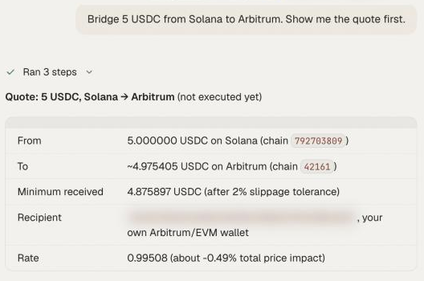

By the end of this guide you will have moved funds from the chain they sit on to the chain your next trade needs, read the quote before sending, and confirmed that the transfer finished.

A bridge moves value from one blockchain to another. OpenFinance routes bridges and cross-chain swaps through Relay. The agent picks the route for you: a swap between two Solana tokens goes through Jupiter, and a send on one chain with no token change is a plain transfer. See [Bridge and swap](/markets/bridge-and-swap) for how it works.

## What you need

- Funds on the chain you are leaving, plus a little of that chain's native coin for gas.
- A clear destination: which chain and which token your next trade needs. The table in [Fund each venue](/guides/fund-each-venue) lists them.

## Steps

<Steps>
  <Step title="Find what you hold and where">
    ```text
    What do I hold on every chain, in dollars? Include Solana and Robinhood Chain, and say which chains you checked.
    ```
  </Step>
  <Step title="Ask for a quote, not a transfer">
    Name the source chain, the token, the amount and the destination:

    ```text
    Quote bridging 100 USDC from Base to Arbitrum. Do not send anything yet.
    ```

    A good quote shows what leaves, what is expected to arrive and the route. A quote is free and sends nothing.

    <Frame caption="A bridge quote in chat: what leaves, what arrives and the route">
      
    </Frame>
  </Step>
  <Step title="Check the quote">
    Before you say yes, check three things:

    - **The destination is your own wallet.** Bridges from an agent can only go to your own addresses; the server refuses anything else.
    - **The amount that arrives** is what your trade needs.
    - **The token on arrival** is the one the venue accepts, for example USDC on Arbitrum for Hyperliquid.
  </Step>
  <Step title="Confirm the bridge (moves money)">
    Reply yes, or ask for a fresh quote if you waited a while or changed the amount. Quotes expire.

    The agent signs each step with your wallet and waits for a final result for up to about five minutes.
  </Step>
  <Step title="Track it to the end">
    ```text
    What is the status of my last bridge?
    ```

    A transfer ends as **success**, **refunded** or **failure**. While it is in progress you may see waiting, pending or submitted.
  </Step>
  <Step title="Continue to the trade (moves money)">
    Bridging and depositing can be chained, with a confirmation at each step:

    ```text
    Now deposit the USDC that arrived on Arbitrum to my Hyperliquid account.
    ```
  </Step>
</Steps>

Every bridge and swap needs your confirmation, and nothing here is financial advice.

## Useful combinations

Most trips follow one of a few patterns, and you can paste the Ask column as it is:

| You have | You need | Ask |
| --- | --- | --- |
| USDC on Base or Polygon | Hyperliquid | "Bridge my USDC to Arbitrum, then deposit it to Hyperliquid." |
| USDC on Solana | An EVM chain | "Move 50 USDC from Solana to Base. Quote first." |
| ETH on Arbitrum | SOL for Solana swaps | "Swap 0.05 ETH on Arbitrum for SOL on Solana. Quote first." |
| ETH on Base | USDC on Base | "Swap 0.05 ETH for USDC on Base." |

## Check it worked

When the status reads success, look at where the funds landed:

```text
Show my balance on the destination chain.
```

The amount should match the quote, give or take a small difference.

## Common mistakes

- **No gas on the starting chain.** The first transaction is paid on the chain you leave.
- **No native coin at the destination on Solana routes.** On routes that touch Solana, the automatic gas top-up is switched off.
- **Trying to bridge to a friend.** Agent bridges go to your own wallets only. To pay someone else, use the [Wallet](/product/wallet) page.
- **Panicking at "refunded".** Refunded means the route could not complete and funds were returned. Ask for the status details and a new quote.
- **A 412 on a route from Solana.** Your Solana wallet is not yet enabled for agent trading. Follow the instructions in the error.

## Next guides

<CardGroup cols={2}>
  <Card title="Hyperliquid perp with take-profit and stop-loss" icon="chart-line" href="/guides/hyperliquid-perp-with-tp-sl">
    Use the funds you just moved.
  </Card>
  <Card title="Relay tools" icon="wrench" href="/mcp/tools-relay">
    Quote and execute parameters for your own code.
  </Card>
</CardGroup>
