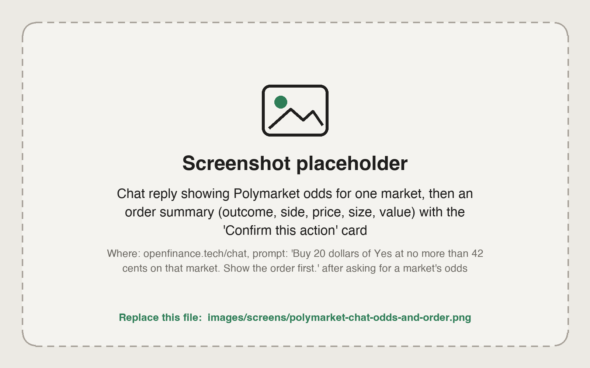
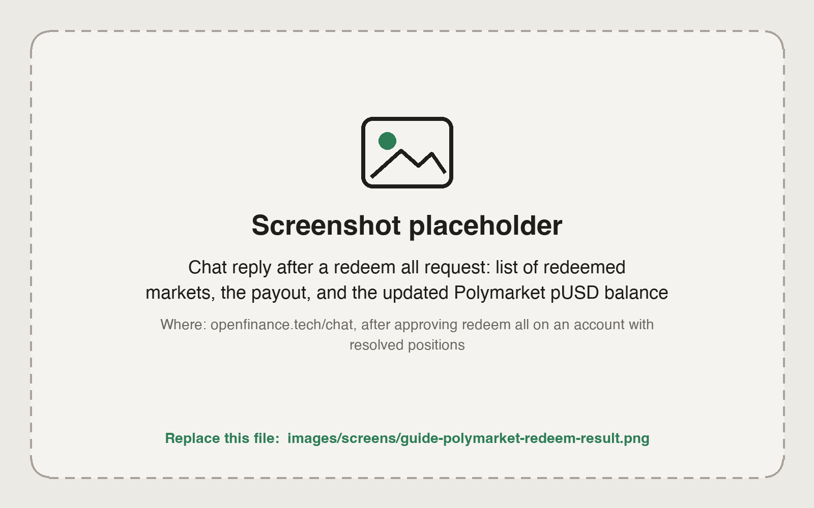

By the end of this guide you will have researched a Polymarket market, placed a limit order from your deposit wallet, followed it until the market resolved, and redeemed and withdrawn the result.

On Polymarket a share price is a probability between 0 and 1. A Yes share at 0.42 costs 42 cents and pays 1 dollar if Yes wins. Polymarket trades from a separate **deposit wallet** that holds **pUSD**, not from your main wallet address. See [Polymarket](/markets/polymarket).

## What you need

- pUSD in your Polymarket deposit wallet, or funds you can move there. See [Fund each venue](/guides/fund-each-venue).
- Polymarket available where you live. Polymarket features are not available where Polymarket itself is not.

## Steps

<Steps>
  <Step title="Find the market">
    ```text
    Search Polymarket for markets on the next Fed rate decision. Show the top five by volume with their current Yes prices and end dates.
    ```

    Pick one market. Many events group several markets, so make sure you are looking at the exact question you want to trade.
  </Step>
  <Step title="Read the rules and the book">
    ```text
    For that market, show the full question and resolution rules, the order book for Yes and No, the spread, the last trade price and the tick size.
    ```

    A wide spread or a thin book means a market order could fill well away from the mid price. The tick size is the smallest price step; your limit price must sit on it.
  </Step>
  <Step title="Check your balance">
    ```text
    What is my Polymarket balance, and where does the pUSD sit?
    ```

    The answer should show pUSD in the deposit wallet. If it is on your main address or arrived as USDC.e, ask the agent to move or convert it first.
  </Step>
  <Step title="Preview a limit order">
    ```text
    Buy 20 dollars of Yes on that market at no more than 0.42. Use a limit order, good till cancelled. Show me the order before placing it.
    ```

    The summary should name the market, the outcome, the side, the price, the number of shares and the total cost.

    <Frame caption="A Polymarket limit order summary waiting for confirmation">
      
    </Frame>
  </Step>
  <Step title="Place it (moves money)">
    Reply yes if every field matches. Then check it:

    ```text
    Show my open Polymarket orders.
    ```

    A limit order rests until it fills, you cancel it, or its expiry passes if you set one.
  </Step>
  <Step title="Follow the position">
    ```text
    What are my open Polymarket positions, with average price, current price and profit and loss?
    ```

    To get out early, sell the shares: "Sell all my Yes shares on that market at 0.55 or better."
  </Step>
  <Step title="Redeem after resolution (moves money)">
    ```text
    Redeem all my resolved Polymarket positions, then show my balance.
    ```

    Redeeming does not cost you gas. Some payouts arrive as USDC.e; ask "Convert my USDC.e to pUSD" to make them tradeable again.

    <Frame caption="Resolved positions redeemed in one step, with the new balance">
      
    </Frame>
  </Step>
  <Step title="Withdraw if you want to cash out (moves money)">
    ```text
    Withdraw 50 pUSD from Polymarket to USDC on Base, to my own wallet.
    ```

    Withdrawals go through Polymarket's bridge, to your own wallets only.
  </Step>
</Steps>

Every order, redeem and withdrawal needs your confirmation, and nothing here is financial advice. Shares on the losing side go to zero.

## Check it worked

- The order appears in your open orders, or as a position once filled.
- After redeeming, the resolved market is gone from your positions and your pUSD balance went up by the payout.

## Common mistakes

- **Rejected for balance with pUSD in your wallet.** The pUSD is on your main address, not the deposit wallet.
- **Rejected for tick size.** Round the price to the market's tick.
- **Very small orders.** Polymarket rejects orders below about one dollar of value.
- **Trading the label, not the rules.** Read how the market resolves before you buy.
- **Market orders in thin books.** Use a limit price when the spread is wide.

## Next guides

<CardGroup cols={2}>
  <Card title="Track other traders" icon="binoculars" href="/guides/track-other-traders">
    Read the leaderboard and any trader's positions.
  </Card>
  <Card title="Hyperliquid outcome markets" icon="circle-half-stroke" href="/guides/hyperliquid-outcome-markets">
    Yes or No markets on Hyperliquid.
  </Card>
</CardGroup>
