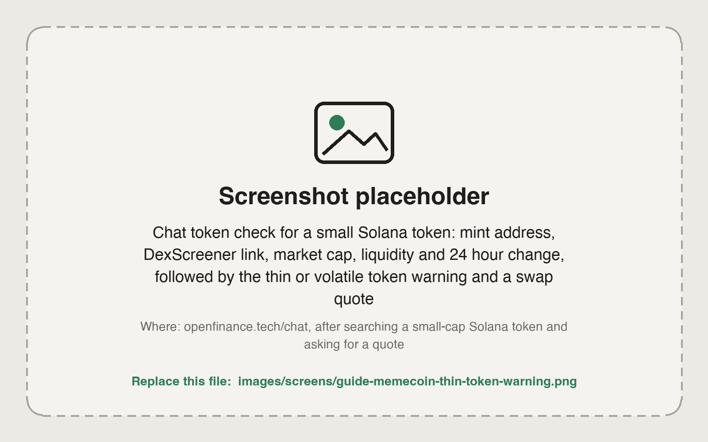

By the end of this guide you will have found a Solana token by name, confirmed it is the contract you meant, read its liquidity numbers and any warning, and swapped into it and back out through Jupiter.

Memecoins are cheap to create and easy to copy, so the swap itself is the easy part. That is why OpenFinance builds the token and liquidity checks into the swap flow. Swaps between two Solana tokens go through Jupiter and land in your own Solana wallet. See [Onchain tokens](/markets/onchain-tokens).

## What you need

- SOL in your Solana wallet, for the swap and for gas. See [Fund each venue](/guides/fund-each-venue).
- A Solana wallet enabled for agent trading. If it is not, the first swap returns a 412 error with instructions to follow.

## Steps

<Steps>
  <Step title="Search by name">
    ```text
    Find BONK on Solana. Show the top matches with contract address, price, market cap, liquidity and 24 hour volume.
    ```

    Many tokens share a name. The agent picks the match with the most liquidity, and if several are close it shows the top few and asks which one you mean.
  </Step>
  <Step title="Verify the contract yourself">
    The agent gives you a DexScreener chart link for the token. Open it and check that the contract address, the chart and the pool look like the project you expect. If you have the contract address from the project's own site, paste it instead of the name:

    ```text
    Look up this Solana token by address: <paste the mint address>
    ```
  </Step>
  <Step title="Read the thin-token warning">
    The agent warns you before any swap when a token's market cap is below 10 million dollars, its liquidity is below 250 thousand dollars, or it moved more than 30% in a day. The warning states all three numbers. It means slippage and rug risk are high, so only swap an amount you can afford to lose.

    <Frame caption="A token check in chat: contract, market cap, liquidity, chart link and a thin-token warning">
      
    </Frame>
  </Step>
  <Step title="Get a quote">
    ```text
    Quote swapping 0.2 SOL for that token. Show the estimated output, price impact, slippage and route. Do not execute yet.
    ```

    If you name only one token, the other side defaults to SOL. Say "pay with USDC" if you want that instead. A high price impact on a small amount is a sign the pool is thin.
  </Step>
  <Step title="Swap (moves money)">
    Reply yes only if the token, amount and output match. Solana swaps cannot be reversed once they succeed.
  </Step>
  <Step title="Check what arrived">
    ```text
    Show my Solana holdings with dollar values.
    ```
  </Step>
  <Step title="Sell when you choose (moves money)">
    ```text
    Sell half of my BONK for SOL. Quote first.
    ```
  </Step>
</Steps>

Every swap needs your confirmation, and nothing here is financial advice. Most memecoins lose value.

## Check it worked

- The token in your holdings has the same mint address you verified in step 2.
- The amount received is close to the quote's estimate.

## Common mistakes

- **Buying the copy.** A token with the right name and the wrong address is a different token. Check the mint.
- **Ignoring price impact.** On a thin pool, a larger order can move the price against you a lot. Split it or size down.
- **No SOL left for gas.** Keep a little SOL after the swap.
- **Trusting a token's description or a link inside it.** Verify the address from a source you trust.
- **Expecting sniping or automatic buys.** Every swap is quoted and confirmed by you.
- **Tokens still on a launch curve.** A token launched on a bonding curve trades on that curve until it graduates. See [Token launches](/markets/token-launches).

## Next guides

<CardGroup cols={2}>
  <Card title="Tokenized stocks and FX tokens" icon="landmark" href="/guides/tokenized-stocks-and-fx">
    The same checks for stock and currency tokens.
  </Card>
  <Card title="Onchain and Jupiter tools" icon="wrench" href="/mcp/tools-onchain">
    The swap tools for your own code.
  </Card>
</CardGroup>
