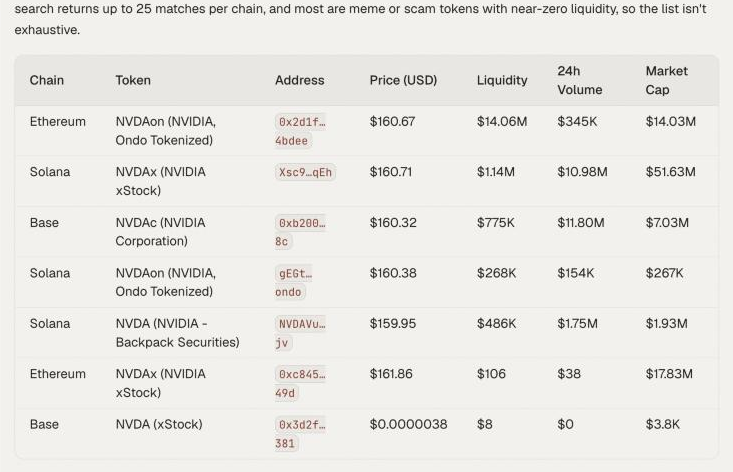

By the end of this guide you will have found a tokenized stock or FX token, picked the version with real liquidity on the right chain, and swapped into it so it sits in your own wallet.

A **tokenized stock** is a token that tracks a share price. It is not the share: rights, redemption and dividends depend on the issuer, and some give no legal claim on the underlying. An **FX token** is usually a stablecoin tied to a currency other than the dollar. Both trade like any other token: on Solana through Jupiter, on EVM chains through Relay. If you want leverage instead of holding a token, see [Stock and FX perps](/guides/hyperliquid-stock-perps).

## What you need

- Funds on the chain where the token you want lives, plus gas. You will find out which chain in step 1.
- Time to read the issuer's terms, including where the token is available.

## Steps

<Steps>
  <Step title="Find every version of the token">
    ```text
    Search for tokenized NVDA tokens on Solana, Base and Ethereum. For each match show the issuer if known, chain, contract address, price, market cap, liquidity and 24 hour volume.
    ```

    The same stock can exist as several tokens from different issuers on different chains.

    <Frame caption="Tokenized versions of one stock across chains, with liquidity for each">
      
    </Frame>
  </Step>
  <Step title="Pick the one with real liquidity">
    Prefer the version with the deepest liquidity and steady volume. Compare its price with the stock's own price; a large gap means the pool is thin or the price is stale. Open the chart link the agent gives you and confirm the contract.
  </Step>
  <Step title="Read the issuer's terms">
    Check what the token gives you, how dividends are handled, and whether it is offered where you live. OpenFinance shows you the token; the issuer sets its rules.
  </Step>
  <Step title="Fund that chain (moves money)">
    ```text
    I want to buy that token on Solana. Do I have enough USDC or SOL there? If not, bridge 100 USDC from Base to Solana. Quote first.
    ```

    See [Move funds between chains](/guides/move-funds-between-chains).
  </Step>
  <Step title="Get a quote">
    ```text
    Quote buying 100 dollars of that NVDA token with USDC. Show output, price impact and route. Do not execute yet.
    ```

    On Solana, say "with USDC" if you want to pay in USDC; otherwise the other side defaults to SOL.
  </Step>
  <Step title="Swap (moves money)">
    Reply yes if the token address and amounts match. Onchain swaps cannot be reversed.
  </Step>
  <Step title="Check the holding">
    ```text
    Show my holdings on Solana with dollar values.
    ```
  </Step>
</Steps>

Every swap needs your confirmation, and nothing here is financial advice.

## FX tokens

The flow is the same. Start with a search:

```text
Find euro stablecoins on Base and Solana with the most liquidity. Show issuer, address and liquidity.
```

Then quote, confirm and check, as above.

## Spot token or perp

If you are still choosing between holding a token and trading a perp, these are the main differences:

| | Tokenized stock or FX token | Stock or FX perp on Hyperliquid |
| --- | --- | --- |
| You hold | A token in your own wallet | A leveraged position |
| Leverage and funding | No | Yes |
| Liquidation risk | No, price risk only | Yes |
| Where | Solana and EVM chains | Hyperliquid HIP-3 markets |

## Check it worked

- The token in your wallet has the contract address you chose in step 2.
- The value roughly tracks the stock or currency it follows.

## Common mistakes

- **Buying the thinnest version.** A token with little liquidity can trade far from the stock price, and selling can cost more than buying.
- **Assuming shareholder rights.** Read the issuer's terms.
- **Funding the wrong chain.** USDC on Base cannot pay for a swap on Solana until you bridge it.
- **Checking one chain for holdings.** Ask the agent to check every chain, including Robinhood Chain if you hold tokens there.

## Next guides

<CardGroup cols={2}>
  <Card title="Stock and FX perps on Hyperliquid" icon="building-columns" href="/guides/hyperliquid-stock-perps">
    Leveraged exposure instead of a token.
  </Card>
  <Card title="Options" icon="file-contract" href="/markets/options">
    Options go through your own broker account in the app.
  </Card>
</CardGroup>
