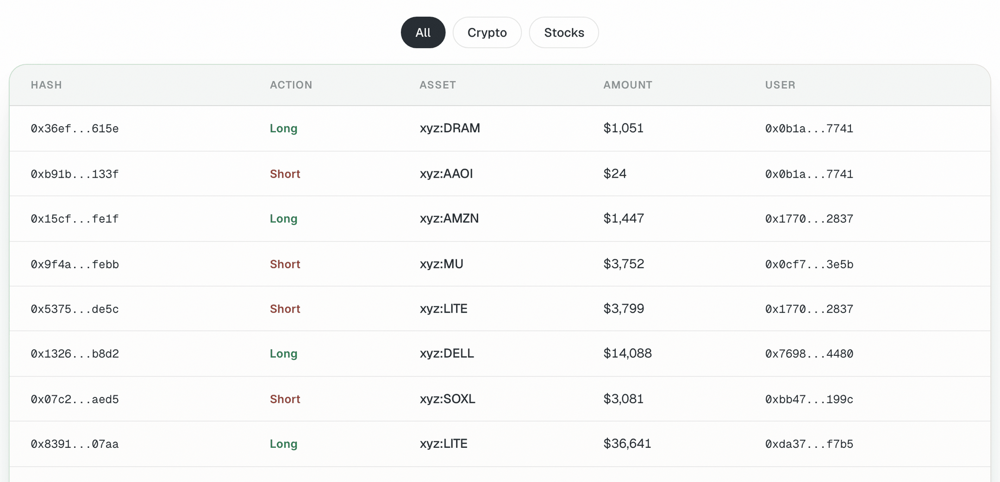

By the end of this guide you will have a watchlist of Hyperliquid wallets and Polymarket traders, a way to read what they hold and how they have done, and a habit for turning what you see into your own decisions.

Positions on Hyperliquid and Polymarket are public. OpenFinance can read any address on both venues, so your agent can compare wallets, follow a trader's activity and read the Polymarket leaderboard. It does **not** copy trades automatically: if you want to mirror a position, you place your own order and confirm it like any other.

## What you need

- A connected agent. Reading other traders moves no money.
- Addresses to follow. Good sources are the Polymarket leaderboard (step 4) and the [Live Transactions](/product/live-transactions) page for large Hyperliquid orders.

<Frame caption="The User column on Live Transactions links each large Hyperliquid order to a trader address">
  
</Frame>

## Steps

<Steps>
  <Step title="Read one Hyperliquid wallet">
    ```text
    What is Hyperliquid wallet 0x... holding? Show positions on every dex with size, entry, unrealized profit and loss and leverage, plus open orders.
    ```

    Account reads work for any address. Copy the full address from the explorer; the table shows it shortened.
  </Step>
  <Step title="Compare several wallets at once">
    ```text
    Compare these Hyperliquid wallets in one table: 0x..., 0x..., 0x.... For each, show account value, open positions and the largest position by size.
    ```

    The agent fetches every wallet in one request, across the main dex, every HIP-3 dex and spot.

  </Step>
  <Step title="Look at a wallet's recent fills">
    ```text
    Show the last 20 fills for Hyperliquid wallet 0x..., with time, market, side, size and price.
    ```

    Fills show what actually traded. Open orders show what the wallet is waiting for.
  </Step>
  <Step title="Find Polymarket traders worth watching">
    ```text
    Who are the top 10 Polymarket traders in sports this month, by profit? Show name, profit, volume and wallet.
    ```

    You can rank by profit or by volume, by category (politics, sports, crypto and others) and by period (day, week, month or all time).
  </Step>
  <Step title="Read a Polymarket trader's record">
    ```text
    For Polymarket wallet 0x..., show open positions, the 10 largest closed positions with realized profit and loss, and overall profit and loss.
    ```

    Closed positions show how a trader actually did, not only what they hold now. A single big win can hide many losses.
  </Step>
  <Step title="Mirror a position yourself, if you choose (moves money)">
    ```text
    That trader holds Yes on this market. Show me the current price and book, and what 15 dollars of Yes would cost me. Do not place it.
    ```

    Decide on your own size. The trader's entry price is not the price you will get. If you go ahead, reply yes to the summary.
  </Step>
</Steps>

Every trade needs your confirmation, and nothing here is financial advice. Someone else's position is not a recommendation.

## Turn it into a routine

Save your watchlist in a note and paste it at the start of a session:

```text
Check my watchlist. Hyperliquid: 0x..., 0x.... Polymarket: 0x.... Tell me what changed since yesterday: new positions, closed positions and size changes. Do not place anything.
```

For a page that refreshes on its own, build a watchlist dashboard. See [Build a trading dashboard or bot](/guides/build-trading-dashboard).

## Check it worked

- The positions the agent reports match what you see on the venue's explorer for that address.
- The Polymarket address you track is the trader's deposit wallet, which is the address the leaderboard gives you.

## Common mistakes

- **Copying late.** By the time you see a position, the price may have moved. Check the book before you size.
- **Copying size.** A large trader's position size says nothing about what fits your account.
- **Mistaking orders for fills.** On Live Transactions, a row is an order; it may fill, partly fill or be cancelled.
- **Reading only open positions.** Look at closed positions and profit and loss over time.
- **Expecting automatic copy trading.** Every order is yours to confirm.

## Next guides

<CardGroup cols={2}>
  <Card title="Polymarket from research to redeem" icon="square-poll-vertical" href="/guides/polymarket-research-to-redeem">
    Place and manage your own order.
  </Card>
  <Card title="Build a trading dashboard or bot" icon="hammer" href="/guides/build-trading-dashboard">
    Turn a watchlist into an app.
  </Card>
</CardGroup>
