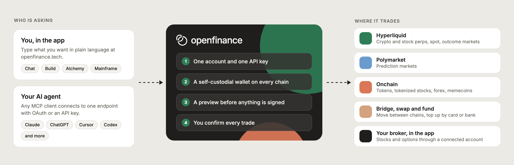

<CardGroup cols={4}>
  <Card title="Quickstart" img="/images/art/quickstart.svg" href="/welcome/quickstart">
    Sign up, fund your wallet and place a first trade in minutes.
  </Card>
  <Card title="What is OpenFinance?" img="/images/art/what-is-openfinance.svg" href="/welcome/what-is-openfinance">
    The product, its pieces and how they fit together.
  </Card>
  <Card title="Connect your agent" img="/images/art/agents.svg" href="/getting-started/quick-install">
    You're an agent, or you run one? Start here.
  </Card>
  <Card title="Mainframe templates" img="/images/art/build.svg" href="/mainframe/overview">
    Start from a ready-made trading tool or app and make it yours.
  </Card>
</CardGroup>

## The OpenFinance platform

Everything in the app works the same way: you say what you want in plain language, OpenFinance shows you what it is about to do, and nothing is traded until you confirm.

<CardGroup cols={3}>
  <Card title="Chat" icon="comments" href="/product/chat">
    Research markets and place trades by asking, with the leading AI models.
  </Card>
  <Card title="Build mode" icon="hammer" href="/product/build-mode">
    Turn a prompt into a working app, then deploy it to your own domain.
  </Card>
  <Card title="Studio" icon="image" href="/product/studio">
    Generate and edit images from a prompt, paid from your AI credits.
  </Card>
  <Card title="Mainframe" icon="table-cells-large" href="/mainframe/overview">
    A gallery of templates you can run, change and ship.
  </Card>
  <Card title="Connectors" icon="plug" href="/product/connectors">
    Plug in your brokerage, GitHub and Vercel accounts.
  </Card>
  <Card title="External AI" icon="key" href="/product/external-ai">
    Your MCP server URL and API key, for the AI tools you already use.
  </Card>
</CardGroup>

## How it fits together

Whether you ask in the app or through your own agent, every request takes the same path.

<Frame caption="You or your agent ask in plain language. OpenFinance previews the action, you confirm, and it trades on the venue.">
  
</Frame>

## Go deeper

When you want more detail, these are the parts you will use most often.

<CardGroup cols={4}>
  <Card title="Markets" img="/images/art/markets.svg" href="/markets/overview">
    Every market you can trade and the venue behind it.
  </Card>
  <Card title="Alchemy" img="/images/art/alchemy.svg" href="/alchemy/overview">
    Type an event or a thesis and get the trades that express it.
  </Card>
  <Card title="Wallet" img="/images/art/wallet.svg" href="/product/wallet">
    A self-custodial wallet on every chain, created when you sign up.
  </Card>
  <Card title="Models and AI credits" img="/images/art/inference.svg" href="/product/models-and-credits">
    Pick the model for the job and see how credits are spent.
  </Card>
</CardGroup>

## What you can trade

One account reaches every market below. Each guide explains the venue first, then shows what to ask for. To get money onto a venue, start with [Deposit and buy credits](/funding/overview).

<CardGroup cols={3}>
  <Card title="Hyperliquid perps and spot" icon="chart-line" href="/markets/hyperliquid">
    Crypto, stock, commodity and FX perps, plus spot.
  </Card>
  <Card title="Outcome markets" icon="scale-balanced" href="/markets/hyperliquid-outcomes">
    Yes or No markets on Hyperliquid.
  </Card>
  <Card title="Polymarket" icon="square-poll-vertical" href="/markets/polymarket">
    Prediction markets on politics, sports, crypto and culture.
  </Card>
  <Card title="Onchain tokens" icon="coins" href="/markets/onchain-tokens">
    Tokens, tokenized stocks, FX tokens and memecoins.
  </Card>
  <Card title="Bridge and swap" icon="shuffle" href="/markets/bridge-and-swap">
    Move funds between chains and swap along the way.
  </Card>
  <Card title="Fund with card or bank" icon="credit-card" href="/markets/fund-with-card-or-bank">
    Top up your wallet without owning crypto first.
  </Card>
</CardGroup>

## Connect your own agent

Already use an AI agent or chat client? The OpenFinance MCP server lets it reach the same account through natural language: multi-chain market data, quotes, orders, positions, transfers and bridges.

There is nothing to clone or build. Your client connects over HTTPS to the endpoint below, and each setup guide shows where to paste it.

<CardGroup cols={2}>
  <Card title="Endpoint" icon="link">
    `https://api.openfinance.tech/agent/mcp`
  </Card>
  <Card title="Transport" icon="signal-stream">
    Streamable HTTP
  </Card>
</CardGroup>

### What you get

<CardGroup cols={4}>
  <Card title="Live market data" icon="chart-line">
    Multi-chain prices, funding rates, order books, and market metadata.
  </Card>
  <Card title="Quotes first" icon="magnifying-glass-chart">
    See a quote or order summary before anything is sent.
  </Card>
  <Card title="Wallet operations" icon="wallet">
    Place, modify, and cancel orders with your API key.
  </Card>
  <Card title="Transfers and bridges" icon="shuffle">
    Send, swap and bridge from your own wallet after you confirm.
  </Card>
</CardGroup>

### Where to start

Pick the guide that matches the tool you use.

<CardGroup cols={4}>
  <Card title="Claude Code" icon="rocket" href="/getting-started/quick-install">
    Get up and running in two commands.
  </Card>
  <Card title="API Keys" icon="key" href="/getting-started/api-keys">
    Make an account and copy your key.
  </Card>
  <Card title="Other Editors" icon="code" href="/installation/coding-agents/cursor">
    Cursor, Codex, VS Code, Windsurf, Cline, OpenClaw, Hermes.
  </Card>
  <Card title="Chat Clients" icon="comments" href="/installation/chat-clients/claude-ai-web">
    Claude Desktop, Claude.ai, ChatGPT, Manus.
  </Card>
</CardGroup>

## Full reference

When you need every tool and its options, the complete reference lives in [MCP and API](/mcp/overview). The same key also works with the [inference API](/inference/overview).

<Note>
OpenFinance (openfinance.tech) is an AI trading layer for crypto, stocks, forex, options and prediction markets. It is not affiliated with openfinance.sh or with Brazil's Open Finance banking program.
</Note>
