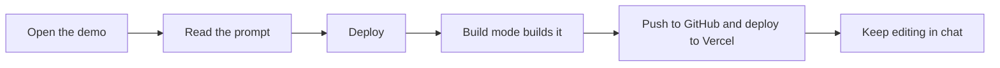
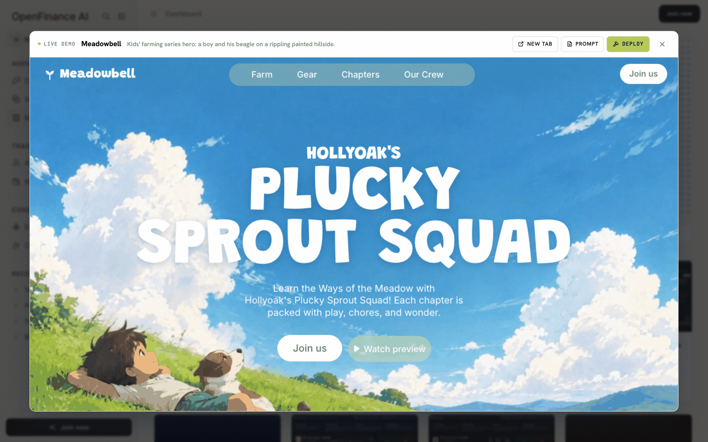
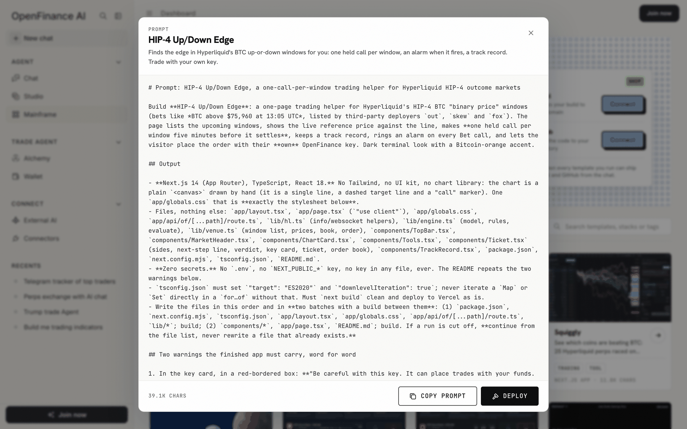

It takes five steps, and you can stop after any of them. The first two need no account and cost nothing, **Deploy** starts the build, and the last two put the result in your own GitHub and Vercel. The diagram shows the whole path; the sections below take each step in turn.



## 1. Preview the demo

Click a card's picture, or hover it and click **Open demo**. The demo opens full size in a viewer with **New tab**, **Prompt** and **Deploy** buttons.

- Website templates show a **Live demo**: the actual page running in the viewer, video and animations included.
- Trading templates show **Demo · captured**: a screen of the finished app recorded with live data. It is a picture, so nothing in it is connected to an account.

<Frame caption="The demo viewer, with New tab, Prompt and Deploy in the header">
  
</Frame>

## 2. Read the prompt

Click **Prompt** to read the full brief. The window shows the template's name, its one-line description, the prompt text and its length, with **Copy prompt** and **Deploy** at the bottom.

<Frame caption="A template's prompt window">
  
</Frame>

Reading the prompt is the best way to know what you will get. Most prompts follow the same shape: what to build, the exact layout and copy, where the data comes from, how a key is handled (trading templates), and an **acceptance check**, a list of tests the builder runs before it says the job is done.

## 3. Click Deploy

**Deploy** is on the card, in the demo viewer and in the prompt window. Clicking it:

1. Loads the template's prompt and keeps it in your browser tab.
2. Opens Chat. If you are not signed in, you are asked to sign in; the prompt waits and is not lost.
3. Switches Chat to **Build mode**, whatever mode it was in, so the build runs on Build mode's coding model.
4. Sends one message, "Build this exactly as specified:" plus the template's name, with the whole prompt attached.

The prompt is used once. If you go back to the gallery and click Deploy again, a new build starts in a new chat.

## 4. Connect GitHub and Vercel

Most prompts open with a reminder to connect GitHub and Vercel before the build starts. Use the **Connectors** card at the top of the Mainframe page: **Vercel** deploys your build to your domain, **GitHub** saves the code to your repository. Each **Connect** button opens the provider's sign-in in a popup; once it reports back, the button reads **Connected**. You connect once and every later template can use it.

You can also connect from the Build panel or the [Connectors](/product/connectors) page. Building and previewing work without them; you need them only to push the code or get a permanent address.

## 5. Watch the build, then ship it

From here it is a normal [Build mode](/product/build-mode) run: a checklist tracks each stage, and the preview opens beside the chat when the build is done. When you are happy with the preview, ship it with two messages:

```text
Push this app to a new GitHub repo.
```

```text
Deploy this app to Vercel.
```

You can also use the **Push** and **Deploy** buttons in the preview panel.

## What you end up with

Once the app is pushed and deployed, you have three things:

- **A repository** in your GitHub account with the full source code.
- **A deployed site** on your Vercel account, at an address you control.
- **A chat** that remembers the build, so you can keep asking for changes.

The copy is yours. Other people who deploy the same template get their own separate copy.

## Edit it afterwards

Come back to the same chat and describe the change in plain words. The builder edits the files, rebuilds and shows the new preview; then push and redeploy.

```text
Make the headline smaller on phones and change the accent colour to orange.
```

See [Customize a template](/mainframe/customize) for more examples.

## Tips

A few habits make builds smoother and safer:

- Open the demo before you deploy. It is the fastest check that the template is what you want.
- Long prompts cost more AI credits than a short chat. Check your balance first; see [Models and AI credits](/product/models-and-credits).
- If a run pauses, click **Continue run**. Some trading prompts tell the builder to work in two batches and to continue from the file list instead of starting over.
- AI-built software can have bugs. Run through the template's acceptance checks yourself before you rely on a trading tool, and test with small amounts.

## FAQ

<AccordionGroup>
  <Accordion title="Do I need an account to look around?">
    No. You can browse, open demos, read and copy prompts while signed out. Deploying and connecting GitHub or Vercel ask you to sign in.
  </Accordion>
  <Accordion title="What if I did not connect GitHub and Vercel first?">
    The build still runs and you get a preview. Connect them afterwards, then ask the chat to push and deploy.
  </Accordion>
  <Accordion title="Can I deploy the same template twice?">
    Yes. Each Deploy starts a new build with its own code, so you can keep two versions side by side.
  </Accordion>
  <Accordion title="Is the demo the same as what I get?">
    It is what the prompt is written to produce. Your build is made fresh from the prompt, so small details can differ. Ask for changes until it matches.
  </Accordion>
</AccordionGroup>

## Next

<CardGroup cols={2}>
  <Card title="Customize a template" icon="pen-to-square" href="/mainframe/customize">
    Edit the prompt first, or ask for changes after.
  </Card>
  <Card title="Keys and safety" icon="shield-halved" href="/mainframe/safety">
    Read this before you deploy a trading template.
  </Card>
</CardGroup>
