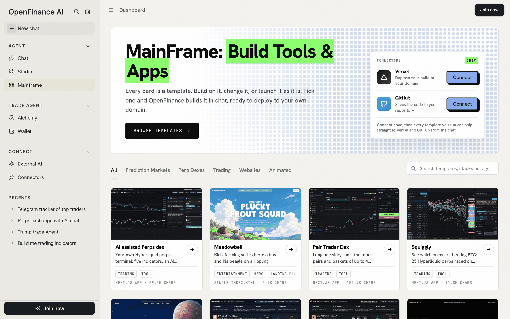
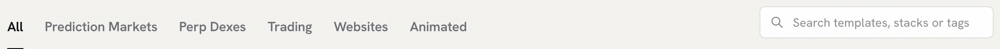

Mainframe lives inside the OpenFinance app at [openfinance.tech/mainframe](https://openfinance.tech/mainframe). Each card is a template for a trading tool or a website. Pick one, check its demo, and click **Deploy**: OpenFinance builds the app for you in Chat and can ship it to your own GitHub and Vercel.

<Frame caption="The Mainframe page: the hero with the Connectors card, then the section tabs and the template cards">
  
</Frame>

## What a template is

Every card in the gallery is made of two things:

- **A prompt.** A long, precise brief that tells the builder exactly what to make: the layout, the data sources, the copy, the safety rules and a list of checks to run before calling the job done. You can read every prompt before you use it.
- **A demo.** A preview of what the prompt produces. Website templates show a live page you can click around in. Trading tools show a screen captured with live data, so the gallery never needs your key.

When you click **Deploy**, the prompt goes into [Build mode](/product/build-mode) as your first message. The result is a fresh copy of the app that belongs to you: code you can push to your own GitHub repository and a site you can deploy to your own Vercel account. Nothing is shared with other people who use the same template.

## How the gallery is organised

Tabs above the grid filter the cards. A search box beside them matches template names, sections, descriptions, tech stacks and tags.

<Frame caption="Section tabs and search">
  
</Frame>

Each tab holds one kind of template:

| Tab | What is in it |
| --- | --- |
| **All** | Every template |
| **Prediction Markets** | Helpers for short BTC and ETH up-or-down windows |
| **Perp Dexes** | Your own trading terminals for Hyperliquid perpetuals |
| **Trading** | Strategy desks, such as funding carry |
| **Websites** | Landing pages, heroes and footers |
| **Animated** | Sites built around video and motion |

Each card shows the demo, the title, a one-line description, tags, the output (for example "Next.js app" or "Single index.html") and the prompt's length. Hover a card for three buttons: **Prompt**, **Open demo** and **Deploy**. The Mainframe card also has a **Live** link to a deployed copy.

## Every template

Here is every template in the gallery today, grouped the same way as the tabs. Click a card to read its own page. The gallery grows over time, so the app may show cards that are not listed here yet.

### Prediction markets

<CardGroup cols={2}>
  <Card title="HIP-4 Up/Down Edge" img="/images/mainframe/card-updown-hip4.jpg" href="/mainframe/templates/updown-hip4">
    One held call per Hyperliquid BTC up-or-down window, an alarm and a track record.
  </Card>
  <Card title="Poly Up/Down Assist" img="/images/mainframe/card-updown-polymarket.jpg" href="/mainframe/templates/updown-polymarket">
    The same helper for Polymarket's BTC and ETH up-or-down windows.
  </Card>
</CardGroup>

### Perp dexes

<CardGroup cols={2}>
  <Card title="AI assisted Perps dex" img="/images/mainframe/card-ai-perps-dex.jpg" href="/mainframe/templates/ai-perps-dex">
    A Hyperliquid terminal with five indicators, an AI copilot and a market-order ticket.
  </Card>
  <Card title="Pair Trader Dex" img="/images/mainframe/card-pair-trader.jpg" href="/mainframe/templates/pair-trader">
    Long one side, short the other: pairs and baskets of up to four markets.
  </Card>
  <Card title="Squiggly" img="/images/mainframe/card-hl-compare.jpg" href="/mainframe/templates/hl-compare">
    Up to 25 Hyperliquid perps raced against BTC on one chart, with a trade panel.
  </Card>
</CardGroup>

### Trading

<CardGroup cols={2}>
  <Card title="Arb Funding" img="/images/mainframe/card-carry-bot.jpg" href="/mainframe/templates/carry-bot">
    A funding-carry desk: hold spot, short the perp on Hyperliquid, keep the funding.
  </Card>
</CardGroup>

### Websites

<CardGroup cols={2}>
  <Card title="LinkFlow" img="/images/mainframe/card-linkflow.jpg" href="/mainframe/templates/linkflow">
    A workflow automation hero on a looping video, sage green on white glass.
  </Card>
  <Card title="Heritage Grove" img="/images/mainframe/card-heritage-grove.jpg" href="/mainframe/templates/heritage-grove">
    A full-viewport footer on hand-drawn ink artwork, in one HTML file.
  </Card>
  <Card title="Camper" img="/images/mainframe/card-camper.jpg" href="/mainframe/templates/camper">
    An overnight camp hero with a moonlit video and a stacked serif headline.
  </Card>
</CardGroup>

### Animated

<CardGroup cols={2}>
  <Card title="Mainframe" img="/images/mainframe/card-mainframe.jpg" href="/mainframe/templates/mainframe">
    A creative agency hero with a mouse-scrubbed video and a typewriter greeting.
  </Card>
  <Card title="Orbis" img="/images/mainframe/card-orbis-nft.jpg" href="/mainframe/templates/orbis-nft">
    A four-section NFT site in deep space with video backgrounds and liquid glass.
  </Card>
  <Card title="Meadowbell" img="/images/mainframe/card-meadowbell.jpg" href="/mainframe/templates/meadowbell">
    A kids' series hero: a boy and his beagle on a rippling painted hillside.
  </Card>
</CardGroup>

## Before you start

A few things are worth knowing before your first deploy.

- Browsing, opening demos and reading prompts work without an account. Deploying asks you to sign in. Please make an account at [openfinance.tech](https://openfinance.tech) to get your keys.
- Connect GitHub and Vercel once, in the **Connectors** card at the top of the page, so the finished app can ship straight from the chat.
- Templates are long prompts, so a build spends more AI credits than a short chat. See [Models and AI credits](/product/models-and-credits).
- Trading templates place real orders only with your own OpenFinance key, pasted in your own copy. Read [Keys and safety](/mainframe/safety) first.

## Next

<CardGroup cols={2}>
  <Card title="How it works" icon="diagram-project" href="/mainframe/how-it-works">
    From demo to a deployed site you own, step by step.
  </Card>
  <Card title="Customize a template" icon="pen-to-square" href="/mainframe/customize">
    Change a template before or after you build it.
  </Card>
  <Card title="Keys and safety" icon="shield-halved" href="/mainframe/safety">
    How trading templates handle your OpenFinance key.
  </Card>
  <Card title="Build mode" icon="hammer" href="/product/build-mode">
    The builder that turns a prompt into an app.
  </Card>
</CardGroup>
