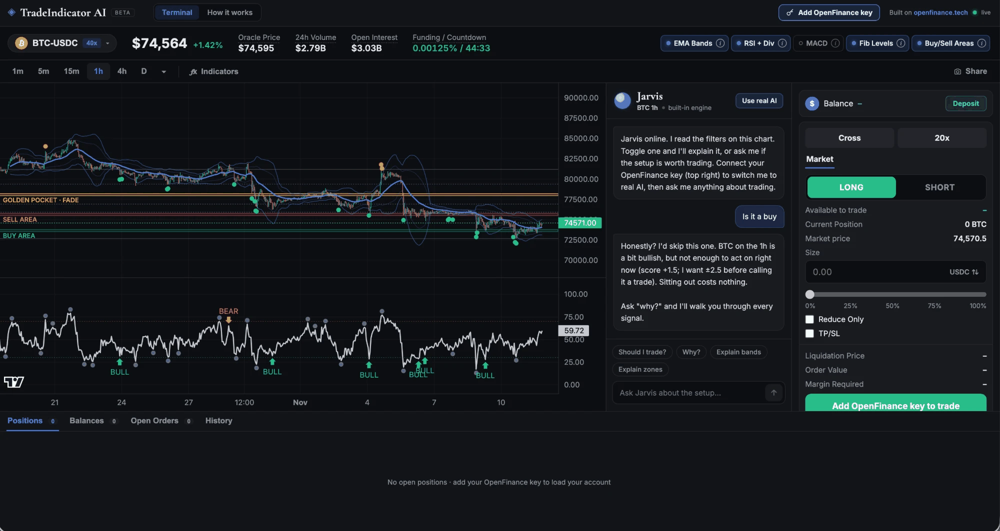

Everything fits on one page: a chart with five indicators for any Hyperliquid perpetual, the copilot Jarvis in the middle, and the trade ticket on the right. You will find the template under **Perp Dexes** in Mainframe. The finished app is titled TradeIndicator AI; rename it if you like.

<Frame caption="The captured demo: chart with indicators, Jarvis in the middle, the trade ticket on the right">
  
</Frame>

## Who it is for

It suits traders who want their own charting terminal with a second opinion built in, and a ticket that trades Hyperliquid perps from their OpenFinance account.

## What it does

- **Every Hyperliquid perp.** Crypto plus the stock, index, commodity and FX markets, with a searchable market picker grouped by category.
- **Five indicators**, each with an on/off pill and an explainer: EMA Bands, RSI with divergences, MACD, Fib levels, and Buy/Sell areas with the golden pocket. A **Key levels** block sums them up.
- **Jarvis.** Reads the chart with a free built-in engine, no key needed. With your key it can run models such as Claude, GPT, Gemini and Grok on the live chart, paid from your OpenFinance AI credits.
- **Trade ticket.** Market orders, long or short, cross or isolated, a leverage slider, size in USDC or coins, Reduce Only and optional TP/SL, with estimated liquidation, order value and margin.
- **Account panel.** Positions with Close, balances, open orders with Cancel, and fill history.
- **Share** saves or copies a picture of the chart, and a **How it works** tab explains every part.

## What it needs

| Need | Why |
| --- | --- |
| Your OpenFinance key | Turns on trading and the AI models. Charts and the built-in engine work without it |
| USDC on Hyperliquid | Margin for trades. **Deposit** shows your Hyperliquid address; Hyperliquid accepts USDC only |
| AI credits | Only for Jarvis answers from AI models |
| GitHub and Vercel | To keep the code and deploy your copy |

Market data comes straight from Hyperliquid's public API, no key needed.

## Deploy it

<Steps>
  <Step title="Check the demo">Open the card's demo and read the prompt in Mainframe.</Step>
  <Step title="Deploy">Click **Deploy**. Build mode builds the app and runs its acceptance checks.</Step>
  <Step title="Ship and add your key">Deploy to Vercel, open your copy, and add your key with the button at the top right.</Step>
</Steps>

## Ideas to customize

Once your copy runs, ask for changes in the same chat. For example:

```text
Add a Limit tab to the trade ticket with a price field and a Mid button that sends Gtc limit orders.
```

```text
Make ETH and the 15 minute timeframe the defaults, and turn MACD on by default.
```

## Limits

- Market orders only, filled at most 1% past the live price. A price move of more than 1% after you confirm cancels the send.
- The app's server can reach only a short list of OpenFinance routes. Withdrawals and transfers are not on it.
- On the first balance read, if your Hyperliquid account is not in unified mode and holds funds, the app switches it to unified mode once and tells you.
- Jarvis cannot see your account or place orders, has no live news, and can be wrong.

Every trade needs your confirmation, and nothing here is financial advice. Read [Keys and safety](/mainframe/safety) before you add your key.
