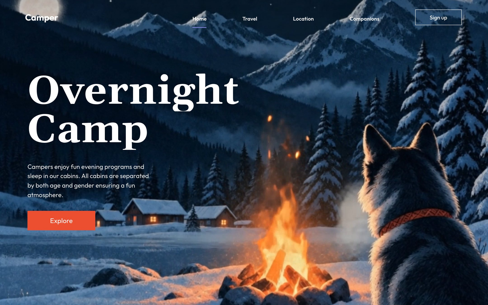

The hero is written for a fictional overnight camp, so the copy and links are yours to replace. You will find it under **Websites** in Mainframe.

<Frame caption="The demo: Overnight Camp headline and Explore button over the campfire scene">
  
</Frame>

## Who it is for

Camps, travel brands and outdoor businesses get one strong first screen from it. It also suits anyone who needs a hero that keeps its composition on every screen size.

## What it does

- **One file.** A single `index.html` with HTML, CSS and a little JavaScript. No framework and no local assets.
- **Looping video** of a husky by a campfire, snowy cabins, pines and a full moon. The artwork never moves or parallaxes.
- **Headline** "Overnight / Camp" in a stacked serif, a short paragraph and a square orange **Explore** button.
- **Header** with the logo, Home, Travel, Location and Companions, and a square **Sign up** button.
- **Three layouts** chosen by script: an exact desktop composition, a tablet layout with a side drawer menu, and a compact phone layout that keeps the dog and fire in view.
- **Entrance animation** where the headline slides up and the button wipes in, with a reduced-motion version.

## What it needs

- No OpenFinance key and no trading.
- GitHub and Vercel to keep the code and deploy it.
- Stack: plain HTML, CSS and JavaScript, Google Fonts. Output: a single `index.html`.

## Deploy it

<Steps>
  <Step title="Check the demo">Open it full size and try a narrow window.</Step>
  <Step title="Deploy">Click **Deploy** on the card.</Step>
  <Step title="Ship it">Push to GitHub and deploy to Vercel from the chat.</Step>
</Steps>

## Ideas to customize

Paste a request like these into the build chat:

```text
Change the headline to "Summer / Camp", the paragraph to our own text, and link Explore to our booking page.
```

```text
Swap the video for my own clip at this URL and keep the same crop so the subject stays in view.
```

## Limits

- It is one hero screen. The prompt tells the builder not to add sections, a footer or forms; ask for them after the build if you need them.
- The links are placeholders until you point them somewhere.
- The video comes from an outside host named in the prompt. Use your own footage for a real business.
