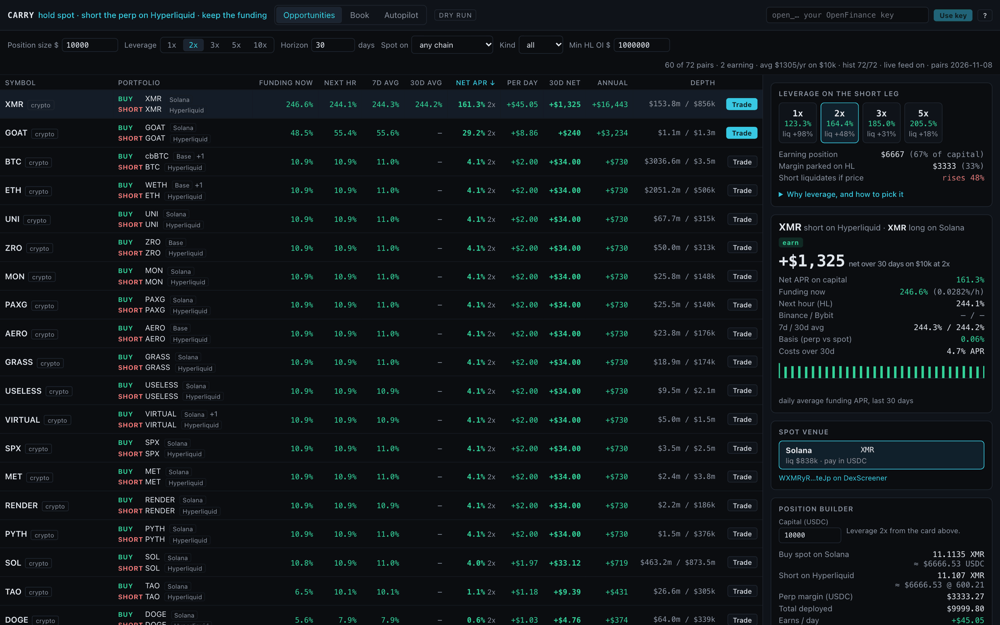

The strategy is easy to state: hold a coin or stock token in spot, short the same dollar amount on Hyperliquid, and collect the hourly funding while the price moves cancel out. The desk does the comparing and the sizing for you. It sits under **Trading** in Mainframe, and the finished app's own wordmark reads CARRY.

<Frame caption="The captured demo: the opportunities table, the leverage card and the position builder">
  
</Frame>

## Who it is for

It is built for traders who already understand funding rates and want to compare carry trades across many markets in dollars, size both legs, and track the open book.

## What it does

- **Opportunities table.** Hyperliquid perps that have a spot twin on Solana, Base or Robinhood Chain, 72 pairs written into the prompt, crypto and stock tokens. Columns show funding now, the next hour, 7 and 30 day averages, net APR on capital, and per day, per horizon and annual dollars for your position size. Funding updates live.
- **Controls** for position size, leverage on the short (1x to 10x), horizon in days, chain, kind and minimum open interest.
- **Leverage card** that shows how leverage splits your capital between the earning position and margin, and how far price can rise before the short is liquidated, with a plain explainer.
- **Detail and builder.** For the selected pair: rates, basis, costs, a 30 day funding bar chart, a choice of spot venue, both leg sizes, break-even days, and **Preview calls** showing the exact requests.
- **Book tab.** Your carry positions with delta, funding earned and an unwind button, plus spot you hold with no hedge.
- **Autopilot tab.** Entry, exit and rebalance rules with a decision log, checked once an hour.

## What it needs

| Need | Why |
| --- | --- |
| Your OpenFinance key | Balances, the Book and sending. Rates and the table work without it |
| USDC on Hyperliquid | Margin for the short |
| Dollars on the spot chain | USDC on Solana or Base, or USDG on Robinhood Chain, to buy the spot leg |
| GitHub and Vercel | To keep the code and deploy a private copy |

Spot legs go through OpenFinance's Solana swap and cross-chain routes; the perp leg through OpenFinance's Hyperliquid orders.

## Deploy it

<Steps>
  <Step title="Deploy">Click **Deploy** on the card. The build ships in dry run.</Step>
  <Step title="Try it in dry run">Paste your key, pick a row, and use **Dry-run both legs**. The log shows what would be sent.</Step>
  <Step title="Go live only on purpose">Live sending needs live trading switched on in your deployment's settings, the **armed** box ticked, and your confirmation on every send.</Step>
</Steps>

## Ideas to customize

Two requests to try after the build:

```text
Hide meme coins by default and set the minimum Hyperliquid open interest to $20 million.
```

```text
Add a browser notification when a pair's net APR stays above 25% for three hours.
```

## Limits

- No reverse carry. When funding is negative the row reads "pays" and cannot be traded.
- Each trade is capped at 2% of the spot pool's liquidity. Costs are fixed estimates set in the prompt.
- The short can be liquidated on a large price rise even though spot gains the same amount; watch the drift in the Book tab.
- Funding changes every hour. The dollar columns are estimates at today's rate, not promises.
- ETF tokens such as SPY, QQQ and GLD stand in for index and gold perps and are flagged as proxies.

Every trade needs your confirmation, and nothing here is financial advice. See [Keys and safety](/mainframe/safety).
