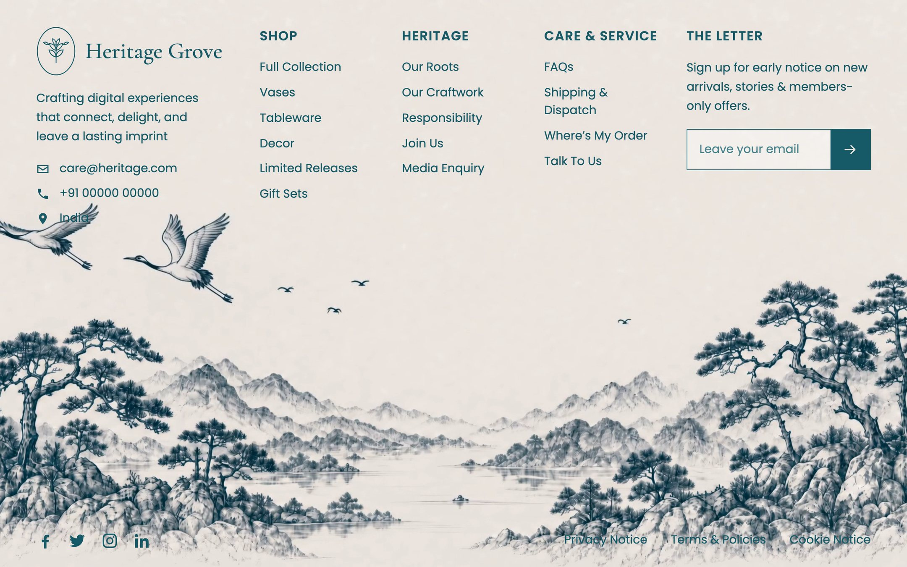

It is written for a fictional homeware brand, with the brand's contact details, link columns and a newsletter field laid over the artwork. You will find it under **Websites** in Mainframe.

<Frame caption="The demo: brand block, link columns and newsletter over the ink artwork">
  
</Frame>

## Who it is for

Shops and brands that want a footer people actually look at will get the most from it, as will anyone who needs a drop-in section with no build step.

## What it does

- **One file.** Everything lives in a single `index.html`: markup, CSS and inline SVG icons. No JavaScript and no framework.
- **Brand block** with a seedling mark, the wordmark, a short blurb and email, phone and location rows.
- **Three link columns**, Shop, Heritage and Care and Service, and a newsletter column with an email field.
- **Bottom bar** with social icons and Privacy, Terms and Cookie links.
- **Video background** of misty mountains, a lake and two cranes, full-bleed on desktop with no overlay. On tablets and phones the video moves below the text so nothing overlaps.
- **Gentle entrance** where each item rises in, and a still image for people who prefer reduced motion.

## What it needs

- No OpenFinance key and no trading.
- GitHub and Vercel to keep the code and deploy it.
- Stack: plain HTML and CSS, Google Fonts. Output: a single `index.html`.

## Deploy it

<Steps>
  <Step title="Check the demo">Resize the window to see the layout change.</Step>
  <Step title="Deploy">Click **Deploy** on the card.</Step>
  <Step title="Ship it">Push to GitHub and deploy to Vercel, or paste the file into your own site.</Step>
</Steps>

## Ideas to customize

To make it yours, try requests like these:

```text
Change the brand to "Juniper & Clay", the email to care@juniperclay.com and the location to Lisbon.
```

```text
Connect the newsletter form to my Mailchimp signup URL.
```

## Limits

- It is a footer, not a whole site. Add it to the bottom of your own pages.
- The newsletter form has no service behind it until you connect one.
- The design deliberately keeps the text directly on the artwork on desktop; the prompt asks the builder not to add a tint.
- The video and poster come from outside hosts named in the prompt. Use your own artwork for a real brand.
