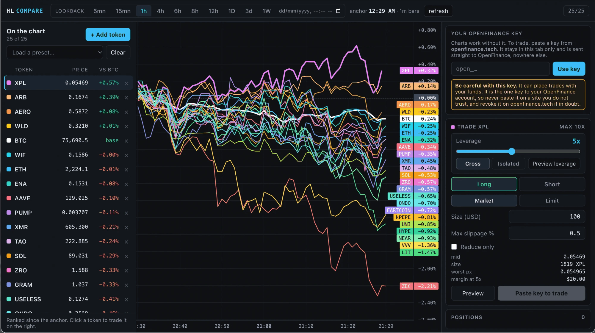

The terminal draws up to 25 Hyperliquid perpetuals as a percent race from the same starting moment, ranks them, and keeps a trade panel beside the chart. It sits under **Perp Dexes** in Mainframe.

<Frame caption="The captured demo: the ranked list, the race chart and the trade panel">
  
</Frame>

## Who it is for

It suits traders who rotate between coins and want to see relative strength at a glance, then act on the leader or the laggard.

## What it does

- **The race.** Every line starts at 0% at a fixed anchor time, so you compare moves, not prices. BTC is the white base line.
- **Lookbacks** from 5 minutes to 1 week, plus a custom start time.
- **Ranked list.** Best to worst since the anchor, with live price and change versus BTC. Click a row to highlight its line and load it in the trade panel.
- **Add token.** Search every listed perp, or add whole sectors such as AI, Meme, L2 or HIP-3 stocks. Presets include BTC vs ETH, Majors and BTC vs stocks. Your basket is remembered in your browser.
- **Trade panel.** Leverage with cross or isolated, long or short, market or limit, size in USD, slippage or limit price, reduce-only, and a **Preview** that prints the exact order before you send it.
- **Positions** list with unrealised profit and loss.

## What it needs

| Need | Why |
| --- | --- |
| Your OpenFinance key | Only for trading and your balance. The chart works without it |
| USDC on Hyperliquid | Margin for trades |
| GitHub and Vercel | To keep the code and deploy your copy |

Prices and candles come straight from Hyperliquid's public API.

## Deploy it

<Steps>
  <Step title="Deploy">Click **Deploy** on the card in Mainframe.</Step>
  <Step title="Check the chart">In the preview, the default 25 lines should move, with BTC at the base.</Step>
  <Step title="Ship it">Deploy to Vercel, then paste your key in the key card to trade.</Step>
</Steps>

## Ideas to customize

Ask for changes like these once the build runs:

```text
Change the default basket to BTC, ETH, SOL, HYPE and the six biggest AI coins.
```

```text
Make 4h the default lookback and add a button that copies the ranked list as text.
```

## Limits

- 25 lines at most. When the chart is full, remove a token before adding one.
- Stock markets show "closed" when their market is shut; that is not an error.
- Without a key the send button reads **Paste key to trade**; Preview still works.

Every trade needs your confirmation, and nothing here is financial advice. See [Keys and safety](/mainframe/safety).
