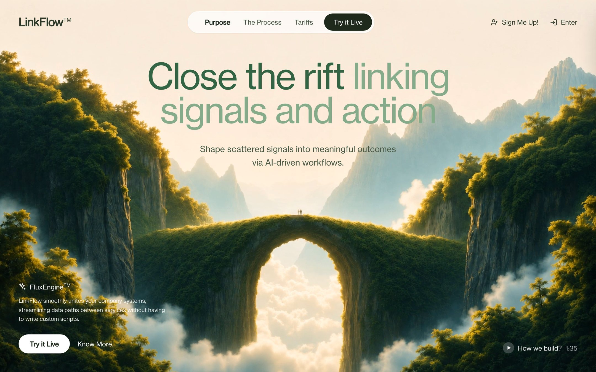

The copy is written for a fictional workflow automation product called LinkFlow, ready for your own name and words. It sits under **Websites** in Mainframe.

<Frame caption="The demo: glass nav pill, two-tone headline and the bottom CTA block over the video">
  
</Frame>

## Who it is for

SaaS and AI tool makers looking for a calm, premium landing hero are the obvious fit. It is also a good model for anyone who wants a looping video without a jump at the loop point.

## What it does

- **Boomerang background.** The video plays once while its frames are captured, then loops forward and backward at 30 frames a second, so there is never a visible cut.
- **Navbar** with the logo, a white glass pill (Purpose, The Process, Tariffs and a "Try it Live" button), plus "Sign Me Up!" and "Enter".
- **Headline** "Close the rift linking signals and action" in two greens, with a one-line subhead.
- **Bottom-left CTA block** with a product badge, a short paragraph, "Try it Live" and "Know More.", and a "How we build?" video link at the bottom right.
- **Mobile drawer** that slides in from the right with staggered links.

## What it needs

- No OpenFinance key and no trading.
- GitHub and Vercel to keep the code and deploy it.
- Stack: React 18, TypeScript, Vite, Tailwind CSS and lucide icons. Output: a Vite app.

## Deploy it

<Steps>
  <Step title="Check the demo">Open it and watch the loop reverse.</Step>
  <Step title="Deploy">Click **Deploy** on the card.</Step>
  <Step title="Ship it">Push to GitHub and deploy to Vercel from the chat.</Step>
</Steps>

## Ideas to customize

Two requests to start from:

```text
Rename the product to "Relay", change the headline to "Every alert, one place", and make the accent blue.
```

```text
Add a pricing section below the hero with three plans, using the same glass style.
```

## Limits

- It is a hero only. The nav links point to sections that do not exist yet, and the buttons do nothing until you wire them up.
- If you swap the video, host it somewhere that allows cross-origin use; the boomerang reads the frames in the browser and cannot do that otherwise.
- The fonts and video come from outside hosts named in the prompt. Use assets you have the rights to for a real brand.
