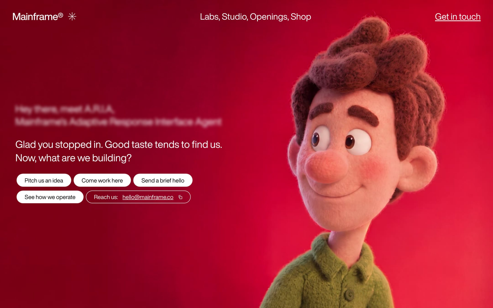

This template shares its name with the gallery: the copy is written for a fictional creative agency called Mainframe. You will find it under **Animated**, and its card has a **Live** link to a deployed copy you can try before you build.

<Frame caption="The demo: blurred intro, typewriter line and pill buttons over the video">
  
</Frame>

## Who it is for

It fits studios, agencies and freelancers who want a playful first screen with one striking interaction, and anyone learning how a polished hero is put together.

## What it does

- **Mouse-scrubbed video.** The full-screen background video does not autoplay. Moving the mouse left or right scrubs it backward or forward.
- **Navbar** with the logo, the links Labs, Studio, Openings and Shop, and a "Get in touch" link. On phones a hamburger opens a full-screen menu.
- **Greeting.** A blurred two-line intro, then a line typed out letter by letter with a blinking cursor.
- **Pill buttons** that fade in: four white pills and an outline pill that copies the email address to the clipboard.

## What it needs

- No OpenFinance key and no trading.
- GitHub and Vercel to keep the code and deploy it.
- Stack: React, TypeScript, Vite and Tailwind CSS. Output: a Vite app.

## Deploy it

<Steps>
  <Step title="Open the demo">Move the mouse over the demo to feel the scrub.</Step>
  <Step title="Deploy">Click **Deploy** on the card and let Build mode build it.</Step>
  <Step title="Ship it">Push to GitHub and deploy to Vercel from the chat.</Step>
</Steps>

## Ideas to customize

Make it yours with requests like these:

```text
Rename the agency to "Northwind", change the email to hello@northwind.studio and the four pills to our services.
```

```text
Replace the background video with my own file at this URL, and make it play slowly on phones where there is no mouse.
```

## Limits

- The video moves only with a mouse. On touch screens it stays on its first frame unless you ask for a touch version.
- The demo's video file uses the HEVC codec, which some browsers cannot play; they show a plain background. Use your own video in a widely supported format.
- The fonts and video are loaded from outside hosts named in the prompt. Swap in assets you have the rights to before you use it for a real brand.
- Links and pills are placeholders until you point them somewhere.
