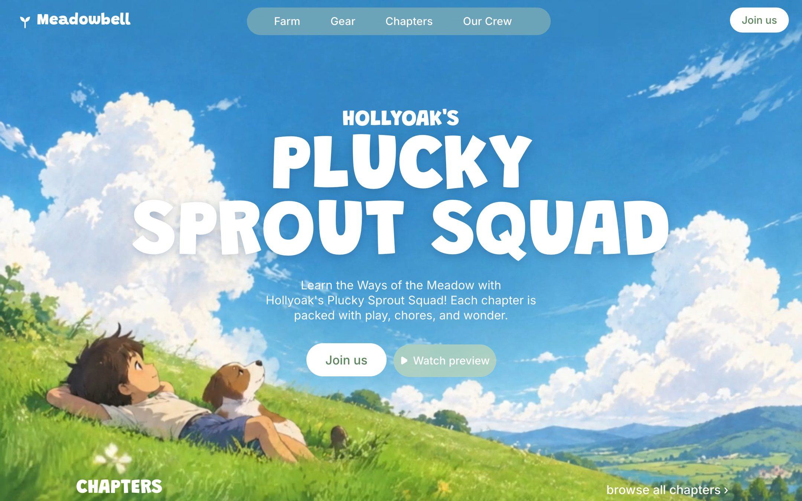

The hero introduces a fictional animated kids' farming series, "Hollyoak's Plucky Sprout Squad", from a studio called Meadowbell. It sits under **Animated** in Mainframe.

<Frame caption="The demo: the series title, buttons and chapters over the painted hillside">
  
</Frame>

## Who it is for

It fits studios, shows, books and family brands that want a warm, hand-painted first screen, and anyone who wants subtle motion without heavy code.

## What it does

- **One file.** A single `index.html` with plain HTML, CSS and JavaScript. No framework and no build step.
- **Painted scene** made of one still image, brought to life by a looping video of the same picture: the grass ripples, the boy's hair and the dog's ears move, the clouds drift. Nothing in the scene is drawn in code.
- **Navbar** with the Meadowbell logo, a translucent pill (Farm, Gear, Chapters, Our Crew) and a **Join us** button.
- **Title block** with the series name, a short subline, **Join us** and **Watch preview**.
- **Chapters row** of three illustrated cards that lift on hover.
- **Entrance animation** where the headline springs up line by line. Reduced motion turns off the video and transitions.
- **Phones** get a stacked layout and a swipeable chapters row.

## What it needs

- No OpenFinance key and no trading.
- GitHub and Vercel to keep the code and deploy it.
- Stack: plain HTML, CSS and JavaScript. Output: a single `index.html`.

## Deploy it

<Steps>
  <Step title="Check the demo">Watch the grass and clouds move.</Step>
  <Step title="Deploy">Click **Deploy** on the card.</Step>
  <Step title="Ship it">Push to GitHub and deploy to Vercel from the chat.</Step>
</Steps>

## Ideas to customize

Try requests like these once it is built:

```text
Rename the series to "Pip and the Tide Pool", the studio to "Saltmarsh", and change the three chapter titles.
```

```text
Make Watch preview open a video in a pop-up player.
```

## Limits

- It is one hero screen; the nav links and buttons are placeholders until you point them somewhere.
- The layout is measured on a fixed frame, so moving elements by hand can break the alignment with the artwork. Describe the change and let the builder adjust the coordinates.
- The artwork and video come from outside hosts named in the prompt. Use your own art for a real show.
