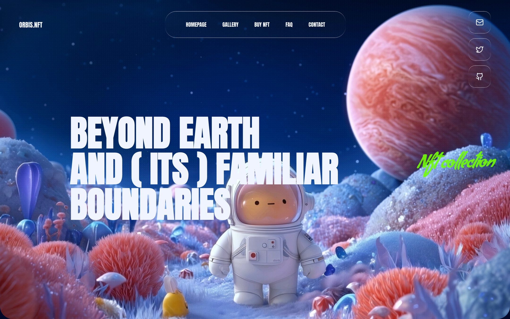

The site is written for a fictional NFT collection, and its own logo reads Orbis.Nft. You will find it under **Animated** in Mainframe.

<Frame caption="The demo: the hero with the glass nav and neon script accent">
  
</Frame>

## Who it is for

It is made for NFT projects, games and creative launches that want a cinematic site, and for anyone learning the liquid glass look.

## What it does

- **Hero** with a looping space video, a glass nav bar (Homepage, Gallery, Buy NFT, FAQ, Contact), a tall capitals headline with a neon script accent, and glass social buttons.
- **About section** on a second video, "Hello! I'm orbis", with a short monospace paragraph.
- **Collection grid** of three video cards, each with a glass bar showing a rarity score and a purple arrow button.
- **Closing section** on a full-width video with a stacked call to action and a glass panel of social links.
- **Liquid glass** panels, a texture overlay, Anton capitals with Condiment script, and a mobile-first layout.

## What it needs

- No OpenFinance key and no trading.
- GitHub and Vercel to keep the code and deploy it.
- Stack: React, TypeScript, Vite, Tailwind CSS and lucide icons. Output: a Vite app.

## Deploy it

<Steps>
  <Step title="Check the demo">Scroll through all four sections.</Step>
  <Step title="Deploy">Click **Deploy** on the card.</Step>
  <Step title="Ship it">Push to GitHub and deploy to Vercel from the chat.</Step>
</Steps>

## Ideas to customize

Two requests to try in the build chat:

```text
Rename the collection to "Driftlight", change the three rarity scores, and link the arrow buttons to our mint page.
```

```text
Add a FAQ section before the closing section with five questions, in the same glass style.
```

## Limits

- The prompt uses a texture image at `/texture.png` but gives no file for it. Add your own texture, or ask the builder to remove the overlay.
- It is a static marketing site. There is no wallet connection or minting.
- The videos come from an outside host named in the prompt. Use your own media for a real project.
