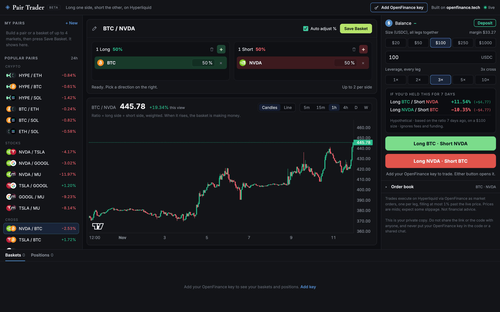

A pair trade goes long one side and short the other, so what counts is how the two move against each other, not where the whole market goes. This lightweight, one-page desk handles up to four Hyperliquid markets at once. It sits under **Perp Dexes** in Mainframe.

<Frame caption="The captured demo: popular pairs, the Long and Short panels with the ratio chart, and the ticket">
  
</Frame>

## Who it is for

It is for traders who think in relative moves, such as "NVDA beats TSLA" or "BTC beats chip stocks", and want both legs opened and closed together.

## What it does

- **Popular pairs** grouped as crypto, stocks, cross-market and baskets, each with its 24 hour move. Save your own under **My pairs**.
- **Basket editor.** A green Long panel and a red Short panel, each with a **+** that opens a ticker picker. One or two markets per side. **Auto adjust %** splits the size 50/50 between sides, or you set weights yourself.
- **Ratio chart.** The long side divided by the short side, as candles or a line, on timeframes from 5 minutes to weekly.
- **Ticket.** Size and leverage presets, an "If you'd held this for 7 days" card for both directions, then a green button for the basket as built and a red one for the exact reverse.
- **Order book** per leg, collapsed until you open it.
- **Baskets and Positions** at the bottom, with live profit and loss and **Close basket**.

## What it needs

| Need | Why |
| --- | --- |
| Your OpenFinance key | Turns on trading. Charts and order books work without it |
| USDC on Hyperliquid | Margin for every leg. **Deposit** shows your Hyperliquid address |
| GitHub and Vercel | To keep the code and deploy a private copy |

No environment variables are needed.

## Deploy it

<Steps>
  <Step title="Deploy from Mainframe">Click **Deploy** on the card. The prompt contains every file of a tested app, so the build copies them rather than inventing code.</Step>
  <Step title="Check it">Confirm the order book and prices are live in the preview.</Step>
  <Step title="Ship it">Deploy to Vercel as a private project, then add your key with the top-right button.</Step>
</Steps>

## Ideas to customize

Small changes like these are safe to ask for:

```text
Add a popular basket called "Majors vs memes": long BTC and ETH, short kPEPE and WIF.
```

```text
Make 1 hour the default ratio timeframe and $50 the default size.
```

Ask for them after the build, because rewriting the files inside the prompt is the easiest way to break the tested code.

## Limits

- Two markets per side, four in all. Each leg must be worth at least \$10; the ticket names a leg that is too small.
- New legs use cross margin. A market where you already hold a position keeps its leverage and mode.
- All legs go in one request, each priced at most 1% past the price you confirmed. If only some fill, the ticket offers **Close filled legs** and **Retry missing legs**.
- The 7 day card is hypothetical and ignores funding.
- The app never changes your account mode, and its server can reach only deposit address, leverage and orders.

Every trade needs your confirmation, and nothing here is financial advice. See [Keys and safety](/mainframe/safety).
