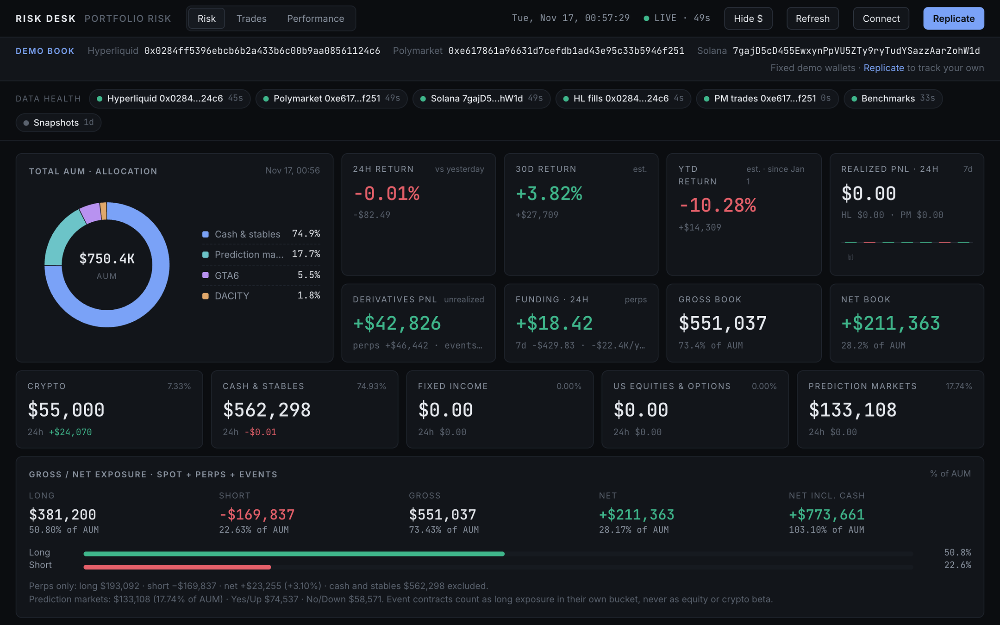

When your money sits across perps, prediction markets, wallets and a broker, no single venue shows the whole picture. This template builds one private dashboard that reads every venue and adds it up. It sits under **Trading** in Mainframe.

<Frame caption="The captured demo: allocation, returns, books and exposure across every venue">
  
</Frame>

## Who it is for

It is for anyone who holds positions in more than one place and wants to know, at a glance, how big the book is, where the risk sits and how it has done.

## What it does

- **Total AUM and allocation** across cash, crypto, prediction markets and equities.
- **Returns and profit and loss** for the day, 30 days and the year so far, plus funding and derivatives profit and loss.
- **Gross and net exposure**, open perps, Polymarket positions, venue weights and net exposure by underlying.
- **Risk against benchmarks**: volatility, Sharpe, max drawdown, value at risk, beta and correlation against BTC, ETH, HYPE, QQQ and SPY.
- **Risk, Trades and Performance tabs**, with a year-to-date trade log and a performance page.
- **Data Health** chips, one per feed, so a stale or failed source is visible and never breaks the page.
- **Hide \$** masks every dollar figure when you share your screen.

It only reads. It never places, cancels or moves anything, and it never asks for a private key or seed phrase.

## What it needs

| Need | Why |
| --- | --- |
| Your public addresses | Hyperliquid, EVM, Solana and Polymarket, pasted into the **Connect** drawer |
| Your OpenFinance key, optional | Adds IBKR and Robinhood through your [connectors](/product/connectors), and full token lists for your wallets |
| GitHub and Vercel | To keep the code and deploy a private copy |

Without a key, everything that reads public addresses still works. The key stays in your browser and is passed through for each request; it is never saved on the server. Syncing IBKR or Robinhood asks you first, because it uses read tools through a short chat and a small amount of AI credit.

## Deploy it

<Steps>
  <Step title="Deploy from Mainframe">Click **Deploy** on the card, then press Enter in the Build message box. The prompt contains every file of a tested app, so the build copies them rather than inventing code.</Step>
  <Step title="Check it">Open the preview and paste one public address to see the numbers fill in.</Step>
  <Step title="Ship it">Deploy to Vercel as a private project, then add your addresses and, if you like, your key in **Connect**.</Step>
</Steps>

You can look at a locked live demo first with **Live Demo** in the demo viewer. It shows fixed demo wallets and accepts no key.

## Limits

- Returns marked **est.** are estimates until the page has two daily snapshots saved in your browser.
- Broker balances are held flat between syncs.
- It is a private copy: do not share its link.

Nothing here is financial advice. See [Keys and safety](/mainframe/safety).
