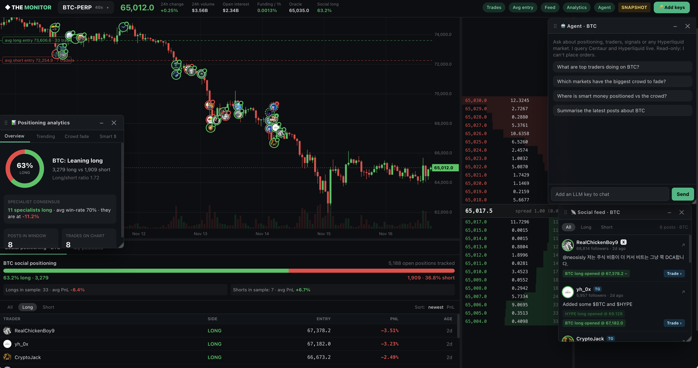

Price alone does not tell you who is in a trade. The Monitor is a one-page Hyperliquid terminal that puts traders tracked by Centaur on top of the chart, so you can see where they got in and what they are saying. It was made by Centaur, an outside team, and sits under **External Tools** in Mainframe.

<Frame caption="The captured demo: trader markers on the chart, positioning, the order book, the Agent and the social feed">
  
</Frame>

## Who it is for

It is for traders who follow other traders and want their calls, entries and positioning next to the price, with a quick way to act on them.

## What it does

- **Every Hyperliquid perp**: native crypto plus the stock, commodity, index, FX and pre-IPO markets, with live prices, candles and an order book.
- **Traders on the chart.** Tracked traders' entries and exits show as avatar markers on the candles.
- **Social feed** of their posts, filtered by long or short.
- **Positioning** with the long and short split, every tracked open position, and signals such as trending, crowd fade and smart money.
- **Copy a trade.** **Trade this signal** on a marker or a post fills the order ticket with that trader's action. Nothing is sent until you confirm.
- **Order ticket** with market and limit orders and leverage, always followed by a **Confirm order** step.
- **Agent** that answers questions with Centaur and Hyperliquid data. It is read-only and runs on your [AI credits](/product/models-and-credits).

## What it needs

| Need | Why |
| --- | --- |
| Your OpenFinance key | Turns on trading, the account view and the Agent. Charts and the order book work without it |
| Your own Centaur API key | Fills the social panels. Without it they stay empty and say so; **Get a Centaur key** opens Centaur's access page |
| USDC on Hyperliquid | Margin for your trades |
| GitHub and Vercel | To keep the code and deploy a private copy |

Both keys stay in your browser and are sent only with each request; they are never stored on the server. The app has no bundled trader data: everything social comes live from Centaur with your key.

## Deploy it

<Steps>
  <Step title="Deploy from Mainframe">Click **Deploy** on the card, then press Enter in the Build message box.</Step>
  <Step title="Check it">Confirm prices, candles and the order book are live in the preview.</Step>
  <Step title="Ship it">Deploy to Vercel as a private project, then add your keys under **Connections**.</Step>
</Steps>

**Live Demo** in the demo viewer opens a deployed copy, so you can try the layout before you build.

## Limits

- Social data depends on your Centaur plan and what Centaur tracks for each market.
- A copied trade is filled as a limit order at the trader's price. Check the size and price before you confirm.
- Busy times on Hyperliquid can pause live data for a moment; the page says so and recovers by itself.

Every trade needs your confirmation, and nothing here is financial advice. See [Keys and safety](/mainframe/safety).
