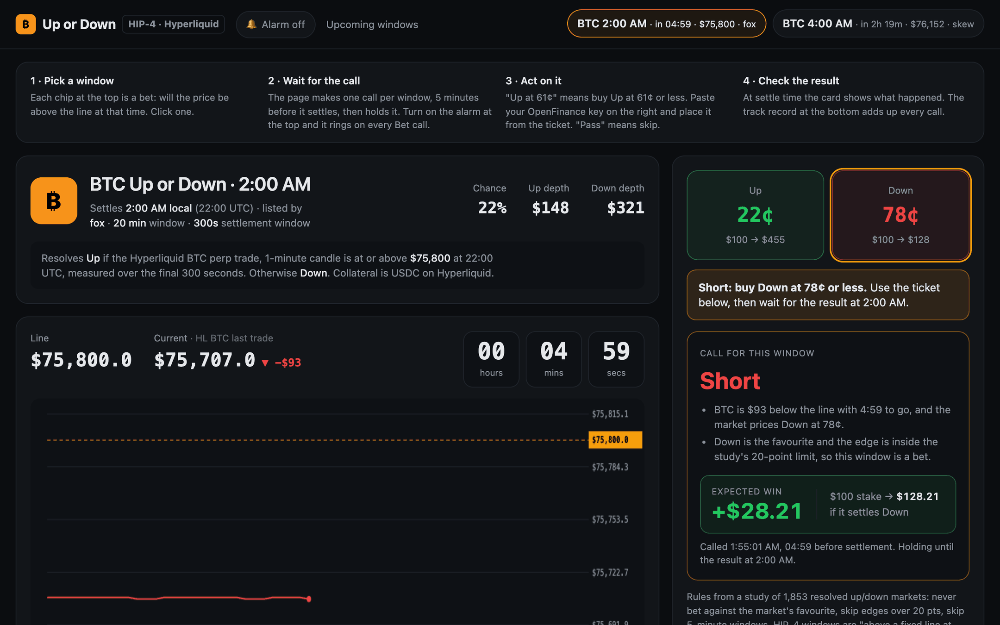

Each of these HIP-4 outcome markets asks one question: will BTC be above this line at this time? The helper answers Up, Down or Pass once per window and then does not change its mind. It sits under **Prediction Markets** in Mainframe.

<Frame caption="The captured demo: upcoming windows, the line and countdown, and the held call">
  
</Frame>

## Who it is for

Use it if you trade [Hyperliquid outcome markets](/markets/hyperliquid-outcomes) and want a calm, rules-based hint instead of numbers that change every second.

## What it does

- **Upcoming windows** as chips at the top, with settle time, countdown, line and the third-party deployer that listed it.
- **Live chart** of the BTC reference price against the line, with a countdown to settlement.
- **Helper tools**, refreshed every 10 seconds: distance from the line versus noise, an edge meter comparing a model's fair chance with the market price, and the live trade flow.
- **One call per window**, made 5 minutes before settlement and then frozen: Up at a price, Down at a price, or Pass, with the reasons.
- **Next-step line** that always says what to do: wait, buy, skip, or the result.
- **Alarm** that rings, retitles the tab and sends a browser notification on every Bet call.
- **Track record** of every call against what happened, with a hit rate and profit and loss on a notional \$100 per bet.
- **Ticket** to buy Up or Down shares with your key, plus the Up-share order book.

## What it needs

| Need | Why |
| --- | --- |
| Your OpenFinance key | Only for your balance and orders |
| USDC on Hyperliquid | Outcome shares are paid in USDC from your Hyperliquid balance |
| GitHub and Vercel | To keep the code and deploy a private copy |

Market data comes from Hyperliquid's public API and WebSocket.

## Deploy it

<Steps>
  <Step title="Deploy">Click **Deploy** on the card. The prompt asks for two build batches; if a run stops, click **Continue run**.</Step>
  <Step title="Watch a window">Pick a chip more than 5 minutes out, turn on the alarm, and wait for the call.</Step>
  <Step title="Trade only when you choose">Paste your key, check the ticket, and confirm the order.</Step>
</Steps>

## Ideas to customize

Two requests to try once it runs:

```text
Add ETH windows next to BTC when Hyperliquid lists them, with their own track record.
```

```text
Export the track record as a CSV file.
```

## Limits

- Most windows are a pass. The call rules skip windows of about 5 minutes, sides priced under 50¢ or over 80¢, and edges that look too large.
- A call is a hint, not a promise. The track record lives in your browser only.
- Orders are whole shares with a minimum of about \$10, sent as immediate-or-cancel.
- For windows that settle on a Pyth price, the chart uses the Hyperliquid mark as a stand-in.

Every trade needs your confirmation, and nothing here is financial advice. See [Keys and safety](/mainframe/safety).
