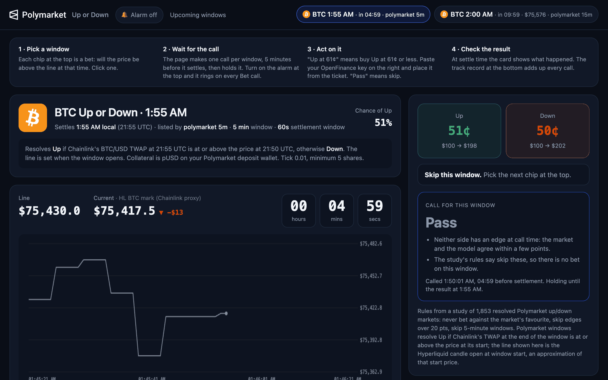

If you have used [HIP-4 Up/Down Edge](/mainframe/templates/updown-hip4), this will feel familiar: it makes one call per "Up or Down" window and holds it. The main difference is how a Polymarket window settles, explained below. It sits under **Prediction Markets** in Mainframe.

<Frame caption="The captured demo: windows across the top, the price against the line, and the held call">
  
</Frame>

## Who it is for

Use it if you trade [Polymarket](/markets/polymarket) crypto windows and want one considered call per window, an alarm, and an honest record of how the calls did.

## What it does

- **Windows** for BTC and ETH, in 15 minute and 5 minute series, shown as chips with settle time and countdown.
- **Line and chart.** Polymarket windows resolve on whether the price at the end is at or above the price at the start. The app shows an approximate start price and the live reference price against it.
- **Helper tools**, refreshed every 10 seconds: distance from the line, an edge meter, and live trade flow.
- **One call per window**, 5 minutes before settlement, then frozen: Up, Down or Pass with reasons.
- **Alarm** with sound and browser notifications on every Bet call.
- **Track record** with hit rate and profit and loss on a notional \$100 per bet.
- **Ticket** to buy Up or Down with your key, showing your Polymarket balance.

## What it needs

| Need | Why |
| --- | --- |
| Your OpenFinance key | Your balance and orders. Also loads markets through OpenFinance if Polymarket's public API does not answer on your network |
| pUSD in your Polymarket deposit wallet | Polymarket trades are paid in pUSD. The app tells you when USDC.e needs wrapping first |
| GitHub and Vercel | To keep the code and deploy a private copy |

The reference price and trade flow come from Hyperliquid's public data for the same coin.

## Deploy it

<Steps>
  <Step title="Deploy">Click **Deploy** on the card. If a run stops, click **Continue run**.</Step>
  <Step title="Watch a window">Pick a chip, turn on the alarm, and wait for the call.</Step>
  <Step title="Trade only when you choose">Paste your key, check the ticket, and confirm the order.</Step>
</Steps>

## Ideas to customize

Ask for changes like these after the build:

```text
Show only 15 minute windows and hide the 5 minute series.
```

```text
Add a weekly summary of the track record by coin.
```

## Limits

- The line shown is an approximation of the official start price. Polymarket settles on its own source, and results are marked "by feed, awaiting official" until confirmed.
- 5 minute windows always pass, so calls come on 15 minute windows. Most windows are a pass.
- Orders are fill-or-kill with a 0.01 tick and a 5 share minimum.
- A call is a hint, not a promise. The track record lives in your browser only.

Every trade needs your confirmation, and nothing here is financial advice. See [Keys and safety](/mainframe/safety).
