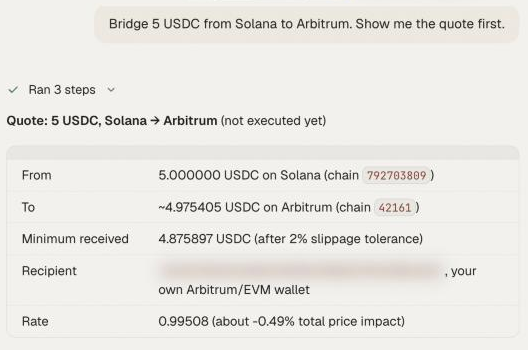

A bridge moves value from one blockchain to another. OpenFinance uses Relay for this, so you can ask for "USDC on Base to USDC on Arbitrum" or "ETH on Arbitrum to SOL on Solana" in one step.

## What it is

Relay does three related jobs:

| Job | Example |
| --- | --- |
| Bridge | USDC on Polygon to USDC on Base |
| Cross-chain swap | ETH on Arbitrum to SOL on Solana |
| Same-chain swap on an EVM chain | ETH to USDC on Base |

It covers a wide set of EVM chains plus Solana and Bitcoin. You will use it most often to get funds to where a venue needs them: USDC to Arbitrum for [Hyperliquid](/markets/hyperliquid), or funds to Polygon for [Polymarket](/markets/polymarket).

Two cases do not use Relay. A swap between two Solana tokens goes through Jupiter, and a plain send on one chain with no token change is a normal transfer. Both are covered in [Onchain tokens](/markets/onchain-tokens). The agent picks the route for you.

Every bridge and swap needs your confirmation before it is sent, and nothing here is financial advice.

## Before you bridge

- **Start with a quote.** A quote is free and sends nothing. It shows what leaves, what arrives and the route.
- **Have gas on the starting chain.** The first transaction is paid on the chain you are leaving.
- **Bridges from an agent go to your own wallets.** The destination must be one of your own addresses: your EVM address, your Solana address or your Polymarket deposit wallet. To send to another person, use the [Wallet](/product/wallet) page.
- **Quotes expire.** If you change the amount or wait a while, ask for a fresh quote.

<Frame caption="A bridge quote in chat: what leaves, what arrives and the route">
  
</Frame>

## Ask in the app

With gas in place, try prompts like these in the chat:

- "Bridge 100 USDC from Base to Arbitrum. Show the quote first."
- "I have USDC on Polygon. Get it onto Hyperliquid."
- "Swap 0.05 ETH for USDC on Base."
- "Move 50 USDC from Solana to Base."
- "What is the status of my last bridge?"

## What happens after you confirm

<Steps>
  <Step title="The agent executes the quote">
    Your wallet signs each step of the route.
  </Step>
  <Step title="Relay fills the transfer">
    The agent waits for a final result for up to about five minutes.
  </Step>
  <Step title="You get a result">
    A transfer ends as success, refunded or failure. If it is still in progress when the wait ends, ask for the status again later.
  </Step>
</Steps>

## From your own agent

Your own agent uses three tools: `relay_get_quote` (read only), `relay_execute` (signs, submits and waits) and `relay_get_status` (check a transfer by its request id). Amounts are in the token's smallest unit, and chains are numeric ids. See [Relay tools](/mcp/tools-relay).

## Limits

- From an agent, the recipient must be one of your own wallets.
- Not every token pair has a route. If a quote fails, try a more common token such as USDC or the chain's native coin.
- On routes that touch Solana, the automatic gas top-up on the destination chain is switched off. Make sure you hold some native coin there.
- A Solana wallet must be enabled for agent trading before a route that starts on Solana.

## FAQ

<AccordionGroup>
  <Accordion title="How do I get funds onto Hyperliquid from another chain?">
    Bridge USDC to Arbitrum, then send it to your Hyperliquid deposit address. You can ask for both in one sentence and confirm each step.
  </Accordion>
  <Accordion title="My bridge says refunded. Did I lose money?">
    Refunded means the route could not complete and the funds were returned. Ask for the status to see the details, then request a new quote.
  </Accordion>
  <Accordion title="Should I bridge or just swap?">
    If the token and the chain both stay the same, you are sending, not bridging. If only the token changes on Solana, that is a Jupiter swap. Everything else is a Relay route.
  </Accordion>
</AccordionGroup>

## Next

<CardGroup cols={2}>
  <Card title="Fund with card or bank" icon="credit-card" href="/markets/fund-with-card-or-bank">
    Start from money in a bank account.
  </Card>
  <Card title="Relay tools" icon="wrench" href="/mcp/tools-relay">
    Tool reference for agents.
  </Card>
</CardGroup>
