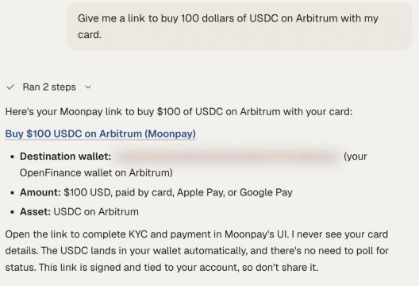

This step is called an onramp. You ask the agent for a checkout link, pay on the provider's page, and the crypto arrives in your wallet.

## How it works

OpenFinance does not take your card details. It builds a checkout link with one of two providers and hands it to you:

| You pay in | Provider | Ways to pay |
| --- | --- | --- |
| INR | Onramp.money | UPI, IMPS and bank transfer |
| Any other currency | Moonpay | Card, Apple Pay, Google Pay and bank transfer |

The provider is picked from the currency you pay in. You finish payment, and any identity check the provider requires, on the provider's own page. The crypto is delivered to your wallet address on the chain you chose.

<Frame caption="A checkout link in chat for buying USDC with a card">
  
</Frame>

## Use it

<Steps>
  <Step title="Say what you want to buy">
    Name the amount, the currency you pay in, the token and the chain. For example: "Buy 100 dollars of USDC on Arbitrum with my card."
  </Step>
  <Step title="Open the link">
    The agent returns a checkout link. Open it and complete payment with the provider.
  </Step>
  <Step title="Check that it arrived">
    Ask "what do I hold on Arbitrum?" once the provider says the order is complete.
  </Step>
  <Step title="Move it to the venue">
    Wallet funds are not yet on a venue. Deposit to [Hyperliquid](/markets/hyperliquid) or [Polymarket](/markets/polymarket), or swap [onchain](/markets/onchain-tokens).
  </Step>
</Steps>

## Example prompts

Prompts like these work in the chat:

- "Give me a link to buy 100 dollars of USDC with my card."
- "Buy 50 euros of ETH on Base."
- "Add 5000 rupees of USDC with UPI."
- "I have no crypto. What is the fastest way to start trading BTC perps?"
- "Buy SOL with Apple Pay."

## Paying in INR

Onramp.money supports a fixed set of token and network pairs:

| Token | Networks |
| --- | --- |
| USDT | Ethereum, Polygon, BNB Chain, Tron |
| USDC | Polygon, BNB Chain |
| ETH | Ethereum, Polygon |
| SOL | Solana |
| MATIC | Polygon |
| BNB, BUSD | BNB Chain |

If you ask for a pair outside this list, such as USDC on Ethereum with INR, the agent proposes a supported one.

<Tip>
To trade on Hyperliquid starting from INR: buy USDC on Polygon or BNB Chain, [bridge](/markets/bridge-and-swap) it to Arbitrum, then deposit to Hyperliquid. Hyperliquid takes USDC only.
</Tip>

## From your own agent

Your own agent needs one tool, `get_onramp_url`. Pass the fiat currency, amount, token and chain, and return the link to the user. See [Wallet and onramp tools](/mcp/tools-wallet-and-onramp).

## Limits

- The provider sets its own limits and exchange rate, and shows them at checkout before you pay.
- OpenFinance does not run identity checks itself. Moonpay and Onramp.money may require them.
- Which payment methods and currencies you see depends on the provider and on where you live.
- The agent cannot see or track your payment. Check your wallet balance to confirm delivery.

## FAQ

<AccordionGroup>
  <Accordion title="Where does the crypto go?">
    To your own OpenFinance wallet: your EVM address for EVM chains, or your Solana address if you chose Solana.
  </Accordion>
  <Accordion title="Can I buy straight into Hyperliquid or Polymarket?">
    No. The onramp delivers to your wallet. Deposit to the venue as a second step.
  </Accordion>
  <Accordion title="Can I already have crypto and skip this?">
    Yes. Send it to your wallet address from any exchange or wallet. See [Wallet](/product/wallet).
  </Accordion>
</AccordionGroup>

## Next

<CardGroup cols={2}>
  <Card title="Bridge and swap" icon="bridge" href="/markets/bridge-and-swap">
    Get funds to the right chain.
  </Card>
  <Card title="Markets overview" icon="globe" href="/markets/overview">
    What each venue needs before you trade.
  </Card>
</CardGroup>
