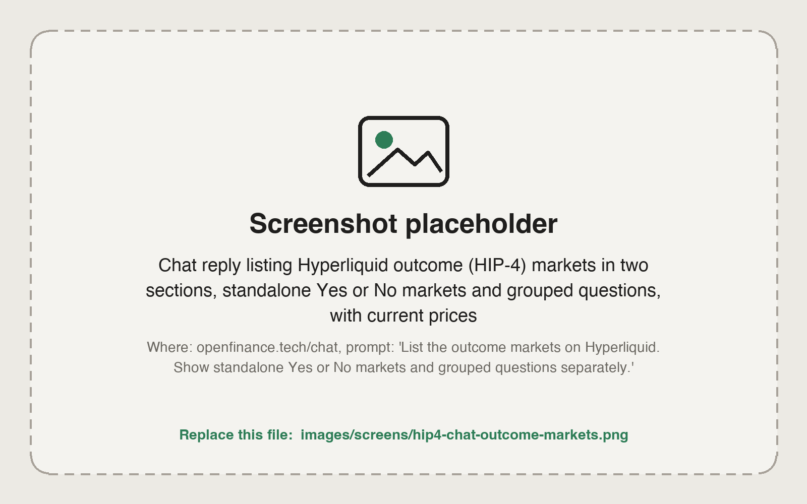

Outcome markets are Hyperliquid's prediction-style markets, also called HIP-4. You buy shares in an outcome, and the share price moves between 0 and 1 as the market changes its mind. A few terms come up on every outcome market, so start with those.

## What it is

- An **outcome** is a statement with two sides, usually Yes and No. Each side is a share you can buy and sell on Hyperliquid's order book.
- A **question** groups several named outcomes where only one can be true, for example a set of price ranges or a list of candidates.
- Some outcomes stand alone and are not part of any question.

A share price reads like a probability. A Yes share at 0.40 means the market prices that outcome at roughly 40%. Many outcome markets are recurring price markets, such as whether an asset will be above a target at a set time, or which price range it will land in.

Every order needs your confirmation before it is sent, and nothing here is financial advice. A share on the losing side can go to zero.

<Frame caption="Outcome markets listed in chat, with standalone Yes or No markets and grouped questions shown separately">
  
</Frame>

## Before you trade

Outcome markets share your Hyperliquid balance, but they have a few rules of their own.

- **Currency:** outcome markets settle in USDC, from the same Hyperliquid balance you use for perps. You do not need a second token. Fund it the same way: USDC from Arbitrum to your Hyperliquid deposit address. See [Hyperliquid](/markets/hyperliquid).
- **Sizes are whole shares.** You cannot buy 2.5 shares. Ask in shares, or ask in dollars and let the agent round to whole shares.
- **Read the real question, not the label.** Recurring markets reuse the same display name. Ask the agent to describe a market in words (underlying, target and expiry) before you trade it.
- **Very small orders can be rejected** for being below the venue's minimum order value. If that happens, raise the number of shares.

## Ask in the app

Prompts like these work in the chat:

- "List the outcome markets on Hyperliquid. Show standalone Yes or No markets and grouped questions separately."
- "What is the order book for the Yes side of that BTC market?"
- "Buy 20 Yes shares at no more than 0.42. Show the order first."
- "What outcome shares do I hold, and what are they worth now?"
- "Cancel my open orders on that outcome."
- "Split 50 USDC into Yes and No shares on that outcome."

## How shares are created and removed

Besides buying and selling on the book, Hyperliquid lets you convert between USDC and shares:

| Action | What it does |
| --- | --- |
| Split | Turns an amount of USDC into the same number of Yes shares and No shares |
| Merge | Turns matching Yes and No shares of one outcome back into USDC |
| Merge a question | Turns one Yes share of every named outcome in a question back into USDC |
| Negate | Turns No shares of one outcome into Yes shares of every other outcome in the same question |

Most people only buy and sell. Split and merge matter if you want to hold both sides or make markets.

## From your own agent

From your own agent, everything goes through the `hyperliquid` tool. `get_outcome_meta` lists the markets, split into standalone binary markets and grouped questions. Shares trade through the normal `place_order`, `modify_order` and `cancel_order` actions with a special asset id, and `split_outcome`, `merge_outcome`, `merge_question` and `negate_outcome` handle conversion. The asset id formula and side numbering are on the [Hyperliquid tool](/mcp/tools-hyperliquid) page.

## Limits

- Outcome markets take USDC only, on Hyperliquid.
- Sizes are whole shares.
- Markets, sides and expiries come from Hyperliquid and change over time. Always ask for the live list.

## FAQ

<AccordionGroup>
  <Accordion title="How is this different from Polymarket?">
    Both let you buy shares in outcomes. Hyperliquid outcome markets live on Hyperliquid and use your Hyperliquid USDC balance. Polymarket is a separate venue with its own deposit wallet and currency. See [Polymarket](/markets/polymarket).
  </Accordion>
  <Accordion title="Do I need USDH?">
    No. Outcome markets use USDC.
  </Accordion>
  <Accordion title="Why was my order rejected for invalid size?">
    Sizes must be whole shares. Round to a whole number and try again.
  </Accordion>
</AccordionGroup>

## Next

<CardGroup cols={2}>
  <Card title="Hyperliquid perps and spot" icon="chart-line" href="/markets/hyperliquid">
    Funding, order types and withdrawals.
  </Card>
  <Card title="Polymarket" icon="square-poll-vertical" href="/markets/polymarket">
    The other prediction venue.
  </Card>
</CardGroup>
