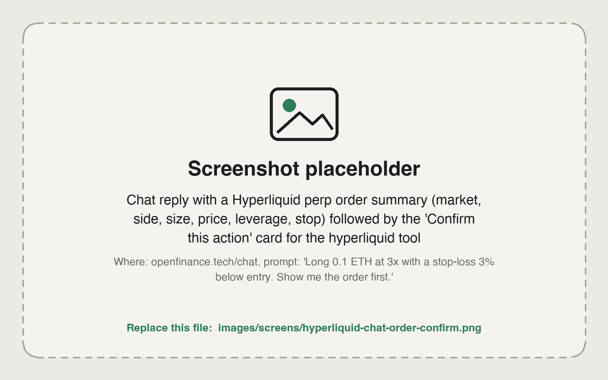

Hyperliquid is a trading venue that runs on its own chain, with its own order book and its own USDC balance. Before you fund it, it helps to know the three kinds of market you will find there.

## What it is

- **Perps** are contracts that track a price without an expiry. You can go long or short and use leverage. You pay or receive a funding rate while the position is open.
- **Spot** is buying and selling the token itself, such as HYPE.
- **HIP-3 markets** are perps listed by independent deployers on Hyperliquid. This is where you find perps on stocks, indices, commodities, FX pairs and pre-IPO names. Their symbols carry a prefix, for example `xyz:NVDA`.

A perp is not the underlying asset. A stock perp gives you price exposure only, with no shareholder rights. HIP-3 markets are run by third-party deployers who set the price source and contract terms, so check a market before you trade it.

As on every venue, each order needs your confirmation before it is sent, and nothing here is financial advice. Leverage can lose your whole margin.

<Frame caption="An order summary in chat, waiting for your confirmation">
  
</Frame>

## Before you trade

Hyperliquid accepts **USDC only**, not USDT and not USDC.e, so funding comes down to getting USDC onto Arbitrum and depositing it.

<Steps>
  <Step title="Get USDC on Arbitrum">
    Deposits come from Arbitrum. If your USDC is on another chain, [bridge it](/markets/bridge-and-swap). If you have no crypto yet, [buy some with a card or bank](/markets/fund-with-card-or-bank).
  </Step>
  <Step title="Deposit to Hyperliquid">
    Ask for your Hyperliquid deposit address and send USDC on Arbitrum to it. The address lives on Arbitrum. Your Hyperliquid balance is credited within minutes.
  </Step>
  <Step title="Check your balance">
    Ask "what is my Hyperliquid balance?". You should get one USDC figure, plus any other tokens and open positions.
  </Step>
</Steps>

<Note>
Hyperliquid can treat your spot USDC and perp USDC as one pool, called a unified account. OpenFinance switches your account to this mode the first time it is needed and tells you when it does. That is why you see one balance instead of two.
</Note>

<Warning>
Send only USDC, and only on Arbitrum, to your Hyperliquid deposit address. Hyperliquid does not accept other tokens or other networks.
</Warning>

## Ask in the app

Once your balance shows up, try prompts like these in the chat:

- "What is my Hyperliquid balance and what positions do I have open?"
- "Which stock perps can I trade on Hyperliquid? Show today's move for NVDA and TSLA."
- "What are the five highest funding rates right now, with open interest?"
- "Long 0.1 ETH at 3x with a stop-loss 3% below entry. Show me the order first."
- "Buy 50 dollars of HYPE on spot."
- "Withdraw 200 USDC from Hyperliquid to Arbitrum."

Good to know when you ask:

- Say the size in dollars or in units. The agent converts dollars to the right size for that market.
- Name a price for a resting limit order. Without a price, the agent treats "buy now" as an order that fills against the book.
- Say the leverage if you want to change it. Otherwise the market's current setting is used.

## Orders you can place

You describe the order in plain words. The table shows what to ask for in each case.

| You want | Ask for |
| --- | --- |
| Fill now at the current market price | A market-style order |
| Rest at your price | A limit order |
| Only add liquidity | A post-only order |
| Exit automatically | A stop-loss or take-profit, alone or attached to an entry |
| Work a large order over time | A TWAP order over a number of minutes |
| Only close, never flip | A reduce-only order |

You can also change leverage, switch between cross and isolated margin, add or remove isolated margin, and modify or cancel open orders.

## From your own agent

From your own agent, the same trades go through the `hyperliquid` tool, where you pick an `action`. A typical flow is `get_perp_categories` or `get_market_metas` to find the market, `get_account_summary` for the balance, `place_order` to trade, `get_open_orders` and `get_user_fills` to follow up, `withdraw_to_arbitrum` to cash out. Request shapes have a few sharp edges, so read [Hyperliquid tool](/mcp/tools-hyperliquid) first.

## Limits

- USDC is the only deposit currency. A small number of HIP-3 markets use USDH as collateral; the agent tells you when one does, and you get USDH by swapping USDC on Hyperliquid spot.
- Withdrawals go to your own address on Arbitrum and take about 5 minutes.
- Hyperliquid rejects prices too far from the current market, and sizes that do not match a market's size precision.
- There is no practice mode. Start small.

## FAQ

<AccordionGroup>
  <Accordion title="Do I need my own Hyperliquid account or private key?">
    No. OpenFinance trades from your embedded wallet. Nothing is pasted into a config file. You can export the wallet key if you want it. See [Safety and custody](/reference/safety-and-custody).
  </Accordion>
  <Accordion title="Can I look at another trader's wallet?">
    Yes. Ask "what is wallet 0x... holding on Hyperliquid?". Account reads work for any address, and you can compare several wallets in one request.
  </Accordion>
  <Accordion title="My balance shows zero but I deposited">
    Check that you sent USDC from Arbitrum to the Hyperliquid deposit address, then ask for the full balance again. Spot and perp USDC are reported as one figure.
  </Accordion>
  <Accordion title="Can I trade options on Hyperliquid here?">
    No. Options go through your own broker account. See [Options](/markets/options).
  </Accordion>
</AccordionGroup>

## Next

<CardGroup cols={2}>
  <Card title="Hyperliquid outcomes" icon="circle-half-stroke" href="/markets/hyperliquid-outcomes">
    Yes or No markets on Hyperliquid.
  </Card>
  <Card title="Hyperliquid tool" icon="wrench" href="/mcp/tools-hyperliquid">
    Actions and request shapes for agents.
  </Card>
</CardGroup>
