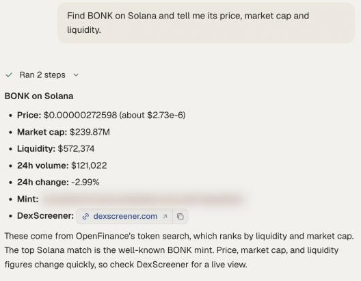

Onchain tokens are assets that live in your own wallet on a blockchain: stablecoins, memecoins, tokenized stocks, FX tokens and everything else with a contract address. You work with them by asking in the chat, and OpenFinance finds a route on the right chain.

## What it is

There is no single exchange here. A swap is routed to a decentralized exchange on the chain where the token lives:

- **On Solana**, swaps go through Jupiter. This covers Solana memecoins, including Pump.fun tokens, and tokenized stocks and FX tokens issued on Solana.
- **On EVM chains** such as Ethereum and Base, swaps go through Relay, which also handles moves between chains. See [Bridge and swap](/markets/bridge-and-swap).

What you get is the token itself, in your wallet. A tokenized stock is a token that tracks a share price; it is not a share and carries no shareholder rights. If you want leveraged exposure instead, look at stock perps on [Hyperliquid](/markets/hyperliquid).

Every swap and send needs your confirmation before it is sent, and nothing here is financial advice. Onchain transactions cannot be reversed.

## Before you trade

Because the funds sit in your own wallet, a few things are up to you.

- **Your wallet holds the funds.** You have one EVM address across EVM chains and one Solana address. Balances are per chain: USDC on Base cannot pay for a swap on Solana until you bridge it.
- **You need gas.** Keep a little of the chain's native coin (ETH on Ethereum and Base, SOL on Solana) for gas.
- **Check the token before you buy.** Many tokens share a name. The agent resolves a name to a contract address, then shows you a chart link, market cap, liquidity and 24 hour volume so you can verify it is the one you mean.
- **Thin tokens are risky.** For a token with a small market cap, low liquidity or a large one-day move, the agent shows a warning before it asks you to confirm. Slippage can be large. Only swap an amount you can afford to lose.

<Frame caption="A token lookup in chat: contract address, price, market cap, liquidity and a chart link">
  
</Frame>

## Ask in the app

Prompts like these work in the chat:

- "What do I hold across all my wallets, in dollars? Check every chain."
- "Find BONK and tell me its price, market cap and liquidity."
- "Swap 1 SOL for BONK. Show the quote first."
- "Buy 50 dollars of the tokenized TSLA token on Solana."
- "Sell half of my WIF."
- "Send 25 USDC on Base to 0x... and show me the summary before sending."

Good to know when you ask:

- On Solana, if you name only one token, the other side defaults to SOL. Say so if you want to pay with USDC instead.
- If a name matches several tokens, the agent lists the top candidates and asks which one.
- When you ask what you hold, ask the agent to check every chain, including Robinhood Chain if you have launched or bought tokens there. Holdings are read one chain at a time.

## Sending tokens

You can send a token to another address on the same chain. If the address is not one of your own wallets, the agent shows a clear external transfer warning and waits for an explicit yes, because funds sent to a wrong address cannot be recovered. For moves between chains, use [Bridge and swap](/markets/bridge-and-swap).

## From your own agent

Your own agent uses a separate tool for each job:

| Job | Tool |
| --- | --- |
| Find a token by name, symbol or address | `onchain_search_tokens` |
| Name, symbol and decimals for a contract | `onchain_get_token_metadata` |
| Price in dollars | `onchain_get_token_usd_price` |
| What a wallet holds on one chain | `onchain_get_address_holdings` |
| Swap on Solana | `onchain_jupiter_order`, then `onchain_jupiter_execute` |
| Swap on an EVM chain | `relay_get_quote`, then `relay_execute` |
| Send on the same chain | `onchain_send_token` |

Details and request shapes are on [Onchain and Jupiter tools](/mcp/tools-onchain).

## Limits

- Solana swaps use Jupiter; swaps on other chains use Relay. The agent picks the route.
- A Solana wallet must be enabled for agent trading before the first Solana swap. If it is not, the request fails with a 412 error and instructions to follow.
- Token search covers many more chains than you can trade on. Finding a token does not mean a swap route exists for it.
- There is no sniping or automatic buying. Every swap is quoted and confirmed.

## FAQ

<AccordionGroup>
  <Accordion title="Which tokenized stocks and FX tokens can I buy?">
    Ask the agent to search for the ticker on Solana, Base or Ethereum and show the matches with liquidity. Availability depends on what issuers have listed and where there is liquidity.
  </Accordion>
  <Accordion title="The agent says I hold nothing, but I do">
    It probably checked only one chain. Ask it to check every chain and to say which chains it looked at.
  </Accordion>
  <Accordion title="Can I send tokens to a friend?">
    Yes, on the same chain. You will see an external transfer warning first. You can also send from the [Wallet](/product/wallet) page.
  </Accordion>
</AccordionGroup>

## Next

<CardGroup cols={2}>
  <Card title="Bridge and swap" icon="bridge" href="/markets/bridge-and-swap">
    Move funds between chains.
  </Card>
  <Card title="Onchain and Jupiter tools" icon="wrench" href="/mcp/tools-onchain">
    Tool reference for agents.
  </Card>
</CardGroup>
