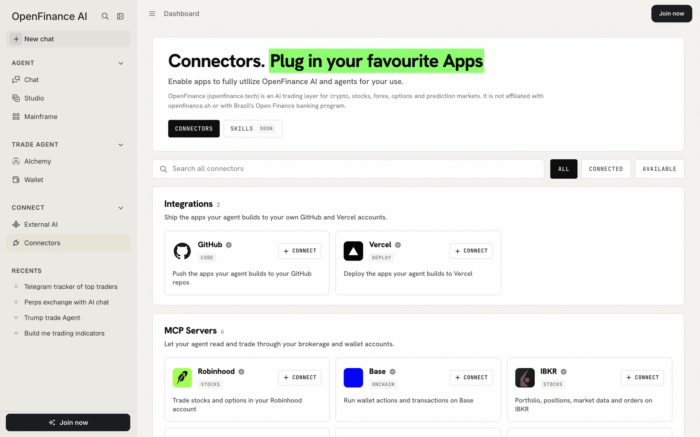

Options trade through your own brokerage account. You connect Interactive Brokers (IBKR) or Robinhood in the OpenFinance app, and the chat can then work with that account.

## How it works

OpenFinance does not hold an options account for you. The connection works like this:

1. You connect your broker on the [Connectors](/product/connectors) page and approve access on the broker's own sign-in page.
2. The chat in the OpenFinance app can then use the broker's tools on your behalf.
3. Orders are placed in your broker account, under your broker's rules and margin requirements.

Every order needs your confirmation before it is sent, and nothing here is financial advice. Options can lose their full value.

<Frame caption="Broker connectors in the OpenFinance app">
  
</Frame>

## What is and is not possible

In short, options work through your broker from the app chat, and nowhere else in OpenFinance.

| | |
| --- | --- |
| Trade stocks and options in your Robinhood account from the OpenFinance chat | Yes, through the Robinhood connector |
| Read your IBKR portfolio, positions and market data, and place orders in your IBKR account | Yes, through the IBKR connector |
| Trade options through the OpenFinance MCP server from your own agent | No |
| Trade options on Hyperliquid | No |
| Use your OpenFinance wallet balance to pay for options | No, options use the cash and margin in your broker account |

## Before you trade

- You need an account with the broker, approved for options by that broker.
- The broker's eligibility rules, identity checks and trading permissions apply. OpenFinance does not change them.
- Funding happens at the broker, not in your OpenFinance wallet.

<Note>
What the chat can do with a broker depends on the tools that broker exposes and on the broker approving the connection. If a broker sign-in does not complete, see [Connectors](/product/connectors).
</Note>

## Ask in the app

After connecting a broker:

- "Show my positions and buying power in my broker account."
- "Show the option chain for NVDA expiring next month."
- "What would a covered call on my AAPL shares look like? Do not place anything."
- "Buy 1 SPY call at the strike and expiry I picked. Show the order first."

## FAQ

<AccordionGroup>
  <Accordion title="Why can my own AI agent not trade options through OpenFinance?">
    Broker connections live in the OpenFinance app. The MCP server covers Hyperliquid, Polymarket, onchain tokens, bridging, onramp and token launches.
  </Accordion>
  <Accordion title="I want leveraged exposure to a stock without a broker">
    Look at stock perps on [Hyperliquid](/markets/hyperliquid). A perp is a different product from an option: it has no strike or expiry, and it can be liquidated.
  </Accordion>
</AccordionGroup>

## Next

<CardGroup cols={2}>
  <Card title="Connectors" icon="plug" href="/product/connectors">
    Connect IBKR or Robinhood in the app.
  </Card>
  <Card title="Markets overview" icon="globe" href="/markets/overview">
    Everything else you can trade.
  </Card>
</CardGroup>
