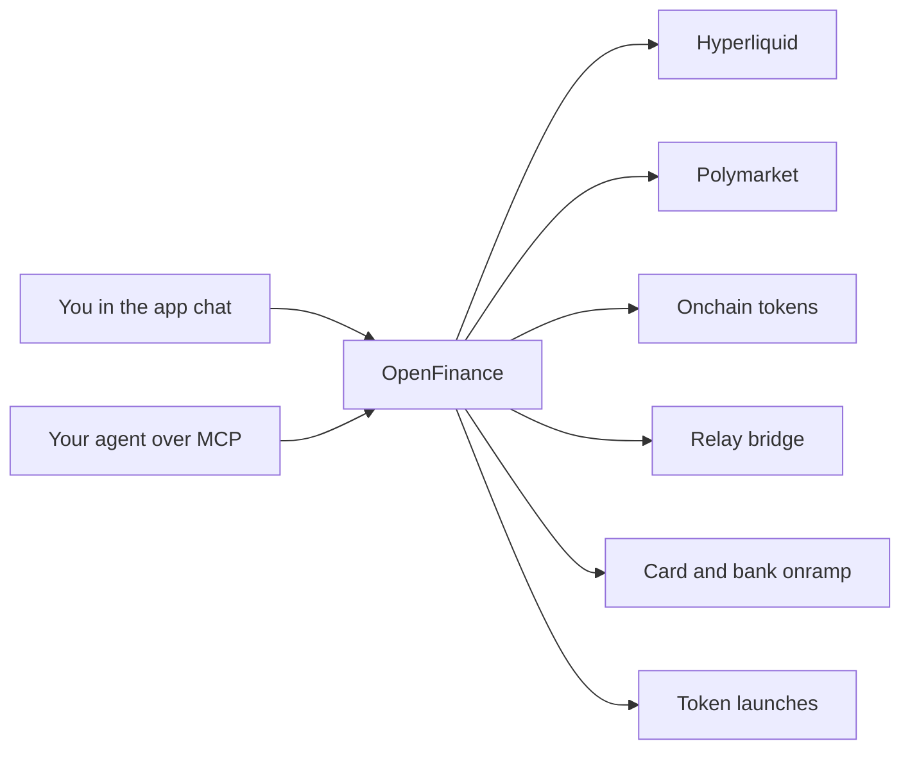
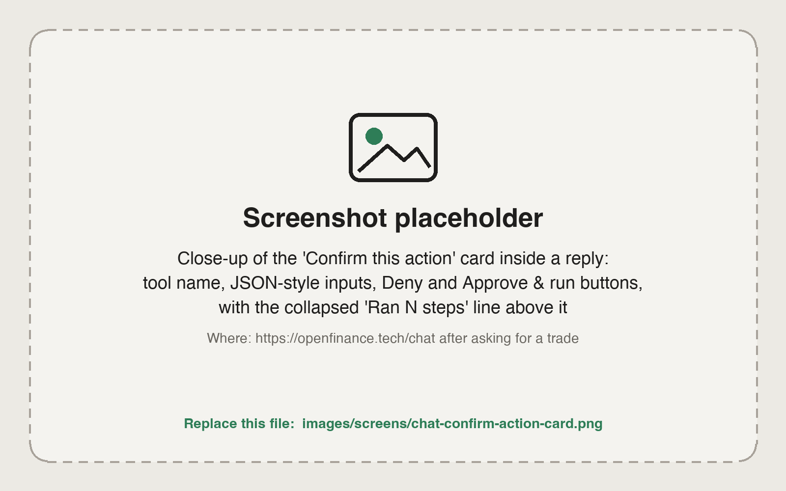

You ask in plain language, in the OpenFinance app chat or from your own AI agent over MCP, and OpenFinance routes the request to the right venue from your own wallet. You never open a separate account per venue, but each venue still has its own rules, so it helps to see how the pieces fit together first.

## How it works

OpenFinance is not an exchange. It sits between you and the venues. Each venue keeps its own order book, its own rules and its own currency, so the main thing to learn is which venue a trade goes through and what that venue needs before you can trade.

Whichever venue a request goes to, every trade, transfer or launch needs your confirmation before it is sent. Nothing in these docs is financial advice.

<Frame caption="The chat asks you to confirm before any action that moves funds or places an order">
  
</Frame>

## What you can trade

Each row below is one kind of trade, the venue that handles it and what you need in place before you start.

| What | Venue | What you need first | Read more |
| --- | --- | --- | --- |
| Crypto perps and spot | Hyperliquid | USDC, deposited from Arbitrum | [Hyperliquid](/markets/hyperliquid) |
| Stock, index, commodity, FX and pre-IPO perps | Hyperliquid (HIP-3 markets) | USDC on Hyperliquid | [Hyperliquid](/markets/hyperliquid) |
| Yes or No outcome markets | Hyperliquid (HIP-4 markets) | USDC on Hyperliquid | [Hyperliquid outcomes](/markets/hyperliquid-outcomes) |
| Prediction markets | Polymarket | pUSD in your Polymarket deposit wallet | [Polymarket](/markets/polymarket) |
| Tokens, memecoins, tokenized stocks and FX tokens (spot) | Onchain, through Jupiter on Solana and Relay on EVM chains | The token you pay with, plus gas | [Onchain tokens](/markets/onchain-tokens) |
| Moving funds between chains | Relay | Funds on the chain you start from | [Bridge and swap](/markets/bridge-and-swap) |
| Buying crypto with a card or bank | Moonpay, or Onramp.money for INR | A payment method | [Fund with card or bank](/markets/fund-with-card-or-bank) |
| Launching your own token | Solana bonding curve, or Robinhood Chain | Funds for the launch | [Token launches](/markets/token-launches) |
| Options | Your own IBKR or Robinhood account, connected in the app | A broker account | [Options](/markets/options) |

You can also call AI models with the same account. See [Inference API](/inference/overview).

## Three things to know before your first trade

<Steps>
  <Step title="Your wallet is created for you">
    When you sign up you get a self-custodial embedded wallet: one EVM address that is the same on every EVM chain, and one Solana address. See [Wallet](/product/wallet).
  </Step>
  <Step title="Each venue has its own balance">
    Money in your wallet is not automatically on Hyperliquid or Polymarket. Hyperliquid takes USDC deposited from Arbitrum. Polymarket takes pUSD in a separate deposit wallet. Onchain swaps spend what is in your wallet on that chain.
  </Step>
  <Step title="You confirm every action">
    The agent shows you what it is about to do and waits. In the app you see a confirmation card. From your own agent, you reply yes and your client may ask for tool approval as well.
  </Step>
</Steps>

## Example prompts

Paste any of these into the [chat](/product/chat):

- "What can I trade from this account, and what is my balance on each venue?"
- "Where are perp funding rates most extreme right now?"
- "Show the Polymarket odds for the next Fed decision."
- "Find the most liquid tokenized NVDA token on Solana and show its price."
- "I have USDC on Base. How do I get it onto Hyperliquid?"
- "Give me a link to buy 100 dollars of USDC with my card."

## FAQ

<AccordionGroup>
  <Accordion title="Do I need a separate account for each venue?">
    No. One OpenFinance account and one wallet reach all of them. For options you connect your own broker account in the app.
  </Accordion>
  <Accordion title="Is the same thing available from my own AI agent?">
    Yes, except options. The MCP server exposes Hyperliquid, Polymarket, onchain, bridge, onramp and launch tools. See [MCP overview](/mcp/overview).
  </Accordion>
  <Accordion title="Is there a practice mode?">
    No. Trades are real. You can ask the agent to walk through a trade or show a quote without placing it.
  </Accordion>
  <Accordion title="Does OpenFinance ask for identity checks?">
    OpenFinance itself does not run KYC. A venue or payment provider may, and its rules still apply. See [Safety and custody](/reference/safety-and-custody).
  </Accordion>
</AccordionGroup>

## Next

<CardGroup cols={2}>
  <Card title="Hyperliquid" icon="chart-line" href="/markets/hyperliquid">
    Perps, spot and stock, commodity and FX perps.
  </Card>
  <Card title="Polymarket" icon="square-poll-vertical" href="/markets/polymarket">
    Prediction markets, odds and winnings.
  </Card>
  <Card title="Onchain tokens" icon="coins" href="/markets/onchain-tokens">
    Search, hold, send and swap tokens.
  </Card>
  <Card title="Deposit and buy credits" icon="wallet" href="/funding/overview">
    Get money onto the venue you want to trade.
  </Card>
</CardGroup>
