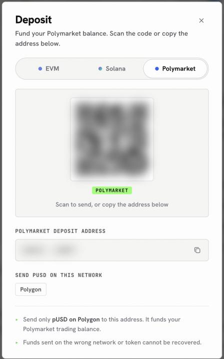

Polymarket is a prediction market. You buy shares in the outcome of a real-world event, such as an election, a match or a rate decision, and each winning share pays out when the event resolves.

## What it is

- A **market** asks a question with outcomes, most often Yes and No. An **event** groups related markets.
- A **price** is a probability between 0 and 1. A share at 0.42 costs 42 cents and implies about a 42% chance.
- Polymarket runs an order book. You can post a limit order and wait, or take the price on offer right now.

OpenFinance trades through Polymarket's own API from your account. You can search events, read odds and order books, look at any trader's positions and results, view the leaderboard, place and cancel orders, redeem winnings and cash out.

Every order, redeem and withdrawal needs your confirmation before it is sent, and nothing here is financial advice. Positions can go to zero.

## Before you trade

Polymarket does not trade from your main wallet address. It trades from a **Polymarket deposit wallet**, a separate smart-contract wallet that belongs to your account.

<Steps>
  <Step title="Find your Polymarket deposit address">
    Ask "what is my Polymarket deposit address?", or open the Deposit box in the app and choose the Polymarket tab.
  </Step>
  <Step title="Fund it with pUSD">
    Polymarket settles in **pUSD** on Polygon. Send only pUSD on Polygon to the deposit address. If your funds are in another token or on another chain, ask the agent to move them for you; see [Bridge and swap](/markets/bridge-and-swap).
  </Step>
  <Step title="Check the balance">
    Ask "what is my Polymarket balance?". The agent reports what is ready to trade.
  </Step>
</Steps>

<Frame caption="The Deposit box on its Polymarket tab shows the address that funds your Polymarket balance">
  
</Frame>

<Warning>
pUSD sent to your main wallet address instead of the Polymarket deposit wallet cannot be used for trading until it is moved over. Always copy the Polymarket deposit address.
</Warning>

A few more things to know before your first order:

- Winnings from some markets arrive as **USDC.e** instead of pUSD. USDC.e cannot be traded or withdrawn directly. Ask the agent to convert it; the conversion is 1 to 1.
- Polymarket rejects very small orders. Keep an order at about one dollar of value or more.
- Polymarket features are not available where Polymarket itself is not available. Check Polymarket's rules for where you live.

## Ask in the app

Once the deposit wallet is funded, try prompts like these in the chat:

- "What are the odds on Polymarket for the next Fed rate decision? Show the order book."
- "Who are the top 10 Polymarket traders in sports this month?"
- "Buy 20 dollars of Yes at no more than 42 cents on that market. Show the order first."
- "What are my open Polymarket positions and my profit and loss?"
- "Cancel all my open orders on this market."
- "Redeem all my resolved positions, then tell me my balance."

## Orders you can place

You describe the order in plain words. The table shows what to ask for in each case.

| You want | Ask for |
| --- | --- |
| Rest at your price until filled or cancelled | A limit order (good till cancelled) |
| Rest at your price until a set time | A limit order with an expiry (good till date) |
| Fill completely now or not at all | A market order (fill or kill) |
| Fill what is available now, cancel the rest | A market order (fill and kill) |
| Only add liquidity | A post-only limit order |
| Several limit orders at once | A batch of orders |

For a market buy you say how much to spend. For a market sell you say how many shares to sell.

## Winnings and cashing out

When a market you hold resolves, getting the money out takes up to three steps.

1. **Redeem.** After a market resolves, ask to redeem that market, or redeem everything at once. Redeeming does not cost you gas.
2. **Convert if needed.** If the payout arrived as USDC.e, ask to convert it to pUSD.
3. **Withdraw.** Ask to withdraw to a chain and token you name. The withdrawal goes through Polymarket's bridge to one of your own wallets.

## From your own agent

From your own agent, use the `polymarket` tool and pick an `action`: `search` and `get_events` to find markets, `get_orderbooks` and `get_prices` for odds, `get_deposit_wallet` for the funding address and balance, `place_order` or `place_market_order` to trade, `redeem_all`, `wrap_collateral` and `withdraw_and_bridge` to cash out. See [Polymarket tool](/mcp/tools-polymarket).

## FAQ

<AccordionGroup>
  <Accordion title="Why is my order rejected for balance when I have pUSD?">
    The pUSD is probably on your main wallet address, not in the Polymarket deposit wallet. Ask for your Polymarket balance; the agent shows where the pUSD sits and can move it.
  </Accordion>
  <Accordion title="Why was my order rejected for tick size?">
    Each market has a minimum price step. Ask the agent to read the market's tick size and round your price to it.
  </Accordion>
  <Accordion title="Can I withdraw straight to someone else's address?">
    Not from an agent. Withdrawals from Polymarket go to your own wallets. To send funds to another person, use the [Wallet](/product/wallet) page.
  </Accordion>
  <Accordion title="Can I follow a successful trader?">
    You can read any trader's positions, closed positions, trades and results, and the leaderboard by category and time period. Copying their trades is your own decision; each order still needs your confirmation.
  </Accordion>
</AccordionGroup>

## Next

<CardGroup cols={2}>
  <Card title="Polymarket tool" icon="wrench" href="/mcp/tools-polymarket">
    Actions and request shapes for agents.
  </Card>
  <Card title="Hyperliquid outcomes" icon="circle-half-stroke" href="/markets/hyperliquid-outcomes">
    Outcome markets on Hyperliquid.
  </Card>
</CardGroup>
